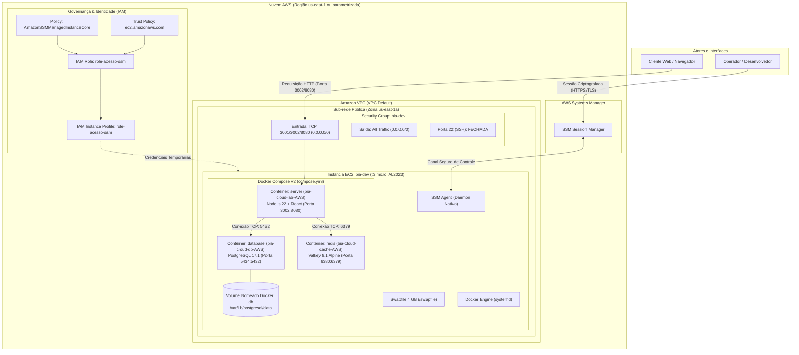

# Arquitetura — Desafio 01: Provisionamento EC2 e Docker Compose

> **Trilha:** Infraestrutura AWS & Computação 
> **Desafio:** 01 — Provisionamento EC2 e Docker Compose 
> **Documento de Referência:** [`../README.md`](../README.md) 
> **Status da Implementação:** ✅ Implementado e Comprovado em Laboratório 

---

## 1. Visão Geral da Arquitetura

O Desafio 01 estabelece o ambiente inicial de desenvolvimento e teste da aplicação BIA na nuvem AWS, servindo de transição entre a execução em máquina local e a orquestração em contêineres gerenciados. A arquitetura provisiona uma instância **Amazon EC2** (`t3.micro`) em sub-rede pública com bootstrap automatizado via **User Data**, orquestração local multicontêiner com **Docker Compose v2** e acesso administrativo seguro via **AWS Systems Manager (SSM) Session Manager**, eliminando completamente o uso de chaves SSH tradicionais (`.pem`) e portas de administração abertas na borda.

---

## 2. Diagrama Arquitetural

---

## 3. Descrição dos Componentes e Matriz de Evidências

| Componente | Tipo / Recurso | Status de Implementação | Papel Arquitetural e Configuração Comprovada |
|---|---|:---:|---|
| **Instância EC2 (`bia-dev`)** | `AWS::EC2::Instance` | ✅ **Implementado e documentado** | Tipo `t3.micro` (1 vCPU, 1 GB RAM) executando Amazon Linux 2023 (`ami-02f3f602d23f1659d` em `us-east-1`). Volume raiz EBS de 15 GB (`gp2`). Tag de governança `Name=bia-dev`. Comprovado em [`scripts/lancar_ec2_zona_a.sh`](../../../../scripts/lancar_ec2_zona_a.sh). |
| **User Data Bootstrap** | Script Bash (`user_data_ec2_zona_a.sh`) | ✅ **Implementado e documentado** | Inicialização automatizada e idempotente executada no primeiro boot: instala pacotes (`git`, `docker`, `jq`, `unzip`), instala AWS CLI v2, configura Docker Compose v2, adiciona `ec2-user` e `ssm-user` ao grupo `docker`, provisiona Swapfile de 4 GB, instala Node.js 22 LTS e Astral `uv` para suporte a ferramentas de IA. |
| **Swapfile (4 GB)** | Sistema de Arquivos do Host | ✅ **Implementado e documentado** | Arquivo de memória virtual `/swapfile` com permissão restrita `600` e persistência via `/etc/fstab`. Essencial para prevenir falhas de *Out of Memory* (OOM) no Node.js e Docker dentro de instâncias com apenas 1 GB de memória física. |
| **VPC & Subnet Pública** | `AWS::EC2::VPC` / `Subnet` | ✅ **Implementado e documentado** | Alocação na VPC default da região com associação automática de IP público dinâmico na Availability Zone A (`us-east-1a`). Comprovado em [`scripts/validar_recursos_zona_a.sh`](../../../../scripts/validar_recursos_zona_a.sh). |
| **Security Group (`bia-dev`)** | `AWS::EC2::SecurityGroup` | ✅ **Implementado e documentado** | Grupo de segurança com liberação de porta de aplicação (porta `3001` no script de validação ou `3002:8080` no Compose) para `0.0.0.0/0` e saída irrestrita. **A porta 22 (SSH) é mantida fechada.** |
| **IAM Role (`role-acesso-ssm`)** | `AWS::IAM::Role` | ✅ **Implementado e documentado** | Papel IAM com Trust Policy autorizando `ec2.amazonaws.com` via STS, associada à política gerenciada `AmazonSSMManagedInstanceCore` e vinculada ao Instance Profile homônimo. Comprovado em [`scripts/criar_role_ssm.sh`](../../../../scripts/criar_role_ssm.sh) e [`scripts/ec2_principal.json`](../../../../scripts/ec2_principal.json). |
| **AWS Systems Manager (Session Manager)** | Serviço Gerenciado (`SSM`) | ✅ **Implementado e documentado** | Canal de comunicação seguro utilizado pelo script operacional [`scripts/start-session-bash.sh`](../../../../scripts/start-session-bash.sh), abrindo shell interativo autenticado sem expor o host diretamente à internet. |
| **Docker Compose Stack** | Orquestrador Local (`compose.yml`) | ✅ **Implementado e documentado** | Stack multicontêiner composta por três serviços: `server` (imagem Node.js 22 + React na porta mapeada `3002:8080`), `database` (PostgreSQL 17.1 na porta `5434:5432`) e `redis` (Valkey 8.1 Alpine na porta `6380:6379`), com volume Docker nomeado para persistência. |

---

## 4. Fluxos de Comunicação e Dependências

### 4.1 Fluxo de Provisionamento Automatizado
1. O operador executa [`scripts/lancar_ec2_zona_a.sh`](../../../../scripts/lancar_ec2_zona_a.sh), que consulta a VPC default, identifica a sub-rede da Zona A, obtém o ID do Security Group `bia-dev` e valida a existência do Instance Profile `role-acesso-ssm`.
2. A chamada `ec2 run-instances` envia o arquivo [`scripts/user_data_ec2_zona_a.sh`](../../../../scripts/user_data_ec2_zona_a.sh) em formato codificado Base64.
3. No boot do host, o script User Data atualiza os repositórios, cria a Swap de 4 GB, inicializa o daemon do Docker, instala Node.js 22 e prepara o ambiente para receber a stack da aplicação.
4. O operador audita o provisionamento executando [`scripts/validar_recursos_zona_a.sh`](../../../../scripts/validar_recursos_zona_a.sh).

### 4.2 Fluxo de Administração Segura (SSH-less)
1. O agente nativo `amazon-ssm-agent` estabelece uma conexão de saída HTTPS (porta 443) persistente com os endpoints do AWS Systems Manager.
2. O operador executa [`scripts/start-session-bash.sh`](../../../../scripts/start-session-bash.sh) na máquina de desenvolvimento local.
3. A AWS valida a identidade e permissões do operador via AWS IAM e estabelece um túnel criptografado seguro com a instância, iniciando uma sessão Bash interativa como usuário `ssm-user`.

### 4.3 Fluxo de Aplicação e Contêineres
1. O cliente HTTP acessa o endereço público da EC2 nas portas mapeadas (`3002` ou `8080`).
2. O Docker Engine encaminha o tráfego de entrada para o contêiner `server`.
3. O serviço `server` resolve os nomes `database` (porta 5432) e `redis` (porta 6379) através do DNS embutido na rede bridge padrão do Docker Compose.
4. Os dados relacionais são persistidos no volume Docker mapeado em `/var/lib/postgresql/data` no disco EBS raiz.

---

## 5. Controles de Segurança Conhecidos

- **Eliminação de Credenciais Estáticas de Acesso:** Nenhuma chave criptográfica privada `.pem` ou par de chaves SSH é gerado, armazenado ou distribuído para os desenvolvedores.
- **Fechamento da Porta 22:** O Security Group `bia-dev` não possui regra de entrada para SSH, mitigando tentativas de ataque de força bruta (*brute force*) na borda da internet.
- **Menor Privilégio no IAM:** A Role SSM possui exclusivamente a política padrão necessária para comunicação do agente (`AmazonSSMManagedInstanceCore`), sem permissões administrativas sobre outros recursos da conta.
- **Proteção do Arquivo de Swap:** O Swapfile é criado com permissões estritas `chmod 600`, prevenindo que usuários comuns sem privilégios leiam páginas de memória descarregadas em disco.
- **Contenção Financeira:** Disponibilização dos scripts [`scripts/ligar_bia_local.sh`](../../../../scripts/ligar_bia_local.sh) e [`scripts/parar_bia_local.sh`](../../../../scripts/parar_bia_local.sh) para evitar cobrança ociosa de computação EC2 fora dos horários de laboratório.

---

## 6. Limitações e Pontos Não Confirmados

- **Ponto Único de Falha (SPOF):** A arquitetura roda em uma única instância EC2 em uma única Zona de Disponibilidade (`us-east-1a`). Falhas físicas de hardware ou indisponibilidade na zona interrompem o serviço.
- **IP Público Efêmero:** A instância utiliza IP público padrão associado dinamicamente pela AWS. Caso a máquina seja interrompida (`stop`) e reiniciada (`start`), o IP público é alterado, exigindo reconfiguração dos clientes ou adoção de Elastic IP.
- **Tráfego Não Criptografado na Borda:** A comunicação externa entre clientes e a aplicação ocorre em HTTP puro sem terminação SSL/TLS (certificado HTTPS), pois não há balanceador de carga ou CloudFront na frente da EC2.
- **Persistência Acoplada ao Ciclo de Vida da VM:** O banco de dados PostgreSQL roda como contêiner local com volume atrelado ao disco EBS da instância. Caso a instância seja terminada acidentalmente sem snapshot manual, os dados de banco são destruídos.
- **Controle de Parâmetros via Variáveis Locais:** No Desafio 01, senhas e configurações são repassadas via arquivo `.env` ou argumentos de linha de comando no host, sem integração com SSM Parameter Store (evoluída no Desafio 04).
- **Efemeridade da Instância de Laboratório:** A instância `bia-dev` é um recurso didático de custo controlado; não se presume que permaneça em execução contínua na AWS, devendo ser interrompida após os testes via `./parar_bia_local.sh`.
