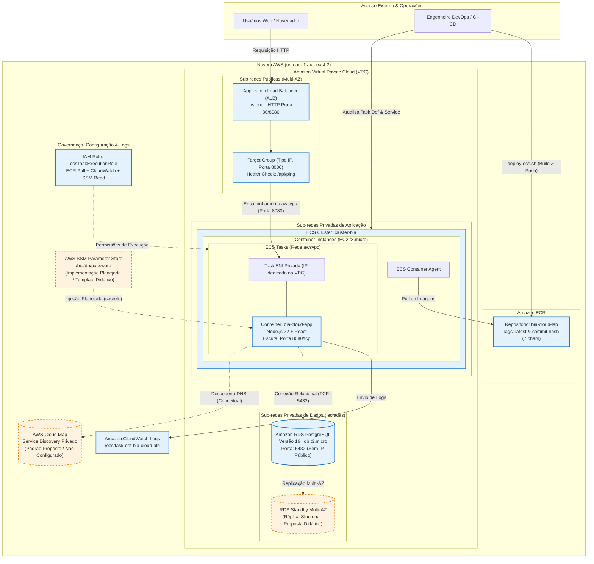

# Arquitetura — Desafio 02: Amazon ECS com ALB, RDS e Análise de Service Discovery

> **Trilha:** Infraestrutura AWS & Computação 
> **Desafio:** 02 — Amazon ECS com ALB, RDS e Cloud Map 
> **Documento de Referência:** [`../README.md`](../README.md) 
> **Diagrama HTML Didático:** [`../../../../docs/architecture/aws-ecs-diagram.html`](../../../../docs/architecture/aws-ecs-diagram.html) 
> **Status da Implementação:** ✅ Recursos Core Implementados | ⚠️ Cloud Map: Proposto / Conceitual 

---

## 1. Visão Geral da Arquitetura

O Desafio 02 eleva a maturidade operacional da aplicação BIA para o padrão de contêineres orquestrados em nuvem. A infraestrutura adota o **Amazon Elastic Container Service (ECS)** com o modo de rede **`awsvpc`** sobre instâncias gerenciadas EC2 (Container Instances), distribui tráfego através de um **Application Load Balancer (ALB)** com verificações ativas de saúde (*health checks*), centraliza imagens versionadas no **Amazon ECR** com pipeline de deploy e capacidade nativa de *rollback* via [`deploy-ecs.sh`](../../../../deploy-ecs.sh), e delega o armazenamento persistente ao banco gerenciado **Amazon RDS PostgreSQL**.

---

## 2. Diagrama Arquitetural

---

## 3. Descrição dos Componentes e Matriz de Evidências

Para manter o rigor arquitetural e atender às diretrizes do laboratório, os componentes são classificados explicitamente de acordo com as evidências reais encontradas no repositório:

| Componente | Tipo / Recurso | Status de Implementação | Evidência / Papel Arquitetural |
|---|---|:---:|---|
| **Amazon ECS Cluster (`cluster-bia`)** | `AWS::ECS::Cluster` | ✅ **Implementado e documentado** | Definido em [`deploy-ecs.sh`](../../../../deploy-ecs.sh) e no manifesto [`task-def-bia-cloud-alb-v2.json`](../../../../task-def-bia-cloud-alb-v2.json). Executa sob o launch type EC2 com instâncias registradas no cluster. |
| **ECS Task Definition (`awsvpc`)** | `AWS::ECS::TaskDefinition` | ✅ **Implementado e documentado** | Modo de rede `awsvpc` comprovado no manifesto e no template [`task-def.example.json`](../templates/task-def.example.json). Cada tarefa recebe sua própria interface de rede elástica (ENI) e IP privado na VPC. Alocação de 512/1024 CPU units e 512/1024 MB de memória. |
| **Application Load Balancer (ALB)** | `AWS::ElasticLoadBalancingV2::LoadBalancer` | ✅ **Implementado e documentado** | Ponto de entrada de tráfego HTTP. Documentado em [`deploy-ecs.sh`](../../../../deploy-ecs.sh) e [`docs/architecture/aws-ecs-diagram.html`](../../../../docs/architecture/aws-ecs-diagram.html). Opera em sub-redes públicas com Target Group direcionando tráfego aos contêineres na porta 8080. |
| **Target Group & Health Check** | `AWS::ElasticLoadBalancingV2::TargetGroup` | ✅ **Implementado e documentado** | Configurado em modo de endereçamento `ip` (obrigatório para `awsvpc`). Endpoint ativo de verificação de integridade configurado em `GET /api/ping`. |
| **Amazon RDS PostgreSQL** | `AWS::RDS::DBInstance` | ✅ **Implementado e documentado** | Banco relacional gerenciado na porta 5432, configurado em [`config/database.js`](../../../../config/database.js) com suporte a SSL remoto. Alocado em sub-redes privadas sem acesso público (`PubliclyAccessible: false`). |
| **Amazon ECR** | `AWS::ECR::Repository` | ✅ **Implementado e documentado** | Repositório privado com suporte a versionamento duplo (tag de commit hash Git com 7 caracteres e tag flutuante `latest`), suportando rollback estruturado. |
| **Script de Deploy (`deploy-ecs.sh`)** | Automação Shell | ✅ **Implementado e documentado** | Script na raiz com comandos `deploy`, `rollback` e `list-versions`. Automatiza o ciclo de compilação Docker, upload no ECR, geração de revisão da task definition e reinicialização de tarefas com `--force-new-deployment`. |
| **CloudWatch Logs** | `AWS::Logs::LogGroup` | ✅ **Implementado e documentado** | Grupo de logs `/ecs/task-def-bia-cloud-alb` configurado com driver nativo `awslogs` para captura contínua de stdout/stderr da API Express. |
| **Injeção de Segredos via SSM Parameter Store** | Serviço Gerenciado (`SSM`) | ⚠️ **Evidenciado parcialmente / Implementação planejada** | Demonstrado no template didático sanitizado [`templates/task-def.example.json`](../templates/task-def.example.json) com a cláusula `secrets` para `/bia/db/password`. No manifesto real histórico executado ([`task-def-bia-cloud-alb-v2.json`](../../../../task-def-bia-cloud-alb-v2.json)), os parâmetros `DB_PWD`, `DB_HOST`, `DB_USER` continuavam repassados como variáveis de ambiente diretas (`environment`). |
| **AWS Cloud Map (Service Discovery)** | `AWS::ServiceDiscovery` | ⚠️ **Proposto para evolução futura** | Presente na nomenclatura do diretório do desafio e citado no material didático como padrão arquitetural para descoberta de microsserviços via DNS privado (`.local`). Na aplicação BIA atual, o roteamento externo é feito exclusivamente pelo ALB diretamente para os IPs das tasks, e a comunicação com RDS/ElastiCache usa endpoints estáticos, não existindo namespaces ou chamadas da API do Cloud Map no código ou nos scripts de automação. |
| **Multi-AZ RDS com Standby Síncrono** | Recurso RDS Multi-AZ | ⚠️ **Proposto para evolução futura** | Ilustrado no diagrama [`aws-ecs-diagram.html`](../../../../docs/architecture/aws-ecs-diagram.html) como recomendação corporativa para tolerância a falhas. No ambiente prático de treinamento, utilizou-se instância Single-AZ (`db.t3.micro`) para contenção orçamentária. |

---

## 4. Fluxos de Comunicação e Dependências

### 4.1 Fluxo de Requisição de Usuário
1. O cliente (navegador web) envia uma requisição HTTP para o DNS do Application Load Balancer.
2. O listener do ALB recebe a requisição e a encaminha ao Target Group associado.
3. O Target Group consulta sua tabela de alvos saudáveis e despacha a requisição via rede interna da VPC para a ENI privada da tarefa ECS ativa na porta 8080.
4. O contêiner `bia-cloud-app` processa o pedido, consulta o banco de dados RDS PostgreSQL na porta 5432 em sub-rede privada e devolve a resposta através da mesma conexão de retorno.

### 4.2 Verificação Ativa de Saúde (Health Check)
1. Em intervalos regulares, o ALB emite requisições HTTP automáticas para o caminho `/api/ping`.
2. A aplicação responde com status `200 OK` caso o servidor HTTP e o pool de conexões estejam responsivos.
3. Se um contêiner falhar em responder consecutivamente dentro do limite de tolerância (*unhealthy threshold*), o ALB drena as conexões ativas e interrompe o roteamento para a respectiva tarefa, enquanto o serviço ECS agenda o lançamento de uma nova tarefa substituta.

### 4.3 Pipeline de Deploy e Rollback Automatizado
1. O desenvolvedor comita alterações de código e executa `./deploy-ecs.sh deploy`.
2. O script obtém o hash curto do commit Git atual (`git rev-parse --short=7 HEAD`).
3. O Docker compila a imagem a partir do `Dockerfile` multi-stage e aplica duas tags: `<commit-hash>` e `latest`.
4. É realizado o push das imagens autenticado no repositório Amazon ECR.
5. Uma nova revisão da Task Definition é registrada na AWS com a referência exata da imagem imutável (`.../bia-cloud-lab:<commit-hash>`).
6. O serviço ECS é atualizado com a nova revisão.
7. Em caso de anomalia funcional na nova versão, o comando `./deploy-ecs.sh rollback -t <HASH_ANTERIOR>` restaura imediatamente a task definition apontando para a imagem estável prévia, sem necessidade de recompilar código.

---

## 5. Controles de Segurança Conhecidos

- **Isolamento de Rede por Modo `awsvpc`:** Diferente do modo bridge tradicional do Docker, no modo `awsvpc` cada tarefa ECS possui sua própria interface de rede elástica com Security Group e regras de firewall dedicadas, impedindo a sobreposição de portas e o tráfego lateral desautorizado entre tarefas no mesmo host.
- **Banco de Dados Estritamente Privado:** O RDS PostgreSQL reside em sub-redes isoladas de dados, com a flag de acessibilidade pública desativada (`PubliclyAccessible: false`). O Security Group do RDS autoriza conexões exclusivamente na porta 5432 com origem no Security Group das instâncias do ECS.
- **Injeção de Segredos em Runtime (Modelo Alvo / Proposto):** No manifesto histórico executado no laboratório (`task-def-bia-cloud-alb-v2.json`), a senha do banco de dados e os endpoints eram passados como variáveis de ambiente planas (`environment`). O template sanitizado [`task-def.example.json`](../templates/task-def.example.json) estabelece a transição para a cláusula `secrets` vinculada ao AWS Systems Manager Parameter Store (`/bia/db/password`), catalogada como a implementação recomendada para eliminar credenciais em texto puro.
- **Redução da Superfície de Ataque:** A imagem Docker oficial é baseada em `public.ecr.aws/docker/library/node:22-slim`, utilizando compilação multi-stage onde artefatos de build do frontend (Vite/Node) são mantidos fora da camada final de execução.
- **Rastreabilidade e Imutabilidade de Artefatos:** Todas as imagens são carimbadas com o commit hash Git, garantindo auditoria de versão no ECR e impedindo que deploys acidentais sobreponham versões produtivas sem histórico.

---

## 6. Limitações e Pontos Não Confirmados

- **Centralização via Parameter Store como Evolução Planejada:** Embora modelada no template sanitizado, a criação dos parâmetros `/bia/*` no SSM Parameter Store não possui scripts de automação associados no repositório local, dependendo de provisionamento manual ou pipeline futuro.
- **Ausência Operacional de AWS Cloud Map:** Apesar de constar no nome didático do laboratório, a automação operacional [`deploy-ecs.sh`](../../../../deploy-ecs.sh) e os manifestos de task definition não registram serviço nem namespace no AWS Cloud Map. Como a BIA opera como monólito modular, o balanceamento e resolução de nomes ocorrem nativamente no ALB e no DNS padrão da VPC.
- **Terminação SSL/TLS no ALB Não Parametrizada no Script:** O script [`deploy-ecs.sh`](../../../../deploy-ecs.sh) foca na camada de entrega contínua do contêiner na porta 8080. A configuração de certificado digital ACM (HTTPS na porta 443) é referenciada conceitualmente em `n8n-lab/n8n-ha-single-mode.md` para domínios customizados, mas não foi formalizada como rotina CLI dentro do script do Desafio 02.
- **Topologia de Banco de Dados de Laboratório:** O RDS foi executado em configuração Single-AZ para otimização de custo na conta de treinamento, ficando a topologia Multi-AZ (com standby síncrono e failover automático) catalogada como recomendação arquitetural corporativa.
- **Ausência de Estratégia Canário / Blue-Green Nativa no Script:** O script [`deploy-ecs.sh`](../../../../deploy-ecs.sh) opera através de *Rolling Update* com substituição progressiva de contêineres (`--force-new-deployment`). A estratégia avançada de Blue/Green com alternância de Target Groups no ALB é tema reservado para a trilha subsequente `04-deploy-strategies`.
