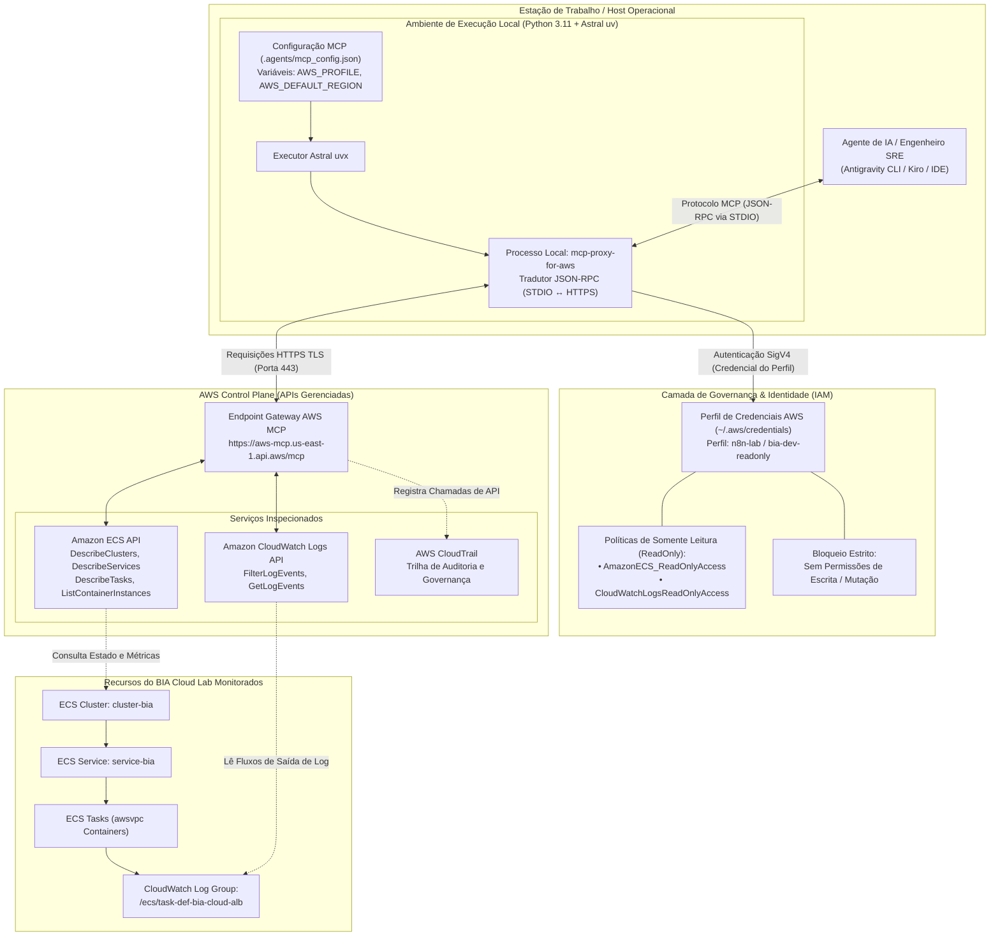

# Arquitetura — Desafio 03: Gestão Operacional do ECS via AWS MCP Server

> **Trilha:** Infraestrutura AWS & Computação 
> **Desafio:** 03 — Gestão Operacional do ECS via AWS MCP Server 
> **Documento de Referência:** [`../README.md`](../README.md) 
> **Template Fornecido:** [`../mcp/mcp-proxy-aws.example.json`](../mcp/mcp-proxy-aws.example.json) 
> **Configuração Ativa Local:** [`../../../../.agents/mcp_config.json`](../../../../.agents/mcp_config.json) 
> **Status da Implementação:** ✅ Implementado e Comprovado em Laboratório 

---

## 1. Visão Geral da Arquitetura

O Desafio 03 introduz a governança operacional assistida por Inteligência Artificial na aplicação BIA. A arquitetura implementa o **Model Context Protocol (MCP)** através do intermediário `mcp-proxy-for-aws`, executado via gerenciador ultrarrápido **Astral `uvx`**. Essa integração estabelece uma ponte segura entre agentes de IA (como Antigravity CLI, Kiro, Cursor ou Claude Desktop) e as APIs de gerenciamento do **Amazon ECS** e **Amazon CloudWatch**, permitindo auditorias de saúde, inspeções de tarefas e diagnósticos de incidentes em tempo real com estrita governança de **menor privilégio (ReadOnly)**.

---

## 2. Diagrama Arquitetural

---

## 3. Descrição dos Componentes e Matriz de Evidências

| Componente | Tipo / Recurso | Status de Implementação | Papel Arquitetural e Configuração Comprovada |
|---|---|:---:|---|
| **Agente de IA / Interface MCP** | Cliente de IA (Antigravity CLI / Kiro / IDE) | ✅ **Implementado e documentado** | Interface conversacional e analítica que traduz dúvidas do operador em chamadas padronizadas de ferramentas (*tool calling*) no protocolo Model Context Protocol. |
| **Astral `uv` / `uvx`** | Gerenciador de Pacotes Python | ✅ **Implementado e documentado** | Utilitário nativo utilizado para baixar e executar `mcp-proxy-for-aws@latest` em ambiente isolado efêmero. Automatizado em [`scripts/user_data_ec2_zona_a.sh`](../../../../scripts/user_data_ec2_zona_a.sh#L59-L65). |
| **`mcp-proxy-for-aws`** | Proxy e Tradutor MCP | ✅ **Implementado e documentado** | Processo intermediário que estabelece comunicação STDIO local com o agente de IA e despacha chamadas autenticadas para o endpoint de API do serviço AWS MCP. |
| **Endpoint Gateway AWS MCP** | Gateway HTTPS de Serviço | ⚠️ **Evidenciado parcialmente** | Endpoint gerenciado da AWS (`https://aws-mcp.<REGIAO>.api.aws/mcp`) consumido externamente e configurado em [`.agents/mcp_config.json`](../../../../.agents/mcp_config.json). |
| **Perfil IAM (`AWS_PROFILE`)** | `AWS::IAM::User` / `Role` | ✅ **Implementado e documentado** | Identidade de acesso configurada localmente (`n8n-lab` ou equivalente) contendo credenciais temporárias ou estáticas com permissões estritamente restritas a leitura (`ReadOnlyAccess`). |
| **Amazon ECS API** | AWS Control Plane | ✅ **Implementado e documentado** | Interface consultada pelo MCP para inspecionar parâmetros de clusters (`DescribeClusters`), estado de serviços (`DescribeServices`), tarefas (`DescribeTasks`) e instâncias registradas (`ListContainerInstances`). |
| **CloudWatch Logs API** | AWS Control Plane | ✅ **Implementado e documentado** | Interface consultada para ler registros do grupo `/ecs/task-def-bia-cloud-alb`, permitindo que o agente diagnostique falhas da aplicação Node.js sem intervenção manual no console. |
| **AWS CloudTrail** | Auditoria e Conformidade | ✅ **Implementado e documentado** | Repositório que registra todas as chamadas de API disparadas pelo servidor MCP com carimbo de tempo, ARN do usuário e parâmetros da consulta. |

---

## 4. Fluxos de Comunicação e Dependências

### 4.1 Fluxo de Inspeção de Estado Operacional
1. O engenheiro ou operador questiona o assistente de IA: *"Como está a saúde do serviço service-bia no cluster do ECS?"*.
2. O assistente de IA seleciona a ferramenta adequada do catálogo MCP (ex: `ecs_describe_services` ou `ecs_describe_tasks`) e emite a solicitação via STDIO para o processo `mcp-proxy-for-aws`.
3. O `mcp-proxy-for-aws` captura as credenciais do perfil configurado (`AWS_PROFILE`) no arquivo [`mcp_config.json`](../../../../.agents/mcp_config.json), assina a requisição com o algoritmo AWS SigV4 e a despacha via HTTPS (TLS 1.3) para o gateway AWS MCP.
4. O gateway executa a chamada contra a API `ecs:DescribeServices` e `ecs:DescribeTasks` na região configurada (`us-east-2` ou `us-east-1`).
5. A AWS processa a requisição, audita a operação no AWS CloudTrail e retorna os metadados de status (ex: contêineres em estado `RUNNING`, contagem de tarefas desejadas vs ativas, histórico de eventos recentes).
6. O proxy repassa a resposta em formato JSON-RPC para o agente de IA, que sintetiza uma resposta analítica clara e formatada para o operador.

### 4.2 Fluxo de Diagnóstico de Falhas em Logs
1. O operador solicita: *"Ocorreu algum erro 500 ou queda de contêiner nos últimos 20 minutos?"*.
2. O cliente MCP aciona a ferramenta de leitura do CloudWatch Logs passando como filtro o grupo `/ecs/task-def-bia-cloud-alb` e a janela de tempo solicitada.
3. A API do CloudWatch Logs retorna os fluxos de eventos correspondentes.
4. O modelo de linguagem processa os stack traces da API Express/Node.js e diagnostica a causa raiz (ex: erro de conexão com banco de dados ou chave de cache expirada).

---

## 5. Controles de Segurança Conhecidos

- **Princípio do Menor Privilégio Absoluto (ReadOnly):** O perfil IAM associado ao MCP deve conter unicamente permissões de consulta (`AmazonECS_ReadOnlyAccess`, `CloudWatchLogsReadOnlyAccess`), impedindo que o assistente de IA execute comandos destrutivos como encerramento de tarefas, exclusão de serviços ou alteração de configurações.
- **Isolamento de Credenciais em Disco:** O arquivo de configuração MCP ([`mcp_config.json`](../../../../.agents/mcp_config.json) e o template [`mcp-proxy-aws.example.json`](../mcp/mcp-proxy-aws.example.json)) referencia exclusivamente o nome do perfil (`AWS_PROFILE`), nunca contendo chaves de acesso (`AWS_ACCESS_KEY_ID`), chaves secretas ou tokens gravados em texto plano.
- **Rastreabilidade Integral via CloudTrail:** Cada requisição gerada pelo proxy é autenticada com a identidade formal do perfil, viabilizando auditoria precisa de quem, quando e qual recurso foi consultado.
- **Criptografia em Trânsito:** Toda comunicação entre a estação local e os endpoints gerenciados da AWS ocorre obrigatoriamente através de túneis criptografados HTTPS com certificados válidos emitidos pela Amazon Trust Services.

---

## 6. Limitações e Pontos Não Confirmados

- **Escopo Exclusivo de Plano de Controle (Control Plane):** O servidor AWS MCP atua sobre as APIs públicas de gerenciamento da AWS. Ele não tem acesso ao plano de dados (Data Plane), o que significa que não pode consultar diretamente tabelas dentro do PostgreSQL nem executar comandos shell dentro dos contêineres ECS (a menos que uma integração específica com SSM Run Command ou ECS Exec seja configurada).
- **Dependência de Conectividade Externa:** O proxy requer saída irrestrita via porta 443 (HTTPS) para o domínio `api.aws`. Em ambientes corporativos isolados por proxies restritivos sem liberação desse endpoint, o proxy não conseguirá sincronizar ferramentas.
- **Limites de Requisição das APIs AWS (Throttling):** Consultas massivas ou loops automatizados frequentes de leitura de logs no CloudWatch podem atingir limites de taxa (*API Rate Limits*) da AWS, provocando erros de throttling (`ThrottlingException`).
- **Necessidade de Credenciais Válidas no Host:** O proxy não renova credenciais expiradas automaticamente. Caso a sessão STS do operador expire, as chamadas MCP falharão imediatamente até que um novo token seja gerado (ex: via [`generate-sts-token.sh`](../../../../generate-sts-token.sh)).
- **Efemeridade dos Recursos Observados:** Os clusters e tarefas ECS monitorados foram criados no âmbito do laboratório prático da Formação AWS; não se presume que os contêineres permaneçam ativos ou em execução indefinidamente.
