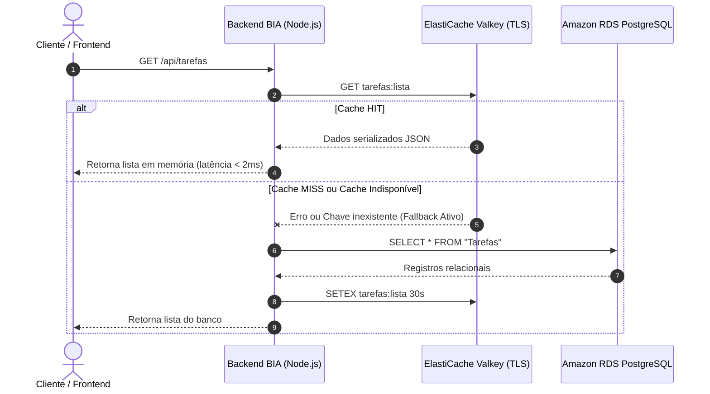

# Desafio 04 — Cache com Amazon ElastiCache Valkey e Gestão via SSM

> **Projeto:** BIA Cloud Lab — D2NS 
> **Trilha:** Infraestrutura AWS & Computação 
> **Referência educacional:** Formação AWS — Henrylle Maia 
> **Implementação e adaptações:** Danilo Lima — D2NS 
> **Status:** ✅ Concluído 
> **Adaptações D2NS:** Implementação de cache em memória Valkey com criptografia em trânsito (TLS), injeção segura de parâmetros via SSM Parameter Store e resiliência de conexão no backend. 
> **Documentação Arquitetural:** [📐 Diagrama & Arquitetura Detalhada](docs/architecture.md) | [🏛️ Decisões da Trilha (ADRs)](../docs/architecture-decisions.md)

---

## 🎯 Objetivo Arquitetural

Implementar uma camada de aceleração de leitura em memória na aplicação BIA utilizando o **Amazon ElastiCache Valkey** (motor compatível com Redis OSS) com suporte a criptografia em trânsito (**TLS**), reduzindo a sobrecarga de consultas frequentes no banco de dados relacional **Amazon RDS PostgreSQL**.

Adicionalmente, gerenciar os parâmetros sensíveis de conexão e acesso da infraestrutura através do **AWS Systems Manager (SSM) Parameter Store** e prover acesso administrativo seguro às instâncias EC2 do cluster via **SSM Session Manager**, eliminando a necessidade de portas SSH abertas na borda.

---

## ☁️ Recursos AWS Envolvidos

- **Amazon ElastiCache:** Cluster Valkey 7.2 com TLS habilitado, provisionado em sub-redes privadas de dados e controlado por Security Groups dedicados (porta TCP `6379`).
- **AWS Systems Manager (SSM) Parameter Store:** Repositório centralizado de parâmetros operacionais (`/bia/db/password`, `/bia/cache/endpoint`, etc.) do tipo `SecureString`.
- **AWS Systems Manager Session Manager:** Canal interativo criptografado para sessões de suporte e auditoria em hosts EC2.
- **AWS IAM:** Função `role-acesso-ssm` com a política gerenciada `AmazonSSMManagedInstanceCore` vinculada aos hosts de execução.
- **Node.js & ioredis:** Camada de software com padrão *Cache-Aside* e resiliência com fallback automático para o banco de dados.

---

## 🛠️ Pré-requisitos

1. Cluster **Amazon ElastiCache Valkey** provisionado na mesma VPC da aplicação BIA com portas liberadas no Security Group.
2. Parâmetros criados no **AWS Systems Manager Parameter Store**.
3. **AWS CLI v2** configurado localmente com credenciais ativas.
4. **AWS Session Manager Plugin** instalado para acesso via terminal interativo.
5. Dependência `ioredis` instalada no projeto Node.js (já gerenciada no [`package.json`](../../../package.json) raiz).

---

## 🌐 Variáveis Necessárias

| Variável | Descrição | Exemplo de Valor |
|---|---|---|
| `CACHE_ENDPOINT` | Endpoint de conexão do nó primário ou de configuração do Valkey | `clustercfg.bia-cache.xxxxxx.use2.cache.amazonaws.com` |
| `CACHE_PORT` | Porta de rede do serviço de cache | `6379` |
| `CACHE_TLS` | Habilita criptografia TLS para conexão com o cluster | `true` (nuvem) / `false` (local) |
| `CACHE_TTL` | Tempo de vida dos registros em cache em segundos | `30`, `60` |
| `AWS_PROFILE` | Perfil local de execução com acesso ao SSM | `bia-dev`, `n8n-lab` |
| `AWS_REGION` | Região onde o ElastiCache e o SSM residem | `us-east-1`, `us-east-2` |

---

## 📂 Referências Relativas aos Arquivos Existentes

Os componentes de código e automação permanecem alocados em seus diretórios nativos:

| Arquivo Original | Finalidade e Descrição |
|---|---|
| [`docs/architecture.md`](docs/architecture.md) | Documento arquitetural dedicado do Desafio 04 contendo diagrama Mermaid, sequência de Cache-Aside com fallback, injeção de parâmetros via SSM e limitações. |
| [`../../../lib/cache.js`](../../../lib/cache.js) | Módulo de abstração do cliente `ioredis`: gerencia reconexão, configura TLS dinamicamente e provê fallback silencioso para o banco relacional caso o cache fique indisponível. |
| [`../../../api/routes/cache-config.js`](../../../api/routes/cache-config.js) | Rota REST (`GET /api/cache-config`) para consulta do estado operacional dos parâmetros de cache configurados no runtime. |
| [`../../../api/controllers/cache-config.js`](../../../api/controllers/cache-config.js) | Controlador associado à rota de status do cache. |
| [`../../../scripts/criar_role_ssm.sh`](../../../scripts/criar_role_ssm.sh) | Automação que provisiona a IAM Role e o Instance Profile com a política `AmazonSSMManagedInstanceCore`. |
| [`../../../scripts/ec2_principal.json`](../../../scripts/ec2_principal.json) | Documento JSON de Trust Policy permitindo que o serviço `ec2.amazonaws.com` assuma a função do SSM. |
| [`../../../scripts/setup_cloudshell_ssm.sh`](../../../scripts/setup_cloudshell_ssm.sh) | Instalação do pacote RPM do Session Manager Plugin em ambientes Amazon Linux / CloudShell. |
| [`../../../scripts/start-session-bash.sh`](../../../scripts/start-session-bash.sh) | Conexão interativa à instância EC2 via Session Manager executando uma sessão Bash protegida. |
| [`../../../compose.yml`](../../../compose.yml#L43-L48) | Configuração multicontêiner local com imagem oficial `valkey/valkey:8.1-alpine` para desenvolvimento desacoplado da AWS. |

---

## 🚀 Padrão Arquitetural de Resiliência (Cache-Aside com Fallback)

O módulo [`lib/cache.js`](../../../lib/cache.js) foi desenhado com foco em alta resiliência:

---

## 🛡️ Decisões de Governança e Segurança

1. **Criptografia em Trânsito (TLS):** No ambiente AWS, o cluster ElastiCache Valkey exige `CACHE_TLS=true`, assegurando que payloads de sessão e dados de negócio não trafeguem em texto aberto na rede interna.
2. **Armazenamento de Segredos via SSM:** Senhas de acesso ao banco e credenciais do cache devem ser gravadas no AWS Systems Manager Parameter Store como `SecureString` (criptografadas via AWS KMS) e recuperadas pela Task Definition do ECS via `secrets`.
3. **Isolamento de Sub-rede:** O grupo de sub-redes do ElastiCache deve residir exclusivamente em sub-redes privadas de dados, sem rota para a Internet Gateway (`0.0.0.0/0`).
