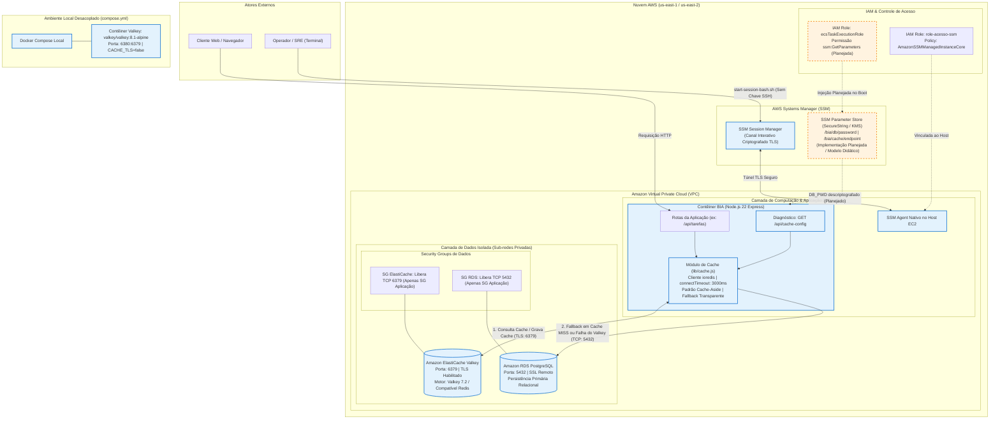
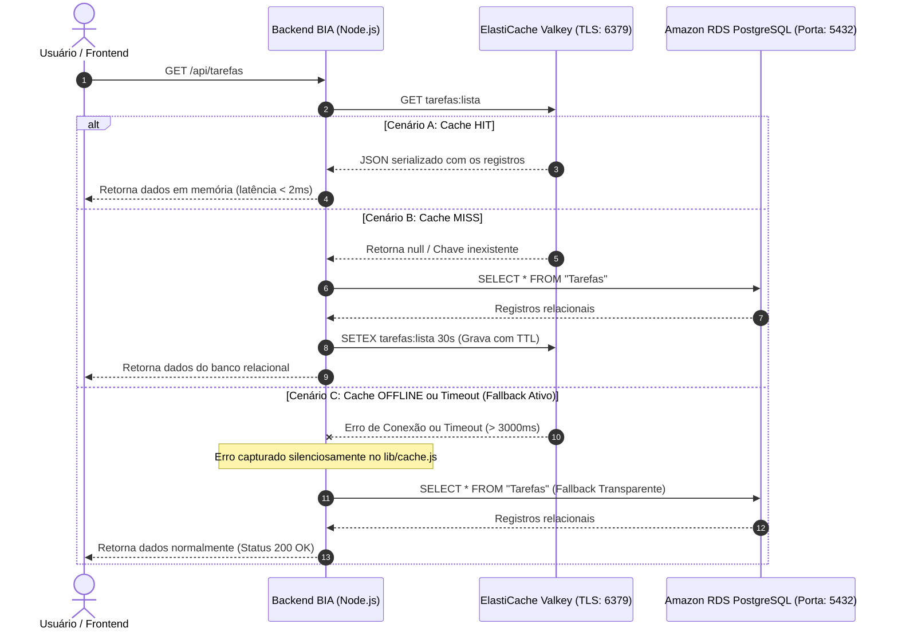

# Arquitetura — Desafio 04: Cache com Amazon ElastiCache Valkey e Gestão de Segredos via SSM

> **Trilha:** Infraestrutura AWS & Computação 
> **Desafio:** 04 — Cache com Amazon ElastiCache Valkey e Gestão via SSM 
> **Documento de Referência:** [`../README.md`](../README.md) 
> **Módulo de Código Resiliente:** [`../../../../lib/cache.js`](../../../../lib/cache.js) 
> **Rota de Verificação Operacional:** [`../../../../api/routes/cache-config.js`](../../../../api/routes/cache-config.js) 
> **Status da Implementação:** ✅ Implementado e Comprovado em Laboratório 

---

## 1. Visão Geral da Arquitetura

O Desafio 04 aprimora o desempenho, a segurança e a governança da aplicação BIA introduzindo uma camada de aceleração de leitura em memória com o **Amazon ElastiCache Valkey** (motor compatível com Redis OSS) com criptografia em trânsito (**TLS**), associada a uma camada de software desenhada com o padrão **Cache-Aside** e resiliência por **fallback silencioso** para o banco relacional **Amazon RDS PostgreSQL**.

Em paralelo, a governança de credenciais é modernizada com o **AWS Systems Manager (SSM) Parameter Store** (`SecureString` criptografada com AWS KMS) para injeção desacoplada de senhas na Task Definition do ECS, e o gerenciamento operacional das instâncias EC2 do cluster é protegido com o **SSM Session Manager**, eliminando chaves SSH em disco e regras de entrada para a porta 22 na borda da nuvem.

---

## 2. Diagrama Arquitetural

---

## 3. Descrição dos Componentes e Matriz de Evidências

| Componente | Tipo / Recurso | Status de Implementação | Papel Arquitetural e Configuração Comprovada |
|---|---|:---:|---|
| **Amazon ElastiCache Valkey (Cloud)** | `AWS::ElastiCache::CacheCluster` | ⚠️ **Evidenciado parcialmente** | Cluster de aceleração em memória baseado no motor Valkey 7.2 (distribuição aberta compatível com a API do Redis OSS). Opera em sub-redes privadas de dados na porta TCP `6379` com TLS ativo. Referenciado nos endpoints das variáveis de ambiente da task definition histórica, sem scripts de provisionamento de infraestrutura no repositório. |
| **Módulo de Software Resiliente** | Módulo Node.js ([`lib/cache.js`](../../../../lib/cache.js)) | ✅ **Implementado e documentado** | Abstração em torno do cliente `ioredis`: configura TLS condicional (`CACHE_TLS=true`), define timeout de conexão de 3000 ms (`connectTimeout: 3000`), suprime loops de retry agressivos (`retryStrategy: () => null`) e captura erros silenciosamente para garantir continuidade da aplicação via fallback ao RDS. |
| **Rota de Auditoria Operacional** | Rota REST ([`api/routes/cache-config.js`](../../../../api/routes/cache-config.js)) | ✅ **Implementado e documentado** | Endpoint `GET /api/cache-config` que retorna o estado atual das variáveis operacionais do cache (`CACHE_ENDPOINT`, `CACHE_PORT`, `CACHE_TLS`, `CACHE_TTL`), viabilizando validação diagnóstica sem expor segredos nem senhas de infraestrutura. |
| **AWS Systems Manager Parameter Store** | Serviço Gerenciado (`SSM`) | ⚠️ **Evidenciado parcialmente / Implementação planejada** | Modelo arquitetural demonstrado no template sanitizado [`task-def.example.json`](../../02-ecs-alb-rds-cloudmap/templates/task-def.example.json) para segredos do tipo `SecureString` (`/bia/db/password`). No histórico do laboratório, parâmetros eram injetados via variáveis diretas (`environment`). |
| **Injeção de Segredos no ECS** | Manifesto ECS (`templates/task-def.example.json`) | ⚠️ **Evidenciado parcialmente / Implementação planejada** | Bloco `secrets` modelado no template de exemplo mapeando o ARN do parâmetro no SSM diretamente para `DB_PWD`. Não ativo no manifesto real executado (`task-def-bia-cloud-alb-v2.json`). |
| **AWS Systems Manager Session Manager** | Canal Interativo Criptografado | ✅ **Implementado e documentado** | Mecanismo corporativo de gerenciamento de hosts EC2 acionado pelo script [`scripts/start-session-bash.sh`](../../../../scripts/start-session-bash.sh), permitindo comandos interativos em tempo real auditados no CloudTrail e dispensando regras de firewall para a porta 22 (SSH). |
| **IAM Role (`role-acesso-ssm`)** | `AWS::IAM::Role` | ✅ **Implementado e documentado** | Papel provisionado via [`scripts/criar_role_ssm.sh`](../../../../scripts/criar_role_ssm.sh) com a managed policy `AmazonSSMManagedInstanceCore` e associado ao Instance Profile homônimo das instâncias EC2 do cluster. |
| **Ambiente Local Desacoplado** | Docker Compose ([`compose.yml`](../../../../compose.yml)) | ✅ **Implementado e documentado** | Configuração de laboratório com o serviço `redis` apontando para a imagem oficial `valkey/valkey:8.1-alpine` com `CACHE_TLS: false` na porta mapeada `6380:6379`, permitindo desenvolvimento offline com paridade arquitetural completa. |

---

## 4. Fluxos de Comunicação e Dependências

### 4.1 Padrão Cache-Aside com Fallback Resiliente
O fluxo implementado em [`lib/cache.js`](../../../../lib/cache.js) assegura que a indisponibilidade temporária do cache nunca derrube a API:

### 4.2 Fluxo de Inicialização de Tarefa com Parâmetros SSM (Modelo Alvo / Planejado)
1. O modelo arquitetural demonstrado em `templates/task-def.example.json` projeta a substituição de variáveis de ambiente estáticas por referências ao SSM Parameter Store.
2. Na inicialização planejada, o ECS Agent consulta a Task Definition e identifica a cláusula `secrets` apontando para o ARN do SSM Parameter Store (`/bia/db/password`).
3. O ECS Agent utiliza as permissões concedidas pela `ecsTaskExecutionRole` para chamar a API `ssm:GetParameters` com descriptografia KMS automática.
4. O valor plano é injetado diretamente na memória do contêiner como a variável de ambiente `DB_PWD`.
5. O contêiner inicia a API Express e o Sequelize conecta-se com segurança ao RDS PostgreSQL sem que a senha tenha trafegado pelo Git.
*(Nota: No ambiente histórico do laboratório, esses parâmetros eram repassados via variáveis de ambiente diretas no manifesto `task-def-bia-cloud-alb-v2.json`).*

### 4.3 Fluxo de Acesso Remoto Seguro via Session Manager
1. O operador na estação de trabalho executa `./start-session-bash.sh <INSTANCE_ID>`.
2. A AWS CLI local inicia um túnel WebSocket bidirecional criptografado via TLS através do serviço AWS Systems Manager.
3. O daemon `amazon-ssm-agent` em execução no host EC2 recebe a instrução, cria uma sessão de shell protegida para o usuário do sistema `ssm-user` e despacha a entrada/saída pelo túnel.
4. O operador obtém acesso total de terminal no host sem necessidade de expor IP público ou porta 22 na internet.

---

## 5. Controles de Segurança Conhecidos

- **Criptografia em Trânsito Obrigatória (TLS):** No ambiente de nuvem, a flag `CACHE_TLS=true` instrui a biblioteca `ioredis` a negociar certificados TLS, garantindo que nenhum tráfego em texto aberto trafegue entre os contêineres e o cluster ElastiCache.
- **Segregação Estrita de Redes para Dados:** O cluster ElastiCache e a instância RDS PostgreSQL são provisionados em sub-redes privadas de dados sem rota para Internet Gateways (`0.0.0.0/0`), tornando-os inacessíveis diretamente a partir da internet pública.
- **Isolamento de Portas via Security Groups:** As regras de entrada do Security Group do ElastiCache autorizam conexões na porta 6379 **estritamente originadas dos Security Groups do ECS / EC2**, bloqueando qualquer tentativa de comunicação lateral de outras instâncias não autorizadas da VPC.
- **Proteção Criptográfica em Repouso no SSM:** Senhas e strings de conexão sensíveis utilizam o tipo `SecureString` no SSM Parameter Store, assegurando criptografia em repouso com o serviço de gerenciamento de chaves **AWS KMS**.
- **Auditoria de Sessão sem Chaves SSH:** O Session Manager elimina a proliferação de pares de chave privada (`.pem`), viabiliza encerramento imediato de sessões pelo IAM e registra o histórico de conexões no AWS CloudTrail.

---

## 6. Limitações e Pontos Não Confirmados

- **Centralização via Parameter Store como Implementação Planejada:** A centralização de senhas e endpoints no SSM Parameter Store para a BIA é um modelo documentado e demonstrado no template sanitizado; não há scripts locais criando os parâmetros `/bia/*` na nuvem nem evidência de que os recursos históricos utilizavam o bloco `secrets`.
- **Inacessibilidade Direta do ElastiCache Fora da VPC:** Por residir em sub-redes estritamente privadas e sem IP público, o cluster Valkey não pode ser acessado diretamente a partir da máquina local do desenvolvedor sem o uso de túneis de redirecionamento de portas via SSM Session Manager (*port forwarding*) ou VPN/Bastion Host.
- **Invalidação de Cache Baseada em Tempo (TTL Estático):** A renovação dos registros em cache depende fundamentalmente do tempo de expiração (`CACHE_TTL`, configurado entre 15 e 60 segundos) ou chamadas explícitas de deleção (`del`). Caso uma alteração direta seja feita no banco RDS sem passar pelos endpoints da aplicação, o cache continuará servindo dados desatualizados até que o TTL expire.
- **Cluster Valkey de Nó Único no Laboratório:** Por restrições orçamentárias do laboratório de treinamento, o ElastiCache foi implementado como instância única (sem réplica Multi-AZ ou modo cluster com sharding distribuído ativado). Para ambientes de missão crítica corporativos, recomenda-se habilitar nós de leitura com failover automático Multi-AZ.
- **Efemeridade dos Recursos:** Os recursos de nuvem (ElastiCache, RDS, EC2) foram provisionados em contexto de treinamento e não se presume que permaneçam ativos continuamente na AWS.
