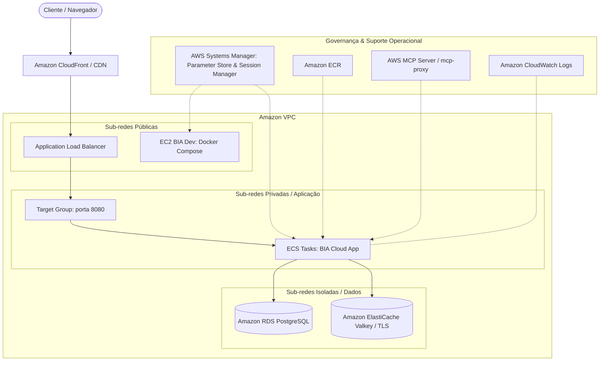

# 🏗️ Trilha: Infraestrutura AWS & Computação

> **Projeto:** BIA Cloud Lab — D2NS 
> **Trilha:** Infraestrutura AWS & Computação 
> **Referência educacional:** Formação AWS — Henrylle Maia 
> **Implementação e adaptações:** Danilo Lima — D2NS 
> **Status:** ✅ Concluído (4 Desafios Validados) 

Laboratórios dedicados ao provisionamento, arquitetura de redes, isolamento de recursos, orquestração de contêineres e integração operacional da infraestrutura da aplicação BIA Cloud.

## 📚 Atribuição e Origem

- **Projeto:** BIA Cloud Lab — D2NS
- **Programa de Referência:** Formação AWS e Imersão AWS & IA, conduzidas por [Henrylle Maia](https://www.linkedin.com/in/henrylle/).
- **Implementações e Adaptações:** Desenvolvidas por **Danilo Lima — D2NS** no âmbito do BIA Cloud Lab.
- **Adaptações D2NS:** Modernização do runtime para Node.js 22 LTS, isolamento de rede VPC/subnets com security groups granulares, integração de camada de cache Amazon ElastiCache Valkey com TLS, governança IAM estrita de menor privilégio, templates parametrizados e automação operacional via AWS MCP Server.
- **Preservação de Código:** A aplicação core da BIA e seus scripts operacionais originais permanecem centralizados na raiz e no diretório `scripts/`, garantindo a integridade do monorepo e evitando duplicações desnecessárias.

---

## 🎯 Índice dos Desafios

| Desafio | Título & Arquitetura | Estado | Recursos AWS Principais | Foco Técnico |
|:---:|---|:---:|---|---|
| **01** | [01-ec2-docker-compose](01-ec2-docker-compose/README.md) ([📐 Arquitetura](01-ec2-docker-compose/docs/architecture.md)) | ✅ Concluído | EC2, VPC, Subnets, Security Groups, IAM | Provisionamento EC2 com automação de User Data, IAM Role SSM e Docker Compose v2. |
| **02** | [02-ecs-alb-rds-cloudmap](02-ecs-alb-rds-cloudmap/README.md) ([📐 Arquitetura](02-ecs-alb-rds-cloudmap/docs/architecture.md)) | ✅ Concluído | ECS (awsvpc), ALB, RDS PostgreSQL, ECR | Cluster ECS EC2, Application Load Balancer, persistência RDS e deploy com rollback. |
| **03** | [03-ecs-aws-mcp](03-ecs-aws-mcp/README.md) ([📐 Arquitetura](03-ecs-aws-mcp/docs/architecture.md)) | ✅ Concluído | ECS, CloudWatch, IAM ReadOnly, AWS MCP Server | Automação e diagnóstico operacional do ECS via servidor Model Context Protocol. |
| **04** | [04-elasticache-ssm](04-elasticache-ssm/README.md) ([📐 Arquitetura](04-elasticache-ssm/docs/architecture.md)) | ✅ Concluído | ElastiCache Valkey, SSM Parameter Store, Session Manager | Camada de cache em memória com TLS, resiliência no backend e gestão de parâmetros via SSM. |

> 🏛️ **Registro Normativo de Decisões:** Consulte o documento consolidado de [Decisões Arquiteturais (ADRs)](docs/architecture-decisions.md) da trilha.

---

## 🛠️ Pré-requisitos Globais da Trilha

Para reproduzir ou auditar os laboratórios desta trilha, são necessárias as seguintes ferramentas e acessos:

1. **Ferramentas Locais / Estação de Trabalho:**
   - **AWS CLI v2** instalado e configurado (`aws --version`).
   - **Docker Engine** e **Docker Compose v2** (`docker compose version`).
   - **Node.js 22 LTS** e **npm 11+** (para execução local ou compilação de assets da aplicação).
   - **AWS Session Manager Plugin** instalado (necessário para conexões SSM interativas).
   - **Astral uv / uvx** e **Python 3.11+** (necessário para execução das ferramentas MCP do Desafio 03).
   - Utilitário `jq` para formatação e manipulação de payloads JSON no terminal.

2. **Permissões e Acessos AWS (Princípio do Menor Privilégio):**
   - Perfil AWS configurado localmente via `aws configure --profile <nome-perfil>` ou credenciais temporárias ativas geradas via `generate-sts-token.sh`.
   - Permissões para provisionamento e leitura de instâncias EC2, VPC, Subnets, Security Groups e IAM Roles.
   - Permissões para orquestração de clusters, serviços e task definitions no Amazon ECS.
   - Acesso de leitura/escrita ao Amazon ECR para upload e pull de imagens.
   - Permissões para criação e conexão a bancos gerenciados Amazon RDS PostgreSQL e clusters ElastiCache.
   - Permissões no AWS Systems Manager (SSM Parameter Store e Session Manager).

---

## 🌐 Variáveis Globais de Ambiente

As automações da trilha utilizam as seguintes variáveis padronizadas:

| Variável | Descrição | Exemplo de Valor |
|---|---|---|
| `AWS_PROFILE` | Perfil de credenciais ativas da AWS CLI | `bia-dev`, `formacao-aws` |
| `AWS_REGION` | Região da AWS onde os recursos são provisionados | `us-east-1`, `us-east-2` |
| `AWS_ACCOUNT_ID` | Identificador de 12 dígitos da conta AWS | `123456789012` |
| `VPC_ID` | Identificador da VPC utilizada pelo laboratório | `vpc-0123456789abcdef0` |
| `DB_PASSWORD` | Senha de autenticação do PostgreSQL (injetada via ambiente) | `postgres`, `${DB_PASSWORD}` |

---

## 🗺️ Mapa de Recursos AWS Envolvidos

---

## 📂 Organização dos Arquivos e Referências da Aplicação

Para preservar o funcionamento da aplicação BIA e manter o repositório conciso:
- **Aplicação Core:** Os arquivos de código ([`client/`](../../client/), [`api/`](../../api/), [`config/`](../../config/), [`lib/`](../../lib/) e [`database/`](../../database/)) e os orquestradores de raiz ([`compose.yml`](../../compose.yml), [`Dockerfile`](../../Dockerfile), [`deploy-ecs.sh`](../../deploy-ecs.sh)) permanecem nos seus locais originais.
- **Scripts de Laboratório:** Os scripts originais em [`scripts/`](../../scripts/) são documentados e referenciados por links relativos dentro de cada desafio.
- **Templates Sanitizados:** Modelos seguros com placeholders foram disponibilizados dentro das pastas de desafios (`templates/task-def.example.json` e `mcp/mcp-proxy-aws.example.json`), servindo de base arquitetural sem expor credenciais nem identificadores reais de conta.

---

## 🛡️ Decisões de Governança e Segurança

As decisões arquiteturais da trilha estão formalmente registradas em [`docs/architecture-decisions.md`](docs/architecture-decisions.md). Destacam-se as seguintes diretrizes:

1. **Princípio do Menor Privilégio:** IAM Task Execution Roles e Instance Roles utilizam escopos mínimos necessários para o funcionamento dos serviços.
2. **Eliminação de Segredos em Texto Puro:** Senhas de banco e tokens de autenticação não devem ser gravados em arquivos versionados; devem ser injetados via variáveis de ambiente em tempo de execução ou resgatados via AWS SSM Parameter Store e AWS Secrets Manager.
3. **Uso de Templates Sanitizados:** Arquivos de exemplo contendo `<PLACEHOLDERS>` devem ser revisados e populados com valores do ambiente antes de qualquer tentativa de execução ou deploy.
