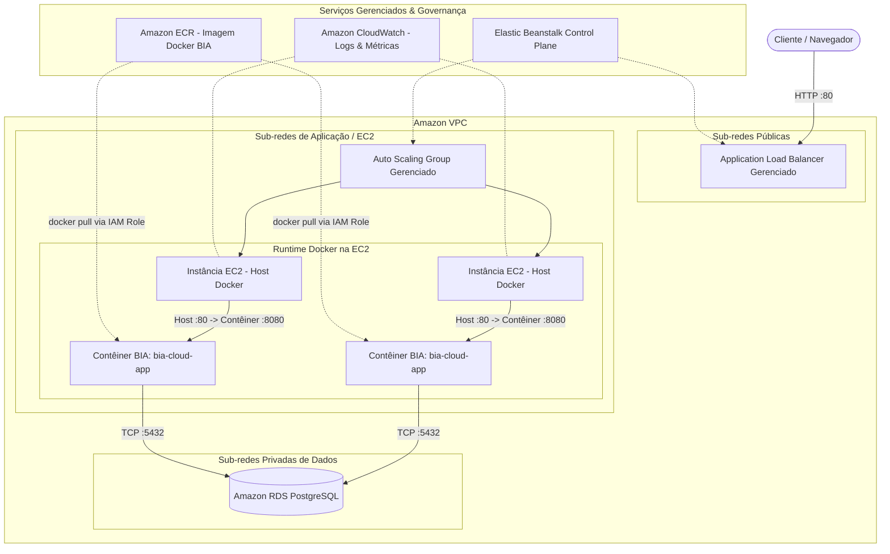
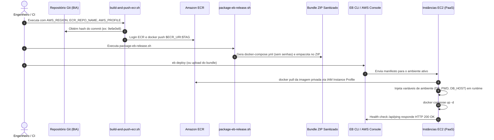

# Arquitetura e Engenharia — AWS Elastic Beanstalk (BIA Cloud Lab)

> **Documento:** Referência Técnica e Arquitetural da Trilha Elastic Beanstalk 
> **Localização:** `DESAFIOS/02-elastic-beanstalk/docs/architecture.md` 
> **Referência:** Formação AWS (Henrylle Maia) | Adaptação e Implementação: Danilo Lima 
> **Repositório Histórico de Origem:** `repositório local bia-eb/bia-eb/` *(Preservado e inalterado)*

---

## 1. Visão Geral da Arquitetura PaaS

O **AWS Elastic Beanstalk** opera como uma camada de **Plataforma como Serviço (PaaS)** sobre a infraestrutura da AWS. Ele abstrai a complexidade do provisionamento manual de servidores, balanceadores de carga, redes e políticas de auto scaling, permitindo que a equipe de engenharia foque exclusivamente no ciclo de vida e na entrega da aplicação.

No contexto do **BIA Cloud Lab**, o Elastic Beanstalk foi explorado na plataforma **Docker (Amazon Linux 2023 / AL2)**, permitindo executar a aplicação BIA containerizada com dependência externa de persistência no **Amazon RDS PostgreSQL** e imagens privadas armazenadas no **Amazon ECR**.

---

## 2. Diagrama Arquitetural da Solução

O diagrama a seguir ilustra a topologia de rede, computação e dados gerenciada pelo Elastic Beanstalk para a aplicação BIA:

---

## 3. Fluxos de Build, Empacotamento e Implantação

A esteira de entrega contempla duas abordagens complementares e auditadas:

### 3.1 Esteira Parametrizada e Segura (Fase D.3)

O fluxo evoluído utiliza scripts parametrizados defensivos que impedem a exposição de senhas e eliminam valores fixos de conta/região:

---

## 4. Componentes e Dependências Técnicas

| Componente | Papel no Laboratório | Dependências Diretas |
|---|---|---|
| **Elastic Beanstalk Environment** | Orquestra a infraestrutura EC2, balanceador de carga e alarmes de saúde. | Plataforma Docker oficial AWS, VPC configurada. |
| **Amazon ECR** | Registro de contêineres privado para armazenar a imagem da aplicação compilada. | Autenticação via `aws ecr get-login-password`, IAM Role com permissão de leitura. |
| **Dockerrun.aws.json (v1)** | Manifesto legado para execução *Single Container Docker*. Mapeia a imagem remota e a porta do contêiner (`8080`). | Plataforma Beanstalk Docker legada / nativa. |
| **compose-eb.example.yml / docker-compose.yml** | Manifesto moderno de contêiner para o Beanstalk, permitindo definir portas do host (`80:8080`) e variáveis de conexão com banco. | Docker Compose v2 na instância AL2023. |
| **Amazon RDS PostgreSQL** | Banco de dados relacional que atende às rotas de `/api/tarefas`. | Security Group autorizando tráfego da porta 5432 a partir do Security Group da EC2 Beanstalk. |
| **Bundle ZIP de Release** | Pacote mínimo contendo exclusivamente o manifesto de orquestração (`docker-compose.yml`), sem código-fonte pesado e **sem arquivos `.env`**. | Utilitário `zip` no Linux/macOS. |

---

## 5. Considerações de Engenharia e Governança

### 5.1 Permissões IAM e Princípio do Menor Privilégio
Em conformidade com as melhores práticas de segurança da AWS, a concessão de privilégios segue o princípio do menor privilégio estrito, evitando políticas administrativas amplas:

1. **Instance Profile da EC2 (`aws-elasticbeanstalk-ec2-role`):**
   - `AmazonEC2ContainerRegistryReadOnly`: concede permissão estrita de download das imagens privadas no Amazon ECR.
   - `AWSElasticBeanstalkWebTier`: fornece permissões necessárias para comunicação de status e envio de métricas e logs ao CloudWatch.
2. **Service Role do Elastic Beanstalk (`aws-elasticbeanstalk-service-role`):**
   - `AWSElasticBeanstalkEnhancedHealth`: permite ao control plane coletar métricas aprofundadas do cluster e ALB.
   - `AWSElasticBeanstalkManagedUpdatesCustomerRolePolicy`: autoriza atualizações gerenciadas de plataforma.
3. **Credenciais de Operador / Automação CI:**
   - Devem possuir escopo estritamente delimitado às operações de Beanstalk (`elasticbeanstalk:*`), manipulação de objetos no bucket S3 de releases e autenticação no ECR (`ecr:GetAuthorizationToken`), evitando concessões irrestritas (`AdministratorAccess` ou `AWSElasticBeanstalkFullAccess`).

### 5.2 Rede e Isolamento (VPC)
- **Topologia de Borda:** O Application Load Balancer gerenciado reside nas sub-redes públicas para recepção de requisições web na porta 80/443.
- **Topologia de Computação e Dados:** As instâncias EC2 do Auto Scaling Group e a instância do Amazon RDS devem preferencialmente residir em sub-redes privadas.
- **Security Groups:** O Security Group do banco relacional deve liberar conexões TCP na porta 5432 **estritamente** para o Security Group atribuído às instâncias do Beanstalk.

### 5.3 Segurança e Proteção de Segredos
- **Desacoplamento de Credenciais:** As credenciais de banco de dados (`DB_USER`, `DB_PWD`, `DB_HOST`) **nunca** devem ser gravadas em arquivos de configuração versionados no Git ou incluídas no bundle `.zip`.
- **Risco de Exposição via CLI:** A passagem de senhas diretamente em comandos de terminal (ex: `eb setenv DB_PWD=senha`) representa grave vulnerabilidade operacional, expondo segredos no histórico de comandos (`.bash_history`), na lista de processos do kernel (`ps aux`) e em logs operacionais.
- **Injeção Segura Recomendada:** O provisionamento de variáveis sensíveis deve ser realizado através das propriedades de ambiente protegidas no Console Web do Beanstalk ou arquivos transitórios locais (`chmod 600`) excluídos do controle de versão.
- **Evolução Proposta — SSM Parameter Store:** Como evolução arquitetural futura recomendada (não implementada nesta fase), a aplicação ou hooks de deploy (`.platform/hooks/predeploy/`) podem consultar parâmetros criptografados (`SecureString`) no AWS Systems Manager Parameter Store em tempo de inicialização, utilizando a IAM Role da instância.

### 5.4 Observabilidade e Monitoramento
- **Health Checks:** A rota `/api/ping` da aplicação BIA é utilizada pelo Target Group do ALB para atestar a vitalidade dos contêineres.
- **Logs:** Os logs da aplicação são centralizados no Amazon CloudWatch Logs através da integração nativa do Beanstalk (`/var/log/eb-engine.log` e logs dos contêineres Docker).

### 5.5 Custos Operacionais
- O serviço AWS Elastic Beanstalk não possui custo de licenciamento adicional. O faturamento é baseado estritamente no consumo dos recursos subjacentes (instâncias EC2, Load Balancers, instâncias RDS e armazenamento EBS).

### 5.6 Comparativo das Estratégias de Deploy no Elastic Beanstalk

| Critério de Comparação | Upload Manual (Console / S3) | Scripts Parametrizados Locais | AWS Elastic Beanstalk CLI (`eb`) |
|---|:---:|:---:|:---:|
| **Interface de Operação** | Interface Web AWS Console | Shell Script (`bash`) | Terminal CLI dedicada (`awsebcli`) |
| **Velocidade de Deploy** | Baixa (requer navegação manual) | Média-Alta (requer upload manual ou AWS CLI) | Alta (`eb deploy` em comando único) |
| **Parametrização de Ambiente** | Manual nos formulários | Totalmente parametrizada via variáveis | Integrada via `.elasticbeanstalk/config.yml` |
| **Proteção contra Vazamento** | Depende da atenção do operador | Automatizada pelo script de empacotamento | Alta (permite deploy com git integration) |
| **Diagnóstico e Logs** | Download de ZIP via console | AWS CLI / CloudWatch Console | Comandos ágeis (`eb logs --tail`, `eb health`) |
| **Adequação para CI/CD** | Inadequado | Altamente compatível com pipelines | Altamente compatível via automação CLI |

---

## 6. Papel Histórico dos Arquivos de Laboratório (`bia-eb`)

No repositório histórico `bia-eb/bia-eb/`, os seguintes arquivos desempenharam papéis essenciais na construção do laboratório:

1. **`Dockerrun.aws.json`:** Primeiro formato testado para descrever a tarefa Docker para o Beanstalk em modo Single Container.
2. **`compose-eb.yml`:** Template de definição do serviço `server` com mapeamento da porta `80:8080` e injeção da variável `${TAG}`.
3. **`gerar-compose.sh`:** Script empírico inicial de compilação do manifesto, usando `git rev-parse HEAD | cut -c 1-7` para injetar a tag.
4. **`build.sh`:** Automação empírica executada localmente: login no ECR, build da imagem BIA, push, geração do compose e compactação do bundle `bia-versao-$versao.zip`.
5. **`bia-versao-9e6e0e8.zip`:** Pacote de release gerado com base no commit `9e6e0e8`, demonstrando a viabilidade de implantar a BIA via upload de arquivo no console Beanstalk.

---

## 7. Matriz de Evidências e Maturidade

Classificação transparente do nível de maturidade e validação dos artefatos da trilha Elastic Beanstalk:

| Componente / Atividade | Classificação de Estado | Evidência Documentada |
|---|:---:|---|
| **Scripts Parametrizados de Build e Release** | ✅ Implementado e Documentado | Scripts defensivos [`scripts/build-and-push-ecr.sh`](../01-eb-docker-deploy/scripts/build-and-push-ecr.sh) e [`scripts/package-eb-release.sh`](../01-eb-docker-deploy/scripts/package-eb-release.sh) com validação sintática e sem segredos codificados. |
| **Manifesto Docker Compose e Templates Sanitizados** | ✅ Implementado e Documentado | Modelos sanitizados [`templates/Dockerrun.aws.example.json`](../01-eb-docker-deploy/templates/Dockerrun.aws.example.json) e [`templates/compose-eb.example.yml`](../01-eb-docker-deploy/templates/compose-eb.example.yml). |
| **Pacote ZIP Histórico de Release** | ✅ Implementado e Documentado | Artefato binário original `bia-versao-9e6e0e8.zip` preservado no repositório histórico `bia-eb`. |
| **Guia Operacional EB CLI (`awsebcli`)** | ✅ Implementado e Documentado | Fluxo completo documentado em [`01-eb-docker-deploy/README.md`](../01-eb-docker-deploy/README.md) com menor privilégio IAM e proteção de credenciais. |
| **Validação de Logs Ativos na Nuvem** | 🔍 Evidenciado Parcialmente | Laboratório executado com sucesso na nuvem AWS durante a formação; histórico de logs da sessão não retido no monorepo local. |
| **Injeção de Segredos via SSM Parameter Store** | ⚪ Proposto para Evolução Futura | Mapeado conceitualmente no design arquitetural; implementação técnica de hooks de inicialização ou desacoplamento no código Node.js proposta para evolução futura (não implementada). |
