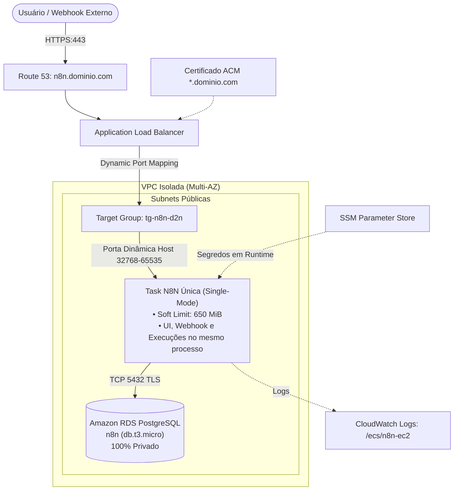
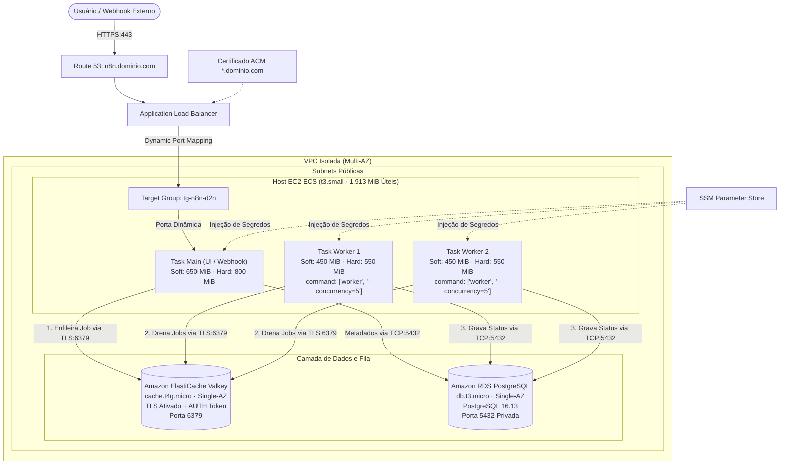

# Memorial Arquitetural — N8N na AWS: Single-Mode vs Queue Mode

Este documento consolida o memorial arquitetural da plataforma de automação **N8N** na AWS, detalhando a evolução técnica realizada entre o **Desafio 5 (Single-Mode com Auto-Recovery)** e o **Desafio 6 (Queue Mode com Fila Distribuída no ElastiCache Valkey)**.

---

## 1. Visão Geral e Evolução Arquitetural

A implementação do N8N na Formação AWS foi conduzida em duas etapas arquiteturais evolutivas:

1. **Desafio 5 — Single-Mode com Auto-Recovery:**
   Arquitetura simplificada onde uma única task ECS concentra todas as responsabilidades do sistema (interface gráfica de usuário, editor de fluxos, recepção de webhooks, agendador de rotinas e execução direta de nós). A resiliência é provida pelo mecanismo de **Self-Healing** do Auto Scaling Group e do ECS Service.
2. **Desafio 6 — Queue Mode com Fila Distribuída:**
   Arquitetura distribuída de alta vazão onde a tarefa principal (`n8n-main`) atua exclusivamente como controladora de entrada (UI, editor, timers e webhook receiver), delegando a execução dos fluxos para tarefas especializadas (`n8n-worker`) através de uma fila em memória gerenciada pelo BullMQ sobre o Amazon ElastiCache Valkey.

---

## 2. Comparativo Técnico entre as Arquiteturas

| Dimensão Técnica | Desafio 5: Single-Mode | Desafio 6: Queue Mode | Justificativa da Evolução |
|---|---|---|---|
| **Modelo de Execução** | Monolítico (`EXECUTIONS_MODE=regular`) | Distribuído (`EXECUTIONS_MODE=queue`) | Desacopla a recepção de tráfego HTTP da carga computacional pesada dos workflows. |
| **Composição de Tasks** | 1 Task ECS (`task-def-n8n-d2n`) | 1 Task Main + Múltiplas Tasks Workers | Evita que execuções lentas ou concorrentes congelem o editor ou atrasem webhooks. |
| **Message Broker** | Nenhum | Amazon ElastiCache Valkey (TLS + AUTH) | Fila assíncrona gerenciada com retenção em memória via BullMQ. |
| **Computação EC2** | 1x `t3.micro` (1 vCPU, 1 GB RAM) | 1x `t3.small` (2 vCPU, 2 GB RAM) | Acomoda 1 task Main + 2 tasks Workers com margem de segurança de SO/Docker (~363 MiB livres). |
| **Persistência de Metadados** | Amazon RDS PostgreSQL (`db.t3.micro`) | Amazon RDS PostgreSQL (`db.t3.micro`) | Banco relacional mantém schemas, credenciais, histórico final e estados de execução. |
| **Exposição Externa** | ALB Internet-Facing (HTTPS:443) | ALB Internet-Facing (HTTPS:443) | Somente a task Main é exposta ao ALB; workers não possuem portas abertas nem listener. |
| **Comportamento sob Sobrecarga** | Webhooks e UI competem por CPU/RAM | Fila absorve picos; workers drenam concorrentemente | Absorção elástica de rajadas com consistência no processamento. |

---

## 3. Diagramas de Arquitetura

### 3.1 Arquitetura Desafio 5 — Single-Mode (Auto-Recovery)



### 3.2 Arquitetura Desafio 6 — Queue Mode (Fila Distribuída)



---

## 4. Topologia de Rede e Fronteiras de Segurança

A proteção entre os componentes na VPC é assegurada por **regras estritas de Security Groups encadeados**:

```
[ Internet ]
     │
     ▼ (HTTPS:443)
[ Security Group: n8n-alb ]
     │
     ▼ (TCP: 32768-65535 originado estritamente do SG n8n-alb)
[ Security Group: n8n-ec2 ]
     │
     ├───► (TCP: 5432 originado estritamente do SG n8n-ec2) ───► [ Security Group: n8n-db ]
     │
     └───► (TCP: 6379 originado estritamente do SG n8n-ec2) ───► [ Security Group: n8n-valkey-sg ]
```

* **Sem Exposição Pública de Dados:** Nem o RDS PostgreSQL nem o ElastiCache Valkey possuem IP público ou acesso direto da internet.
* **Isolamento de Broker:** O broker Valkey aceita conexões na porta 6379 única e exclusivamente vindas de instâncias associadas ao `n8n-ec2`. Nem mesmo o ALB possui conectividade com o broker.

---

## 5. Dimensionamento de Memória e Capacidade

### 5.1 Host EC2 `t3.small` (1.913 MiB Registrados no ECS)

O particionamento de memória foi projetado para assegurar que todas as tasks sejam agendadas na mesma máquina sem contenção:

| Componente | Reserva Suave (Soft Limit) | Limite Rígido (Hard Limit) | Papel Operacional |
|---|---|---|---|
| **Task Main** | 650 MiB | 800 MiB | UI, Editor, Agendadores e Webhooks. |
| **Worker Task w1** | 450 MiB | 550 MiB | Drenagem e execução assíncrona (concurrency: 5). |
| **Worker Task w2** | 450 MiB | 550 MiB | Drenagem e execução assíncrona (concurrency: 5). |
| **Total Alocado (Soft)** | **1.550 MiB** | — | **81% da capacidade útil da máquina.** |
| **Capacidade Residual Livre** | **363 MiB** | — | **Margem para overhead do SO AL2023, Docker e ECS Agent.** |

---

## 6. Fronteiras de Persistência e Limitações de Resiliência

> [!WARNING]
> **Diferença Crítica entre Falha de Worker e Falha de Broker:**
> 1. **Falha de Worker (Container Crash ou Stop):**<br>
>    As mensagens retidas na fila BullMQ permanecem seguras na memória do Valkey. Ao reiniciar os workers, o processamento é retomado do ponto de parada sem perda de requisições.
> 2. **Falha de Broker (ElastiCache Valkey Single-Node):**<br>
>    Por ser implantado em nó único sem persistência em disco ou replicação Multi-AZ, caso o nó Valkey falhe ou passe por manutenção, **mensagens em espera serão perdidas**. Os workflows já concluídos e credenciais permanecem seguros no PostgreSQL.

---

## 7. Diferenciação: Implementado em Laboratório vs Recomendações de Produção

| Componente | Implementado e Validado no Laboratório | Recomendação para Produção Corporativa |
|---|---|---|
| **ElastiCache Valkey** | 1 nó `cache.t4g.micro` Single-AZ | Cluster Multi-AZ com Multi-Node Replication Group e Auto-Failover |
| **Amazon RDS** | `db.t3.micro` Single-AZ, sem backups | RDS PostgreSQL Multi-AZ com réplica de leitura e snapshots automatizados |
| **Host ECS** | 1 instância `t3.small` EC2 em ASG (min=1, max=1) | ECS Fargate ou Auto Scaling EC2 dinâmico baseado em profundidade de fila |
| **Domínio DNS** | Apontamento em hosted zone compartilhada | Hosted Zone dedicada delegada exclusivamente para automações |
| **Segurança IAM** | Usuário dedicado com políticas temporárias | Autenticação federada OIDC via GitHub Actions sem chaves estáticas |
