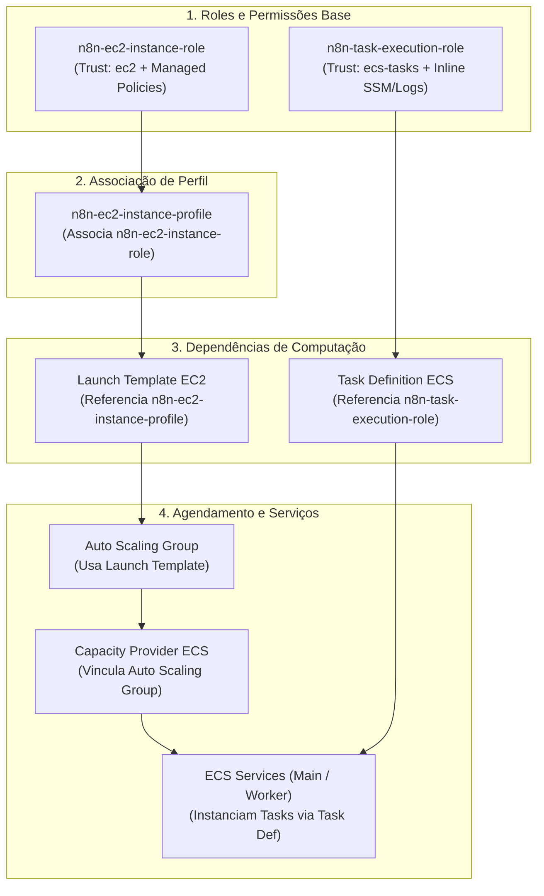

# Governança IAM e Políticas de Menor Privilégio — N8N na AWS

> **Projeto:** BIA Cloud Lab — D2NS<br>
> **Trilha:** N8N na AWS (Automação & Workflows)<br>
> **Referência educacional:** Formação AWS — Henrylle Maia<br>
> **Implementação e adaptações:** Danilo Lima — D2NS<br>
> **Status:** ✅ Modelado e Documentado (9 Templates Sanitizados)<br>
> **Adaptações D2NS:** Desenho de 9 políticas e roles de menor privilégio delimitadas ao prefixo `n8n-*`, restringindo PassRole e garantindo matriz de dependências estrita para segurança.

Este diretório consolida os templates sanitizados e a documentação de governança de segurança baseada em **Identidades e Acessos (IAM)** para a orquestração do N8N na AWS, tanto para o **Desafio 5 (Single-Mode)** quanto para o **Desafio 6 (Queue Mode com ElastiCache Valkey)**.

---

## 1. Princípio do Menor Privilégio (Least Privilege)

Em ambientes corporativos e em conformidade com o pilar de segurança do **AWS Well-Architected Framework**, o provisionamento e operação do N8N rejeitam expressamente o uso de permissões amplas como `AdministratorAccess`, `AmazonElastiCacheFullAccess` ou `AmazonRDSFullAccess`.

A governança adotada apoia-se em quatro pilares:
1. **Segregação de Papéis de Runtime:** Instâncias EC2 e tarefas ECS possuem identidades independentes com fronteiras de privilégio delimitadas.
2. **Restrição por Recursos (Resource-Level Permissions):** Ações de modificação, leitura de segredos e deleção são estritamente restritas aos ARNs com prefixos dedicados (`n8n-*`, `/ecs/n8n-ec2`, `/n8n/*`).
3. **Políticas Temporárias de Implantação:** O usuário ou role de automação recebe apenas os privilégios estritamente necessários para provisionar a infraestrutura e realizar a validação prévia.
4. **Isolamento de Segredos:** Containers não recebem credenciais de banco de dados ou tokens de fila em variáveis de ambiente em texto claro; os segredos são resolvidos e injetados diretamente em memória pelo ECS Agent a partir do SSM Parameter Store (`SecureString`).

---

## 2. Catálogo de Templates IAM Sanitizados

Todos os arquivos neste diretório são templates reutilizáveis parametrizados com placeholders padrão (`<AWS_ACCOUNT_ID>`, `<ROUTE53_HOSTED_ZONE_ID>`, `<SEU_DOMINIO>`):

| Template | Tipo de Artefato | Entidade Vinculada | Finalidade Operacional |
|---|---|---|---|
| [`01-policy-prevalidation-readonly.example.json`](01-policy-prevalidation-readonly.example.json) | Managed Policy | Usuário / Role de Deploy | Permissões de leitura somente para pré-validar AMIs ECS, VPC, Subnets, tipos de instância e parâmetros SSM. |
| [`02-policy-deploy.example.json`](02-policy-deploy.example.json) | Managed Policy | Usuário / Role de Deploy | Ações de criação e modificação restritas aos recursos com escopo `n8n` (ECS, EC2, ALB, RDS, SSM e Logs). |
| [`03-trust-policy-ecs-tasks.example.json`](03-trust-policy-ecs-tasks.example.json) | Trust Policy | `n8n-task-execution-role` | Concede a `ecs-tasks.amazonaws.com` permissão para assumir a role de execução da tarefa. |
| [`04-inline-policy-execution-role.example.json`](04-inline-policy-execution-role.example.json) | Inline Policy | `n8n-task-execution-role` | Permite leitura estrita dos segredos SSM (`/n8n/*`) e entrega de fluxos de log no CloudWatch (`/ecs/n8n-ec2`). |
| [`05-trust-policy-ec2.example.json`](05-trust-policy-ec2.example.json) | Trust Policy | `n8n-ec2-instance-role` | Concede ao serviço `ec2.amazonaws.com` permissão para assumir a role do host de container. |
| [`06-instance-role-managed-policies.example.json`](06-instance-role-managed-policies.example.json) | Documento Guia | `n8n-ec2-instance-role` | Mapeamento das políticas gerenciadas AWS obrigatórias (`AmazonEC2ContainerServiceforEC2Role` e `AmazonSSMManagedInstanceCore`). |
| [`07-instance-profile.example.json`](07-instance-profile.example.json) | Documento Guia | `n8n-ec2-instance-profile` | Especificação para criação do container de perfil EC2 e sua vinculação à role da instância para uso no Launch Template. |
| [`08-policy-elasticache-valkey.example.json`](08-policy-elasticache-valkey.example.json) | Managed Policy | Usuário / Role de Deploy | Permissões cirúrgicas para gerenciar o cluster ElastiCache Valkey (`n8n-*`) sem privilégios administrativos globais. |
| [`09-inline-policy-route53.example.json`](09-inline-policy-route53.example.json) | Inline Policy | Usuário / Role de Deploy | Autorização restrita para apontamento do registro Alias A `n8n.<SEU_DOMINIO>` com condição estrita de nome e tipo de registro. |

---

## 3. Matriz de Permissões e Responsabilidades

```
┌─────────────────────────────────────────────────────────────────────────────┐
│                           ENTIDADES E ROLES IAM                             │
└─────────────────────────────────────────────────────────────────────────────┘
          │                                          │
          ▼                                          ▼
┌───────────────────────────────┐          ┌───────────────────────────────────┐
│     n8n-ec2-instance-role     │          │     n8n-task-execution-role       │
├───────────────────────────────┤          ├───────────────────────────────────┤
│ • Auto-registro no Cluster ECS│          │ • Leitura de Segredos SSM:        │
│ • Comunicação com ECS Agent   │          │   - /n8n/db_password              │
│ • Pull de imagens públicas    │          │   - /n8n/encryption_key           │
│ • Telemetria básica EC2       │          │   - /n8n/valkey_token             │
│ • Acesso via SSM Session Mgr  │          │ • Criação de log streams e envio  │
│   (sem expor porta SSH 22)    │          │   de logs para /ecs/n8n-ec2       │
└───────────────────────────────┘          └───────────────────────────────────┘
```

---

## 4. Ordem Obrigatória de Provisionamento e Dependências

Para evitar bloqueios de dependência circular durante o provisionamento da infraestrutura ECS e EC2, as identidades IAM devem ser criadas na ordem exata indicada abaixo:



---

## 5. Procedimento de Teardown e Limpeza de Identidades

Ao encerrar o ciclo de vida do laboratório, as identidades IAM devem ser desprovisionadas **estritamente após a exclusão dos recursos de infraestrutura** (ECS Services, Tasks, Auto Scaling Group, Launch Template, ALB e RDS):

1. **Remoção de Políticas Gerenciadas da EC2 Instance Role:**
   - Desanexar `AmazonEC2ContainerServiceforEC2Role`.
   - Desanexar `AmazonSSMManagedInstanceCore`.
2. **Desassociação e Exclusão do Instance Profile:**
   - Remover a role `n8n-ec2-instance-role` do perfil `n8n-ec2-instance-profile`.
   - Excluir o perfil `n8n-ec2-instance-profile`.
3. **Exclusão da EC2 Instance Role:**
   - Excluir a role `n8n-ec2-instance-role`.
4. **Exclusão da Inline Policy e da Task Execution Role:**
   - Excluir a inline policy associada à role `n8n-task-execution-role`.
   - Excluir a role `n8n-task-execution-role`.
5. **Revogação das Políticas de Deploy:**
   - Desanexar e excluir as políticas de deploy e pré-validação (`01`, `02`, `08`).

---

## 6. Diferença entre Laboratório e Produção Corporativa

> [!NOTE]
> **Comparativo de Governança:**
> - **Ambiente de Laboratório Validado:** Utilização de usuário IAM dedicado (`n8n-lab`) com políticas de menor privilégio escopadas em recursos `n8n-*`, com desprovisionamento manual documentado para custo zero.
> - **Recomendação para Produção Corporativa:**
>   1. **Zero Long-Lived Credentials:** Eliminar chaves de acesso IAM estáticas (`AWS_ACCESS_KEY_ID`), substituindo por integração OIDC (OpenID Connect via GitHub Actions ou AWS IAM Identity Center / SSO).
>   2. **Subzona Delegada no Route 53:** Em vez de compartilhar a zona raiz do domínio principal, delegar um subdomínio exclusivo (ex: `corp-n8n.empresa.com.br`) com permissões estritas concedidas apenas sobre a hosted zone filha.
>   3. **KMS Customer Managed Key (CMK):** Empregar chaves KMS gerenciadas pelo cliente com rotação anual ativada para encriptação dos parâmetros SSM e volumes EBS dos hosts ECS.
