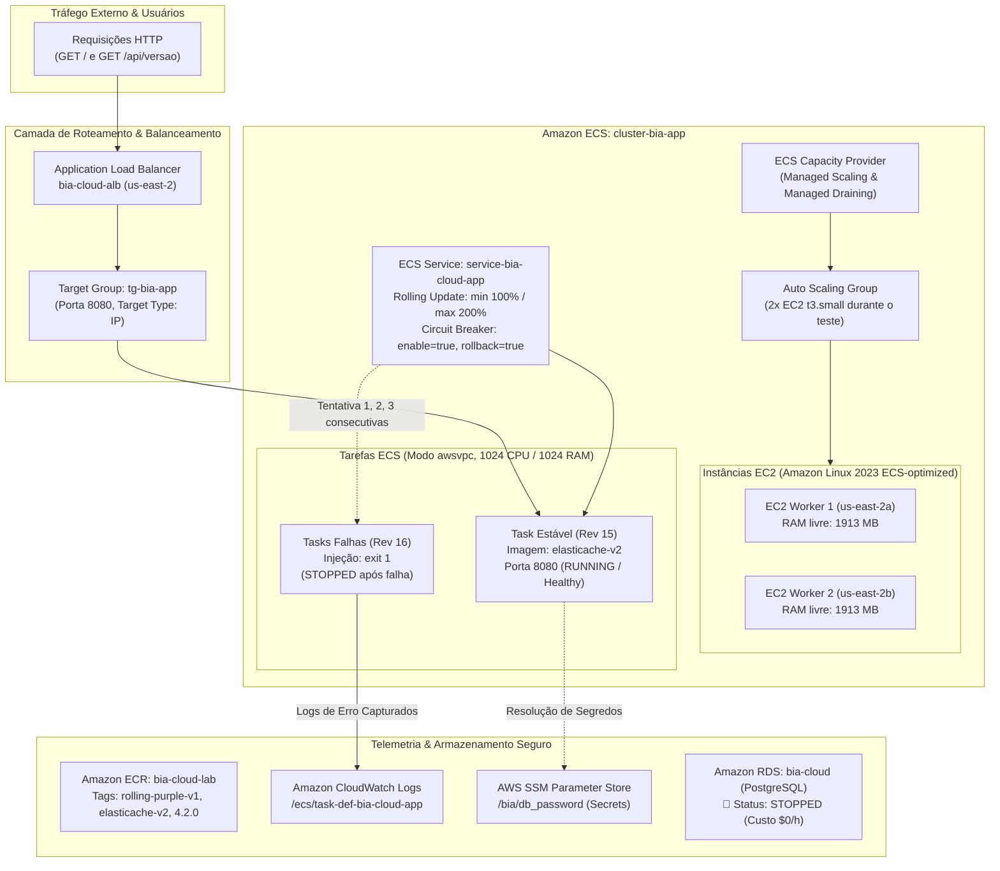

# Desafio 02 — Deploy Contínuo, Rollback Automatizado e Deployment Circuit Breaker no Amazon ECS

> **Projeto:** BIA Cloud Lab — D2NS<br>
> **Trilha:** Estratégias de Deploy & Resiliência (`04-deploy-strategies`)<br>
> **Referência educacional:** Formação AWS (Instrutor: Henrylle Maia)<br>
> **Implementação e Engenharia de SRE:** Danilo Lima — D2NS & AGY<br>
> **Status:** 🟢 **Circuit Breaker Homologado na Nuvem (Fase 2)** | 🟢 **CLI Modular com 18 Testes Automatizados (Fase 3)** | 🛑 **Ambiente em Repouso ($0.00/h de computação)**

---

## 🎯 1. Objetivos e Escopo do Laboratório

O Desafio 02 consolida práticas avançadas de **Engenharia de Confiabilidade (SRE)** e **DevOps** voltadas para a automação de entregas contínuas e auto-recuperação de falhas no **Amazon ECS sob instâncias EC2 gerenciadas por Auto Scaling Group (ASG)**.

O escopo técnico abrange três frentes integradas:
1. **Pipeline de Release Rastreável:** Automação do fluxo completo de publicação: Git Commit SHA imutável $\to$ Docker Build $\to$ Amazon ECR Push $\to$ Task Definition $\to$ ECS Update Service $\to$ Monitoramento em Tempo Real de Rollout $\to$ Smoke Test HTTP.
2. **Resiliência em Nível de Infraestrutura (Nativo ECS):** Configuração autônoma do `deploymentCircuitBreaker: { enable: true, rollback: true }`, homologando na nuvem a injeção deliberada de falha crítica (`exit 1`), captura do limiar de falhas consecutivas de contêineres e auto-reversão transparente sem intervenção humana.
3. **Resiliência em Nível de Aplicação (Rollback Controlado):** Mecanismo de comutação atômica e direta para revisões estáveis anteriores homologadas, sem necessidade de recompilar contêineres ou registrar novas definições, acionado sob falhas lógicas de negócio detectadas no Smoke Test.

---

## 🏗️ 2. Arquitetura AWS e Topologia do Laboratório



---

## 📊 3. Matriz de Maturidade e Evidências

| Dimensão | Situação | Detalhamento Técnico |
|---|:---:|---|
| **Funcionalidade em Código** | ✅ Implementada | Arquitetura modular com 8 scripts especializados em [`scripts/`](../scripts/): CLI central ([`deploy-ecs.sh`](../scripts/deploy-ecs.sh)), biblioteca utilitária ([`common.sh`](../scripts/common.sh)), configuração central ([`deploy.conf`](../scripts/deploy.conf)), deploy ([`deploy.sh`](../scripts/deploy.sh)), rollback direto ([`rollback.sh`](../scripts/rollback.sh)), listagem real ([`list-versions.sh`](../scripts/list-versions.sh)) e monitor de telemetria ([`check-availability.sh`](../scripts/check-availability.sh)). |
| **Execução Histórica** | ✅ Comprovada | Histórico cronológico detalhado das Fases 0, 1 e 2 documentado em [`docs/EXECUTION-LOG.md`](docs/EXECUTION-LOG.md) e inventário real em [`docs/AWS-INVENTORY.md`](docs/AWS-INVENTORY.md). |
| **Homologação na Nuvem (Fase 2)** | ✅ Comprovada | **Circuit Breaker na AWS Real:** Injeção deliberada de falha na Task Definition `:16` (`exit 1`), captura de 3 tasks falhas consecutivas pelo control plane do ECS, auto-reversão transparente para a Revisão `:15` estável e telemetria contínua no ALB com **298 requisições consecutivas respondendo HTTP 200 OK**. |
| **Suíte de Testes Locais (Fase 3)** | ✅ Comprovada | Suíte com **18 testes automatizados de segurança e integração** em [`scripts/test-security-checks.sh`](../scripts/test-security-checks.sh) (**18/18 PASS**) validando isolamento de conta, bloqueio da Revisão `:16`, integridade cirúrgica de atributos via `jq`, tratamento de rollout do Circuit Breaker (exit 2), tolerância a warmup HTTP e rollback automático no smoke test (exit 3). |
| **Estado Atual da Infraestrutura** | 🛑 Em Repouso | Recursos computacionais colocados em repouso total para contenção de custos: ECS `desiredCount=0`, ASG `0/0/0`, instâncias EC2 terminadas, RDS `stopped`. Custo de computação ativo: **$0.00/h**. Procedimento de retomada em [`docs/HANDOFF.md`](docs/HANDOFF.md). |
| **Validações Futuras Planejadas** | ⚪ Planejada | Execução do pipeline completo na nuvem compilando e enviando nova tag SHA para o ECR (depende de anexo temporário de política de escrita no ECR: `ecr:GetAuthorizationToken`). |

---

## 🔬 4. Comprovação Empírica do ECS Deployment Circuit Breaker (Fase 2)

O **Deployment Circuit Breaker** é um mecanismo nativo do Amazon ECS que avalia o progresso do rollout. Quando tarefas de uma nova versão falham sistematicamente durante a inicialização, o ECS aborta o deploy e aciona o auto-rollback.

### 4.1. Fórmula Matemática e Cálculo do Limiar (Threshold)
O plano de controle do ECS utiliza a seguinte fórmula para determinar o número de falhas consecutivas antes de interromper o deployment:

$$\text{Threshold} = \min(200, \max(3, \lceil \text{desiredCount} \times 0.5 \rceil))$$

Para o serviço `service-bia-cloud-app` configurado com `desiredCount = 1`:

$$\text{Threshold} = \min(200, \max(3, \lceil 1 \times 0.5 \rceil)) = 3\text{ falhas consecutivas}$$

### 4.2. Injeção Deliberada de Falha (Revisão 16)
Para homologar o comportamento na nuvem real sem alterar a imagem estável, registramos a Task Definition `task-def-bia-cloud-app:16` com um comando de saída com erro forçado:

```json
"command": [
  "sh",
  "-c",
  "echo '[SIMULACAO] Falha critica de inicializacao provocada para teste de Circuit Breaker' && exit 1"
]
```

### 4.3. Evidências Coletadas na AWS

#### A. Tarefas Paradas e Códigos de Saída
| Task ID | Task Definition | Stop Code | Stopped Reason | Exit Code |
|---|---|---|---|:---:|
| `9ac0b5fa7867461eab42f37249c08687` | `task-def-bia-cloud-app:16` | `EssentialContainerExited` | Essential container in task exited | **1** |
| `c8c31a4663414232ac60269893b7a66f` | `task-def-bia-cloud-app:16` | `EssentialContainerExited` | Essential container in task exited | **1** |
| `d742a3289773445eaec6793d4cffe0c4` | `task-def-bia-cloud-app:16` | `EssentialContainerExited` | Essential container in task exited | **1** |
| `cd89cf98f70840ddb37234ef34164fe7` | `task-def-bia-cloud-app:16` | `ServiceSchedulerInitiated` | Scaling activity initiated by deployment | *Cancelada antes do início* |

#### B. Logs de Erro no Amazon CloudWatch
* **Log Group:** `/ecs/task-def-bia-cloud-app`
* **Log Stream:** `ecs-fail-test/bia-cloud-app/9ac0b5fa...`
* **Mensagem Capturada:**
  ```text
  [SIMULACAO] Falha critica de inicializacao provocada para teste de Circuit Breaker
  ```

#### C. Linha do Tempo de Eventos Oficiais do ECS Control Plane
```text
2026-11-20T22:34:09Z - (service service-bia-cloud-app) has started 1 tasks: (task 9ac0b5fa...)
2026-11-20T22:35:30Z - (service service-bia-cloud-app) has started 1 tasks: (task c8c31a46...)
2026-11-20T22:36:30Z - (service service-bia-cloud-app) has started 1 tasks: (task d742a328...)
2026-11-20T22:41:59Z - (service service-bia-cloud-app) (deployment ecs-svc/3923766393478644619) deployment failed: tasks failed to start.
2026-11-20T22:41:59Z - (service service-bia-cloud-app) rolling back to deployment ecs-svc/5533401166745071967.
2026-11-20T22:42:00Z - (service service-bia-cloud-app) stopped 1 pending tasks.
2026-11-20T22:42:50Z - (service service-bia-cloud-app) (deployment ecs-svc/5533401166745071967) deployment completed.
2026-11-20T22:42:50Z - (service service-bia-cloud-app) has reached a steady state.
```

#### D. Telemetria HTTP no ALB Durante o Incidente
Durante todo o ciclo de falha e auto-recuperação (mais de 11 minutos de monitoramento contínuo com sondas a cada 2 segundos no endpoint `/api/versao` do Application Load Balancer):
* **Período Observado:** 2026-11-20T22:32:18Z até 2026-11-20T22:43:44Z (~11 min e 26 s).
* **Total de Requisições:** 298 requisições consecutivas.
* **Resultado:** **298 respostas HTTP 200 OK (0 erros 5XX, 0 timeouts)** com payload estável `"Bia 4.2.0"`.
* **Latência Média:** 0.270 segundos.
* *Nota Técnica SRE:* Este resultado comprova empiricamente que, na janela de observação do experimento, o tráfego de produção permaneceu atendido pela tarefa da Revisão 15 sem interrupção de serviço, sustentado pelo parâmetro `minimumHealthyPercent = 100`.

---

## ⚙️ 5. Comparativo: Rollback Manual vs. Deployment Circuit Breaker

| Critério | Rollback Manual Controlado (`rollback.sh`) | Deployment Circuit Breaker (ECS Nativo) |
|---|---|---|
| **Gatilho de Disparo** | Operador humano (identifica bug de negócio via Smoke Test). | Control Plane do Amazon ECS (monitora falhas de inicialização). |
| **Ponto de Execução** | CLI local / Runner de CI/CD. | Totalmente autônomo na nuvem AWS. |
| **Tempo de Reação** | Imediato após emissão do comando (comutação atômica). | Condicionado ao threshold de falhas consecutivas (minutos). |
| **Mecanismo** | `aws ecs update-service --task-definition <FAMILIA>:<REV>`. | Reversão automática para o último deployment com status `COMPLETED`. |
| **Requer Compilação Docker?** | **NÃO.** Aponta diretamente para a revisão homologada anterior (:15). | **NÃO.** Restaura a Task Definition homologada anterior (:15). |
| **Dependência de Conexão** | Depende de conectividade entre o operador/CI e a API da AWS. | 100% autônomo na AWS, independente da máquina do operador. |

---

## 💡 6. Desafios Reais de Engenharia e Troubleshooting

### 6.1. O Desafio de Dimensionamento de Memória EC2 (`maximumPercent = 200`)
* **Problema:** Cada instância `t3.small` oferece 1913 MB de memória RAM livre para o agente ECS. A aplicação BIA consome 1024 MB de RAM por tarefa. Quando o serviço opera com `maximumPercent = 200`, o ECS tenta subir uma nova tarefa v2 (1024 MB) antes de encerrar a v1 (1024 MB), demandando 2048 MB simultâneos.
* **Sintoma:** Em um cluster com apenas 1 instância `t3.small`, a nova tarefa ficava retida com status `RESOURCE:MEMORY` e o deploy travava.
* **Solução de SRE:** Elevação preventiva da capacidade do Auto Scaling Group para **2 instâncias `t3.small`** (`DesiredCapacity = 2`) durante a janela de release, garantindo capacidade excedente para o pico de 200% e drenagem segura.

### 6.2. Independência de Banco de Dados e Contenção de Custos (Cost-Aware SRE)
* **Auditoria de Código:** A inspeção do backend Express (`server.js`, `config/express.js`, `api/controllers/versao.js`) comprovou que a inicialização do servidor HTTP e as rotas `/` (React SPA estática) e `/api/versao` não realizam chamadas síncronas ao banco de dados relacional (o Sequelize opera em modo *lazy-loading* nas rotas de negócio).
* **Decisão Operacional:** O banco Amazon RDS (`bia-cloud`, PostgreSQL) foi mantido intencionalmente no estado **`stopped`** durante todo o Desafio 02, economizando custos e validando com fidelidade o desacoplamento de resiliência dos health checks de infraestrutura.

---

## 🛠️ 7. Arquitetura Modular dos Scripts

A automação foi estruturada sob o princípio da responsabilidade única (Single Responsibility Principle):

```
scripts/
├── common.sh                 <-- Biblioteca compartilhada (logging, STS, Git, cores, env loader)
├── deploy.conf               <-- Configuração central de ambientes (app, alb, didatico) e parâmetros
├── deploy.sh                 <-- Release contínuo: Build Docker + Push ECR + Task Def + Rollout + Smoke Test
├── rollback.sh               <-- Rollback direto e enxuto (sem build/push/nova task def)
├── list-versions.sh          <-- Tabela de revisões no ECS Control Plane com marcadores de status
├── check-availability.sh     <-- Telemetria contínua de latência e códigos HTTP no Load Balancer
├── deploy-ecs.sh             <-- Fachada unificada de compatibilidade para linha de comando
└── test-security-checks.sh   <-- Suíte com 18 testes automatizados em sandbox e mocks locais
```

### Cobertura da Suíte de Testes Automatizados (`test-security-checks.sh`):
1. Bloqueio por Conta AWS Não Autorizada no STS (`exit 1`).
2. Falha em `describe-task-definition` bloqueia antes de Docker Build/Push (`exit 1`).
3. Revisão 15 Real é consultada e propriedades (`placementConstraints`, secrets SSM, env) são integralmente preservadas.
4. Contêiner ausente na Task Definition base bloqueia antes de Build/Push (`exit 1`).
5. Ambiguidade de contêineres duplicados bloqueia antes de Build/Push (`exit 1`).
6. Família divergente bloqueia antes de Build/Push (`exit 1`).
7. Task Definition base com status `INACTIVE` bloqueia antes de Build/Push (`exit 1`).
8. Bloqueio rígido da revisão defeituosa `:16` (`exit 1`).
9. Rollout com `desiredCount=0` bloqueia homologação com erro (`exit 1`).
10. Disparo de ECS Deployment Circuit Breaker (`rolloutState=FAILED`) aciona diagnóstico read-only e sai com `exit 2`.
11. Dry-Run offline no ambiente ALB exibe mocks isolados sem vazar revisões do ambiente APP.
12. Execução direta do script especializado `list-versions.sh` em dry-run.
13. Execução direta do script especializado `rollback.sh` com bloqueio da `:16` e dry-run.
14. Execução direta do script especializado `deploy.sh` em modo dry-run.
15. Fachada de compatibilidade `deploy-ecs.sh` delegando com sucesso para `list`, `rollback` e `deploy`.
16. Falha persistente no Smoke Test dispara auto-rollback para a baseline de partida no serviço e sai com código `3`.
17. Smoke Test tolera falha transitória de warmup HTTP com retentativa resiliente e conclui com código `0`.
18. Rollback dinâmico com baseline alternativa (ex: `:17`) não fica preso à `:15`, respeitando a versão ativa de partida.

---

## 🚀 8. Guia de Reprodução Rápida

### Modo A: Simulação Local (Sem Custo / Sem Conta AWS)
Qualquer avaliador técnico pode reproduzir e validar a suíte de testes e os fluxos sem dispor de credenciais AWS:

```bash
# 1. Executar a suíte completa de 18 testes automatizados:
./scripts/test-security-checks.sh

# 2. Simular um deploy completo em modo Dry-Run:
./scripts/deploy-ecs.sh deploy --dry-run

# 3. Simular listagem de revisões em modo offline:
./scripts/deploy-ecs.sh list --dry-run

# 4. Simular rollback direto para a revisão estável 15:
./scripts/deploy-ecs.sh rollback -r 15 --dry-run
```

### Modo B: Execução Real na AWS
Para homologar a execução em uma conta AWS ativa (consulte o guia detalhado pré-execução em [PRE-DEPLOY-CHECKLIST.md](docs/PRE-DEPLOY-CHECKLIST.md)):

```bash
# 1. Criar o arquivo de configuração a partir do modelo:
cp .env.example .env

# 2. Configurar suas variáveis no .env:
#    AWS_ACCOUNT_ID="sua-conta-de-12-digitos"
#    AUTHORIZED_ACCOUNT="sua-conta-de-12-digitos"
#    AWS_PROFILE="seu-perfil"
#    ENV_APP_ALB_URL="http://seu-alb-dns/api/versao"

# 3. Autenticar via AWS CLI:
aws login --profile seu-perfil

# 4. Listar as revisões ativas no Amazon ECS:
./scripts/deploy-ecs.sh list

# 5. Executar o deploy contínuo:
./scripts/deploy-ecs.sh deploy

# 6. Executar rollback direto caso necessário:
./scripts/deploy-ecs.sh rollback -r 15
```

---

## 🤖 9. Engenharia Assistida por Inteligência Artificial (SRE Copilot)

O desenvolvimento deste laboratório utilizou agentes de Inteligência Artificial operando sob governança estrita (**Human-in-the-Loop** e **Princípio do Menor Privilégio**):
* **Cálculo de Limiares:** Modelagem analítica da fórmula de falhas do ECS Circuit Breaker para evitar sobrecarga no cluster.
* **Engenharia de Software Defensiva:** Refatoração de scripts shell com checagens *fail-fast*, sanitização estrita de JSON com `jq` e preservação integral de segredos SSM.
* **Testes de Mutação:** Construção da suíte automatizada com injeção de falhas em binários mockados para validar todas as ramificações de erro antes da execução na nuvem.
* **Governança de Custos:** Identificação da independência assíncrona do banco no Express, recomendando a manutenção do RDS desligado durante o teste do Circuit Breaker.
* **Auditoria de Segurança:** Monitoramento preventivo contra credenciais estáticas (`AKIA...`) e segregação de credenciais temporárias efêmeras via STS.

---

## 🛑 10. Procedimento de Retomada e Estado de Repouso

Para economizar recursos na nuvem, a infraestrutura computacional permanece em repouso controlado:
* Procedimento detalhado para reativar o ASG, ligar instâncias e validar a baseline em [`docs/HANDOFF.md`](docs/HANDOFF.md).
* Relatório completo de permissões e ciclo de vida IAM em [`docs/IAM-ACCESS-REPORT.md`](docs/IAM-ACCESS-REPORT.md) e [`../docs/iam-access-lifecycle.md`](../docs/iam-access-lifecycle.md).
