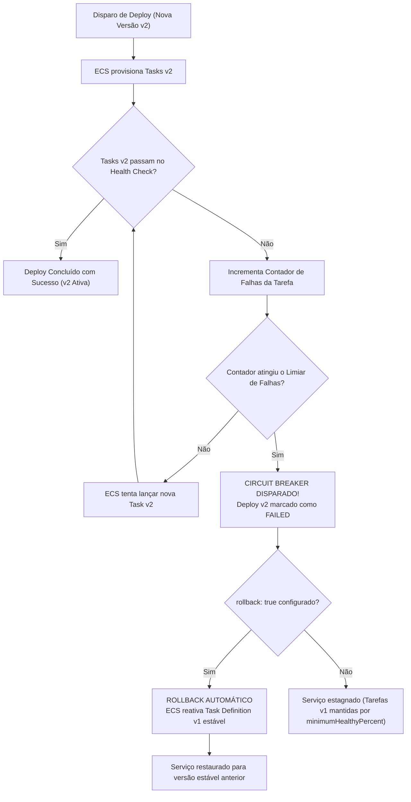

# Desafio 02 — Rollback Automatizado e Deployment Circuit Breaker

> **Projeto:** BIA Cloud Lab — D2NS<br>
> **Trilha:** Estratégias de Deploy & Resiliência<br>
> **Referência educacional:** Formação AWS — Henrylle Maia<br>
> **Implementação e adaptações:** Danilo Lima — D2NS<br>
> **Status:** 🟡 Parcialmente Implementado (Rollback Manual em Código; Circuit Breaker Modelado e Pendente de Teste em Nuvem)<br>
> **Adaptações D2NS:** Implementação de rotina de reversão manual com validação de tags no ECR e template sanitizado de ECS Deployment Circuit Breaker com rollback automático e simulação de falha induzida.

---

## 🎯 Objetivo Arquitetural

Garantir alta disponibilidade e recuperação rápida da aplicação BIA no Amazon ECS através de mecanismos de reversão (*rollback*) em caso de falhas de versão, integrando tanto o **Rollback Manual Controlado via CLI** quanto o **Deployment Circuit Breaker Nativo do Amazon ECS** para interromper e reverter implantações defeituosas de forma autônoma.

---

## 📊 Matriz de Maturidade e Evidências

| Dimensão | Situação | Detalhamento |
|---|:---:|---|
| **Funcionalidade em Código** | ✅ Implementada | Rotina de reversão manual totalmente codificada em [deploy-ecs.sh](../../../deploy-ecs.sh) (função `rollback`), com validação de imagem no ECR e recriação de revisão estável. Template do serviço ECS parametrizado com `deploymentCircuitBreaker: { enable: true, rollback: true }` em [templates/service-circuit-breaker.example.json](templates/service-circuit-breaker.example.json). |
| **Execução Histórica** | ✅ Documentada | Execução de comandos de rollback manual em ambiente de desenvolvimento durante as fases de integração da aplicação BIA com ALB e RDS. |
| **Testes Comprovados** | 🟡 Parcial | Reversão manual validada via terminal (`./deploy-ecs.sh rollback -t <tag>`) com serviço restabelecido na revisão anterior. |
| **Validações Pendentes** | ⚪ Planejada | **Injeção de Falha Controlada na Nuvem:** Provisionar serviço ECS com Circuit Breaker ativo, submeter o template [templates/task-def-fail.example.json](templates/task-def-fail.example.json) em ambiente AWS ativo e capturar os eventos oficiais do CloudWatch comprovando a reversão autônoma sem intervenção humana. |

---

## ⚖️ Comparativo: Rollback Manual vs. Deployment Circuit Breaker

| Critério | Rollback Manual (Script) | Deployment Circuit Breaker (ECS Nativo) |
|---|---|---|
| **Gatilho de Disparo** | Humano (operador identifica bug ou alarme de métricas). | Algoritmo nativo do ECS monitora falhas de inicialização das tarefas. |
| **Ponto de Execução** | Máquina local / Runner de CI-CD executando CLI. | Control Plane gerenciado do Amazon ECS. |
| **Tempo de Reação** | Depende do tempo de diagnóstico humano e início do comando. | Quase imediato após atingir o limiar de falhas de tasks (minutos). |
| **Requisitos** | Acesso IAM ao terminal e conhecimento da tag anterior. | Configurado no próprio serviço ECS (`deploymentConfiguration`). |
| **Resiliência a Falhas de Conexão** | Se a máquina do operador perder conexão, o rollback pode falhar. | 100% autônomo na AWS, independente da conectividade do operador. |

---

## 🧠 Como Funciona o ECS Deployment Circuit Breaker

O **Deployment Circuit Breaker** é uma funcionalidade nativa do Amazon ECS que avalia o progresso do deployment. Se as tarefas da nova versão falharem sistematicamente ao iniciar ou ao passar pelos health checks, o ECS interrompe a implantação e evita um estado de degradação prolongada.



### 1. Parâmetros de Configuração

No bloco `deploymentConfiguration` do serviço ECS:

```json
"deploymentCircuitBreaker": {
  "enable": true,
  "rollback": true
}
```

- **`enable: true`:** Habilita o monitoramento contínuo de falhas na inicialização e saúde das tarefas da nova revisão.
- **`rollback: true`:** Determina que, caso o Circuit Breaker seja disparado, o ECS deve iniciar a reversão imediata para a última implantação que obteve o status `COMPLETED`. Se definido como `false`, o ECS apenas interrompe novas tentativas, mas não reverte automaticamente para a versão anterior.

### 2. Algoritmo de Avaliação e Limiares de Falha

O ECS calcula o limiar de falhas necessárias para acionar o Circuit Breaker segundo as regras do plano de controle:
- **Limite Mínimo:** 3 falhas de tarefas.
- **Limite Máximo:** 200 falhas de tarefas.
- **Fórmula de Cálculo:** $\min(200, \max(3, \lceil \text{desiredCount} \times 0.5 \rceil))$.

Para o serviço BIA com `desiredCount = 2`:
- $2 \times 0.5 = 1 \implies \max(3, 1) = 3$.
- Portanto, se **3 tarefas** da nova versão falharem consecutivamente na inicialização ou no health check, o Circuit Breaker é acionado imediatamente.

### 3. O que Dispara uma Falha de Tarefa?

1. **Falha de Inicialização do Contêiner:** O container principal encerra com código de saída diferente de zero (`exit 1`, segmentation fault, erro de sintaxe ou exceção não tratada no boot).
2. **Falha de Download de Imagem:** Tag inexistente no ECR (`CannotPullContainerError`) ou erro de permissão IAM no execution role.
3. **Falha Contínua de Health Check:** O container sobe, mas falha consecutivamente nas sondas de integridade do container (`CMD-SHELL curl ...`) ou do Application Load Balancer (`HTTP 500` / timeout).

---

## 🛠️ Modos de Operação

### Modo 1: Rollback Manual via Script (`deploy-ecs.sh`)

O script [deploy-ecs.sh](../../../deploy-ecs.sh) implementa a função `rollback` para situações onde a versão nova subiu com sucesso na infraestrutura, mas apresenta um bug funcional de negócio (ex: erro de cálculo ou layout corrompido que não derruba o container):

```bash
# 1. Listar versões disponíveis no Amazon ECR ordenadas por data
./deploy-ecs.sh list-versions -r us-east-1 -e bia

# 2. Executar o rollback para uma tag ou commit hash anterior específico
./deploy-ecs.sh rollback -r us-east-1 -c cluster-bia -s service-bia -f task-def-bia -t a1b2c3d
```

**Mecânica interna do script:**
1. Valida se a imagem com a tag solicitada existe no repositório ECR via `aws ecr describe-images`.
2. Clona a Task Definition atual e atualiza a referência da imagem com a tag de rollback.
3. Registra uma nova revisão na família da Task Definition (`task-def-bia:<nova_revisao>`).
4. Invoca `aws ecs update-service` apontando para a nova revisão.
5. Executa `aws ecs wait services-stable` até a convergência do cluster.

---

### Modo 2: Simulação Controlada do Deployment Circuit Breaker

Para simular e homologar a proteção autônoma do ECS contra falhas catastróficas de release:

#### 1. Configurar o Serviço com Circuit Breaker e Rollback Ativos

Utilizar o template parametrizado [templates/service-circuit-breaker.example.json](templates/service-circuit-breaker.example.json):

```bash
aws ecs update-service \
  --cluster cluster-bia \
  --service service-bia \
  --deployment-configuration "deploymentCircuitBreaker={enable=true,rollback=true},maximumPercent=200,minimumHealthyPercent=100"
```

#### 2. Submeter Task Definition com Falha Induzida

Utilizar o template de falha [templates/task-def-fail.example.json](templates/task-def-fail.example.json), que força uma terminação imediata com código de saída 1:

```bash
# Registrar a task definition com falha deliberada
aws ecs register-task-definition --cli-input-json file://templates/task-def-fail.example.json

# Atualizar o serviço apontando para a revisão defeituosa
aws ecs update-service \
  --cluster cluster-bia \
  --service service-bia \
  --task-definition task-def-bia:<revisao_com_falha>
```

#### 3. Eventos Emitidos pelo ECS durante a Recuperação Autônoma

Ao acompanhar os eventos do serviço (`aws ecs describe-services --cluster cluster-bia --services service-bia --query 'services[0].events[0:5]'`), observa-se o seguinte fluxo de auto-recuperação:

```text
[1] (service service-bia) has started 2 tasks: (task-id-1) (task-id-2).
[2] (service service-bia) task (task-id-1) failed container health checks / exited with error.
[3] (service service-bia) has started 1 tasks: (task-id-3).
[4] (service service-bia) deployment circuit breaker detected that tasks are unable to start.
[5] (service service-bia) deployment circuit breaker: rollback started to task definition task-def-bia:<revisao_anterior_estavel>.
[6] (service service-bia) deployment completed: rollback completed successfully.
```

> **Resultado:** Os usuários finais nunca perdem o atendimento, pois as tarefas antigas continuam em execução graças a `minimumHealthyPercent = 100`, e o ECS desiste da versão defeituosa sem exigir intervenção humana.

---

## 📁 Templates Sanitizados

| Arquivo | Descrição |
|---|---|
| [templates/service-circuit-breaker.example.json](templates/service-circuit-breaker.example.json) | Template de configuração de serviço Amazon ECS com `deploymentCircuitBreaker` configurado com `enable: true` e `rollback: true`. |
| [templates/task-def-fail.example.json](templates/task-def-fail.example.json) | Template de Task Definition contendo falha proposital no ponto de entrada e health check estrito para teste de injeção de falha do Circuit Breaker. |

---

## 🔍 Limitações Conhecidas e Próximos Passos

1. **Injeção de Falha em Nuvem Real:** O procedimento documentado acima está estruturado tecnicamente em templates e scripts, mas a evidência de log de rollback do Circuit Breaker nativo em ambiente AWS real é uma pendência operacional (ambiente desprovisionado).
2. **Integração com Alarmes CloudWatch:** Em cenários onde a aplicação não crasha na subida, mas eleva a taxa de erros HTTP 5XX ou latência após 5 minutos de tráfego, o Circuit Breaker simples não dispara. Para esses casos, a solução recomendada é a integração com **CloudWatch Alarms** no deployment do ECS ou estratégia de [Blue/Green Deployment](../03-blue-green/README.md).
