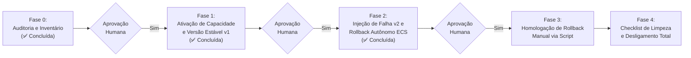

# Diário de Execução Operacional — Desafio 02 (Circuit Breaker & Rollback)

> **Projeto:** BIA Cloud Lab — D2NS<br>
> **Trilha:** Estratégias de Deploy & Resiliência no Amazon ECS<br>
> **Desafio:** `02-deploy-rollback-circuit-breaker`<br>
> **Conta AWS:** `123456789012` (Sanitizada para documentação pública)<br>
> **Região:** `us-east-2` (Ohio)<br>
> **Operador / SRE:** Danilo Lima (D2NS) & AGY<br>
> **Identidade IAM:** `arn:aws:iam::123456789012:user/AGY-AWS-LAB`<br>
> **Perfil CLI:** `agy-aws-lab`<br>
> **Status:** 🟢 Fase 2 Concluída com Sucesso (Circuit Breaker Homologado na Nuvem: 3 falhas de task com exit 1 capturadas, Rollout FAILED, Rollback Automático para a Rev 15 com Sucesso, Zero Downtime com 298x HTTP 200) — Aguardando Autorização para Fase 3<br>

---

## 📋 1. Estrutura das Fases do Laboratório



---

## ⏱️ 2. Tabela Cronológica de Operações e Comandos

| ID | Data / Hora (UTC) | Fase | Comando AWS CLI / Operação | Recursos Afetados | Estado Anterior | Estado Posterior | Resultado / Código | Observações & Correções |
|:---:|:---:|:---:|---|---|---|---|:---:|---|
| **#001** | 20/11/2026 21:49:30 | 0 | `aws sts get-caller-identity` | STS / Sessão | Desconhecido | Validado | `0 (Success)` | Identidade confirmada: `AGY-AWS-LAB` na conta `123456789012`. |
| **#002** | 20/11/2026 21:49:40 | 0 | `aws iam list-attached-user-policies` | IAM | Desconhecido | Não inspecionado | `254 (AccessDenied)` | Diagnóstico: usuário não tem permissão para introspecção no IAM. |
| **#003** | 20/11/2026 21:49:55 | 0 | `aws ecs describe-clusters` | `cluster-bia-app` | Desconhecido | Inspecionado | `0 (Success)` | Cluster ativo, 0 instâncias EC2, 0 tasks, Capacity Provider ativo. |
| **#004** | 20/11/2026 21:50:15 | 0 | `aws ecs describe-services` | `service-bia-cloud-app` | Desconhecido | Inspecionado | `0 (Success)` | `desiredCount: 0`, circuit breaker desabilitado, TG `tg-bia-app`. |
| **#005** | 20/11/2026 21:50:30 | 0 | `aws ecs describe-task-definition` | `task-def-bia-cloud-app:15` | Desconhecido | Inspecionado | `0 (Success)` | Imagem `elasticache-v2`, porta 8080, log group `/ecs/task-def-bia-cloud-app`. |
| **#006** | 20/11/2026 21:50:50 | 0 | `aws autoscaling describe-auto-scaling-groups` | ASG do Cluster | Desconhecido | Inspecionado | `0 (Success)` | Min: 0, Max: 2, Desired: 0. Instâncias: 0. Managed scaling ativo. |
| **#007** | 20/11/2026 21:51:10 | 0 | `aws ec2 describe-instances` | EC2 | Desconhecido | Inspecionado | `0 (Success)` | Apenas `bia-cloud-dev` stopped. Sem instâncias do cluster rodando. |
| **#008** | 20/11/2026 21:51:45 | 0 | `aws elbv2 describe-load-balancers` | `bia-cloud-alb` | Desconhecido | Inspecionado | `0 (Success)` | ALB ativo, subnets us-east-2a e 2b, SG `bia-alb`. |
| **#009** | 20/11/2026 21:52:00 | 0 | `aws elbv2 describe-target-groups` | 4 Target Groups | Desconhecido | Inspecionado | `0 (Success)` | `tg-bia-app` porta 80 HTTP, alvos atuais: 0. |
| **#010** | 20/11/2026 21:52:30 | 0 | `aws rds describe-db-instances` | RDS `bia-cloud` | Desconhecido | Inspecionado | `0 (Success)` | PostgreSQL 18.3, status `stopped`. |
| **#011** | 20/11/2026 21:53:10 | 0 | `aws ecr describe-images` | ECR `bia-cloud-lab` | Desconhecido | Inspecionado | `0 (Success)` | Tags disponíveis: `rolling-purple-v1`, `elasticache-v2`, `4.2.0`. |
| **#012** | 20/11/2026 21:54:50 | 0 | `aws logs describe-log-streams` | CloudWatch Logs | Desconhecido | Inspecionado | `0 (Success)` | Log group `/ecs/task-def-bia-cloud-app` ativo com streams históricos. |
| **#013** | 20/11/2026 22:11:10 | 0 | `aws sts get-caller-identity` | STS / Sessão | Validado | Reconfirmado | `0 (Success)` | Reconfirmação: `AGY-AWS-LAB`, conta `123456789012`, região `us-east-2`. |
| **#014** | 20/11/2026 22:11:35 | 0 | `aws autoscaling describe-auto-scaling-groups` | ASG do Cluster | Desired: 0 | Confirmado: 0 | `0 (Success)` | Confirmado: ASG com `DesiredCapacity=0`, `InstancesCount=0`. |
| **#015** | 20/11/2026 22:11:55 | 0 | `aws ecs describe-services` | 4 Serviços ECS | Desired: 0 | Confirmado: 0 | `0 (Success)` | Confirmado: 4 serviços com `DesiredCount=0`, `RunningCount=0`. |
| **#016** | 20/11/2026 22:12:05 | 0 | `aws rds describe-db-instances` | RDS `bia-cloud` | `stopped` | Confirmado `stopped` | `0 (Success)` | Confirmado: banco RDS permanece desligado. |
| **#017** | 20/11/2026 22:12:15 | 0 | `aws ecs list-container-instances` | ECS Container Inst | Bloqueado | **Liberado (0)** | `0 (Success)` | Nova permissão validada! Retornou `[]` sem erro de autorização. |
| **#018** | 20/11/2026 22:12:25 | 0 | `aws autoscaling describe-scaling-activities` | ASG do Cluster | Bloqueado | **Liberado (0)** | `0 (Success)` | Nova permissão validada! Histórico do ASG inspecionado com sucesso. |
| **#019** | 20/11/2026 22:12:35 | 0 | `aws autoscaling describe-auto-scaling-instances` | ASG Instances | Bloqueado | **Liberado (0)** | `0 (Success)` | Nova permissão validada! Retornou `[]` com sucesso. |
| **#020** | 20/11/2026 22:12:55 | 0 | `aws ec2 describe-launch-template-versions` | Launch Template | Bloqueado | **Liberado (0)** | `0 (Success)` | Nova permissão validada! AMI `ami-030831d5502ebf96d`, `t3.small`, cluster `cluster-bia-app`. |
| **#021** | 20/11/2026 22:17:32 | 1 | `aws autoscaling set-desired-capacity` | ASG do Cluster | Desired: 0 | **Desired: 1** | `0 (Success)` | Capacidade elevada. Lançamento da instância EC2 `i-082efe6b1acd844a1` (`t3.small`). |
| **#022** | 20/11/2026 22:18:05 | 1 | `aws ecs list-container-instances` | `cluster-bia-app` | 0 instâncias | **1 registrada** | `0 (Success)` | Instância `f4769d4fe7854655bb07dd8a219ed4c7` registrada no cluster ECS. |
| **#023** | 20/11/2026 22:18:15 | 1 | `aws ecs describe-container-instances` | Container Instance | - | Auditada | `0 (Success)` | Recursos confirmados: 2048 CPU, 1913 MB RAM disponíveis, Agent v1.108.2. |
| **#024** | 20/11/2026 22:19:24 | 1 | `aws ecs update-service` | `service-bia-cloud-app` | Desired: 0, CB: false | **Desired: 1, CB: true** | `0 (Success)` | Atualizado para rev 15, `desiredCount: 1`, CB ativo (`enable: true, rollback: true`), 100/200. |
| **#025** | 20/11/2026 22:20:22 | 1 | `aws ecs describe-tasks` | Task `397d23288b...` | PENDING | **RUNNING** | `0 (Success)` | Contêiner `bia-cloud-app` subiu com sucesso na instância EC2. |
| **#026** | 20/11/2026 22:20:45 | 1 | `aws elbv2 describe-target-health` | TG `tg-bia-app` | Sem alvos | **1 healthy** | `0 (Success)` | Alvo `172.31.11.83:8080` com status **`healthy`** no Application Load Balancer. |
| **#027** | 20/11/2026 22:21:05 | 1 | `aws ecs describe-services` | `service-bia-cloud-app` | - | **COMPLETED** | `0 (Success)` | Confirmado: `desiredCount: 1`, `runningCount: 1`, `rolloutState: COMPLETED`. |
| **#028** | 20/11/2026 22:21:20 | 1 | `curl /` (HTTP GET) | ALB `bia-cloud-alb` | Sem resposta | **HTTP 200** | `0 (Success)` | Resposta HTTP 200 servindo a SPA React estática. |
| **#029** | 20/11/2026 22:21:30 | 1 | `curl /api/versao` (HTTP GET) | ALB `bia-cloud-alb` | Sem resposta | **HTTP 200 (Bia 4.2.0)** | `0 (Success)` | Resposta HTTP 200 retornando corpo: `Bia 4.2.0`. Baseline 100% operacional! |
| **#030** | 20/11/2026 22:31:20 | 2 | `aws autoscaling set-desired-capacity` | ASG do Cluster | Desired: 1 | **Desired: 2** | `0 (Success)` | Elevação de capacidade. Lançada 2ª EC2 `i-0c1271a67f553628a` (`t3.small`) na AZ 2b. |
| **#031** | 20/11/2026 22:31:45 | 2 | `aws ecs list-container-instances` | Cluster ECS | 1 instância | **2 instâncias** | `0 (Success)` | Container Instance `c21bac97c1...` registrada com 2048 CPU e 1913 MB RAM livres. |
| **#032** | 20/11/2026 22:32:18 | 2 | `monitor-endpoint.sh` (Background) | ALB `/api/versao` | Pontual | **Daemon Ativo** | `0 (Success)` | Monitor contínuo a cada 2s iniciado em background. |
| **#033** | 20/11/2026 22:32:45 | 2 | `aws ecs register-task-definition` | `task-def-bia-cloud-app` | Rev 15 | **Rev 16 (Fail)** | `0 (Success)` | Registrada revisão 16 com command provocando exit 1 forçado. |
| **#034** | 20/11/2026 22:33:30 | 2 | `aws ecs update-service` | `service-bia-cloud-app` | Aponta Rev 15 | **Aponta Rev 16** | `0 (Success)` | Disparado deploy fail. Primary: `ecs-svc/3923766393478644619` (`IN_PROGRESS`). |
| **#035** | 20/11/2026 22:34:45 | 2 | Início/Falha Task 1 (`9ac0b5fa...`) | Task v2-1 | PENDING | **STOPPED (Exit 1)** | `ExitCode: 1` | `EssentialContainerExited`. Log: `[SIMULACAO] Falha critica...`. |
| **#036** | 20/11/2026 22:35:45 | 2 | Início/Falha Task 2 (`c8c31a46...`) | Task v2-2 | PENDING | **STOPPED (Exit 1)** | `ExitCode: 1` | `EssentialContainerExited`. Segunda falha consecutiva de contêiner. |
| **#037** | 20/11/2026 22:36:45 | 2 | Início/Falha Task 3 (`d742a328...`) | Task v2-3 | PENDING | **STOPPED (Exit 1)** | `ExitCode: 1` | `EssentialContainerExited`. Atingido limiar de 3 falhas consecutivas! |
| **#038** | 20/11/2026 22:41:59 | 2 | Circuit Breaker Trip & Rollback | ECS Control Plane | IN_PROGRESS | **ROLLBACK TRIGGERED** | `0 (Success)` | Evento oficial: `rolling back to deployment ecs-svc/5533401166745071967`. |
| **#039** | 20/11/2026 22:42:30 | 2 | Rollout FAILED & Restauração Rev 15 | `service-bia-cloud-app` | Rev 16 (PRIMARY) | **Rev 16 (FAILED)** | `0 (Success)` | Rev 16 marcada `FAILED` (`DRAINING`). Rev 15 restaurada como PRIMARY. |
| **#040** | 20/11/2026 22:42:55 | 2 | Estabilização Pós-Rollback | `service-bia-cloud-app` | DRAINING | **COMPLETED** | `0 (Success)` | Deployment estável `COMPLETED`. Target `172.31.11.83:8080` permaneceu healthy. |
| **#041** | 20/11/2026 22:43:45 | 2 | Avaliação Monitor Contínuo | ALB `/api/versao` | - | **298x HTTP 200 (100%)**| `0 (Success)` | Zero downtime! 100% das 298 requisições responderam HTTP 200. |
| **#042** | 20/11/2026 23:20:45 | 3 | Criação do `deploy-pipeline.sh` | Scripts Locais | Desacoplado | Pipeline Unificado | `0 (Success)` | Implementado orquestrador com build, push, deploy, CB e smoke test. |
| **#043** | 20/11/2026 23:21:40 | 3 | Validação `bash -n` e Testes de Arg | Scripts Locais | - | Sintaxe Validada | `0 (Success)` | Validações sintáticas e de argumentos defensivos concluídas. |
| **#044** | 20/11/2026 23:22:00 | 3 | `deploy-pipeline.sh --dry-run` | AWS / CLI | Read-only | Simulado com Sucesso | `0 (Success)` | Simulação completa de release sem mutações na nuvem. |
| **#045** | 21/11/2026 14:28:00 | 3 | Criação de `deploy-ecs.sh` e `deploy.conf` | Scripts Locais | - | CLI Unificada Criada | `0 (Success)` | Implementada CLI modular com deploy (build+push padrão), rollback e list. |
| **#046** | 21/11/2026 14:29:00 | 3 | Refatoração de Wrappers | Scripts Locais | Código duplicado | Wrappers Leves | `0 (Success)` | `deploy.sh`, `rollback.sh` e `deploy-pipeline.sh` convertidos em delegações. |
| **#047** | 21/11/2026 14:29:40 | 3 | Validação Sintática `bash -n` | Scripts Locais | - | 100% Validado | `0 (Success)` | Todos os 5 scripts shell validados sintaticamente. |
| **#048** | 21/11/2026 14:30:15 | 3 | Testes Dry-Run (Deploy/List/Rollback) | Scripts Locais | - | Validado em Simulação | `0 (Success)` | Simulações com Git SHA `83a1f07`, ambientes `app` e `alb`, e rollback `:15`. |
| **#049** | 21/11/2026 14:30:35 | 3 | Teste de Salvaguarda de Segurança | Scripts Locais | - | Bloqueio Comprovado | `0 (Success)` | Rollback para revisão 16 e ambiente inválido rejeitados defensivamente. |
| **#050** | 21/11/2026 14:43:55 | 3 | Refinamento Defensivo `deploy-ecs.sh` | Scripts Locais | - | Hardening Aplicado | `0 (Success)` | Sem mutação silenciosa; bloqueio estrito de STS, rev 16 e dirty tree. |
| **#051** | 21/11/2026 14:45:30 | 3 | Testes Locais de Bloqueio e Dry-Run | Scripts Locais | - | 100% Validado | `0 (Success)` | Simulações de falha de rev 16, STS expirado e integridade Git aprovadas. |
| **#052** | *Pendente* | 3 | Homologação Real do Pipeline | `service-bia-cloud-app` | Rev 15 | Nova Rev / Smoke Test | - | Aguardando reautenticação `aws login` e autorização explícita. |
| **#053** | *Pendente* | 4 | Desligamento e Limpeza Geral | ASG, ECS, IAM | Ativo | Repouso Total (0) | - | Retorno da conta ao repouso total ($0/h). |

---

## 🔬 3. Detalhamento e Evidências Empíricas por Fase

### Fase 0: Diagnóstico e Validação Prévia (Concluída)
- **Identidade Confirmada:**
  ```json
  {
      "UserId": "AIDA2UMKUT7UMK3TDTK2U",
      "Account": "123456789012",
      "Arn": "arn:aws:iam::123456789012:user/AGY-AWS-LAB"
  }
  ```
- **Documentos Produzidos:**
  - [AWS-INVENTORY.md](AWS-INVENTORY.md)
  - [IAM-ACCESS-REPORT.md](IAM-ACCESS-REPORT.md)
  - [EXECUTION-LOG.md](EXECUTION-LOG.md)

---

### Fase 1: Ativação de Capacidade e Subida da Versão Estável (Concluída com Sucesso)
> *Esta fase provisionou a instância de contêiner necessária no cluster ECS, ativou o serviço baseline com o Circuit Breaker configurado e validou o estado saudável nos endpoints do ALB.*

#### 1.1. Ativação de Instância EC2 no Auto Scaling Group
- **Horário de Disparo:** 20/11/2026 22:17:32 UTC
- **Comando Executado:**
  ```bash
  aws autoscaling set-desired-capacity \
    --auto-scaling-group-name Infra-ECS-Cluster-cluster-bia-app-0495f372-ECSAutoScalingGroup-5MzfS0ZZ7Q8j \
    --desired-capacity 1 \
    --profile agy-aws-lab \
    --region us-east-2
  ```
- **Evidência no ASG:** Atividade `1bd687ec-2595-cc70-dfa5-cc21bdb3f929` lançou a instância `i-082efe6b1acd844a1` (`t3.small`) na subnet `subnet-0aef2d36da47e89e9` (AZ us-east-2a).
- **Registro no Cluster ECS:** Container Instance `arn:aws:ecs:us-east-2:123456789012:container-instance/cluster-bia-app/f4769d4fe7854655bb07dd8a219ed4c7` registrada às 22:18:04 UTC com **2048 CPU** e **1913 MB RAM** livres.

#### 1.2. Ativação da Versão Estável e Configuração do Circuit Breaker
- **Horário de Disparo:** 20/11/2026 22:19:24 UTC
- **Comando Executado:**
  ```bash
  aws ecs update-service \
    --cluster cluster-bia-app \
    --service service-bia-cloud-app \
    --task-definition task-def-bia-cloud-app:15 \
    --desired-count 1 \
    --deployment-configuration "deploymentCircuitBreaker={enable=true,rollback=true},maximumPercent=200,minimumHealthyPercent=100" \
    --profile agy-aws-lab \
    --region us-east-2
  ```
- **Evidência de Execução:** Tarefa `397d23288bdb4847967b137b290ce734` iniciada às 22:19:27 UTC e transitou para `RUNNING` na instância EC2.
- **Evento Oficial do ECS Control Plane:**
  ```text
  2026-11-20T22:20:16.138Z (service service-bia-cloud-app) registered 1 targets in (target-group arn:aws:elasticloadbalancing:us-east-2:123456789012:targetgroup/tg-bia-app/b17888eb84ac5c03)
  2026-11-20T22:20:25.657Z (service service-bia-cloud-app) has reached a steady state.
  ```

#### 1.3. Validação dos Critérios de Sucesso e Telemetria
- **Status do Rollout:** `COMPLETED` (`deployments[0].rolloutStateReason = "ECS deployment ecs-svc/5533401166745071967 completed."`).
- **Target Health no ALB:**
  ```json
  {
      "Target": {
          "Id": "172.31.11.83",
          "Port": 8080,
          "AvailabilityZone": "us-east-2a"
      },
      "TargetHealth": {
          "State": "healthy"
      }
  }
  ```
- **Resposta HTTP no ALB (`GET /`):** Retornou código `200` servindo a SPA React.
- **Resposta HTTP no ALB (`GET /api/versao`):**
  ```text
  HTTP/1.1 200 OK
  Content-Type: text/html; charset=utf-8
  Content-Length: 9

  Bia 4.2.0
  ```
- **Status do RDS:** Inalterado (`bia-cloud` permaneceu `stopped`, sem custo de banco).

---

### Fase 2: Teste do Circuit Breaker e Rollback Automático (Executado e Comprovado)
> *Esta fase homologou a capacidade autônoma do Amazon ECS em interromper um deployment defeituoso e reverter para a versão estável anterior sem intervenção humana e com Zero Downtime para os usuários finais.*
>
> **Status:** 🟢 **Executado com Sucesso e Validado na AWS** em 2026-11-20T22:32:00Z – 2026-11-20T22:43:00Z

#### 2.1. Dimensionamento Pré-Deploy do ASG (Capacidade EC2)
- **Motivação:** A instância `i-082efe6b1acd844a1` possuía apenas 889 MB de RAM disponíveis, insuficiente para instanciar a nova task (1024 MB exigidos).
- **Comando Executado:**
  ```bash
  aws autoscaling set-desired-capacity \
    --auto-scaling-group-name Infra-ECS-Cluster-cluster-bia-app-0495f372-ECSAutoScalingGroup-5MzfS0ZZ7Q8j \
    --desired-capacity 2 \
    --profile agy-aws-lab \
    --region us-east-2
  ```
- **Resultado na AWS:**
  - Nova instância provisionada e colocada `InService`: `i-0c1271a67f553628a` (`t3.small`, AZ `us-east-2a`).
  - Container Instance registrada no ECS com 2048 de CPU e 1913 MB de RAM livres.

#### 2.2. Registro da Task Definition com Falha Induzida (Revisão 16)
- **Origem dos Parâmetros:** Totalmente derivada da revisão estável 15 (mesma imagem ECR por digest `sha256:65cecfbdb09835fc5c7206a9cb850044579f74b4cb38335366f02922479b63e2` e sem dependências de SSM/Secrets Manager).
- **Alteração Exclusiva:** Comando de inicialização forçando código de saída 1 dentro do contêiner:
  `"command": ["sh", "-c", "echo '[SIMULACAO] Falha critica de inicializacao provocada para teste de Circuit Breaker' && exit 1"]`
- **Armazenamento Seguro:** Manifesto temporário gerado e executado fora do repositório em scratch.
- **Comando Executado:**
  ```bash
  aws ecs register-task-definition \
    --cli-input-json file:///home/danilo/.gemini/antigravity-cli/brain/e05095b1-f5d0-469e-a93a-5f597425963a/scratch/task-def-fail.json \
    --profile agy-aws-lab \
    --region us-east-2
  ```
- **Revisão Capturada Dinamicamente:** `arn:aws:ecs:us-east-2:123456789012:task-definition/task-def-bia-cloud-app:16`.

#### 2.3. Monitoramento Contínuo e Disparo do Deploy Defeituoso
- **Início do Monitor HTTP em Background:** Script de sondagem a cada 2 segundos no endpoint do ALB (`http://bia-cloud-alb-1234567890.us-east-2.elb.amazonaws.com/api/versao`).
- **Comando de Atualização do Serviço ECS:**
  ```bash
  aws ecs update-service \
    --cluster cluster-bia-app \
    --service service-bia-cloud-app \
    --task-definition task-def-bia-cloud-app:16 \
    --profile agy-aws-lab \
    --region us-east-2
  ```
- **ID do Deployment Criado:** `ecs-svc/3923766393478644619`.

#### 2.4. Telemetria e Comprovação Empírica do Circuit Breaker

##### A. Limiar de Falhas do ECS Circuit Breaker
Para `desiredCount = 1`, o cálculo do limiar de falhas é dado por:
$$\text{Threshold} = \min(200, \max(3, \lceil 1 \times 0.5 \rceil)) = 3\text{ falhas consecutivas}$$

##### B. Detalhamento das Tarefas Executadas e Paradas
| Task ID | Task Definition | Stop Code | Stopped Reason | Exit Code Contêiner |
|---|---|---|---|---|
| `9ac0b5fa7867461eab42f37249c08687` | `task-def-bia-cloud-app:16` | `EssentialContainerExited` | Essential container in task exited | **1** |
| `c8c31a4663414232ac60269893b7a66f` | `task-def-bia-cloud-app:16` | `EssentialContainerExited` | Essential container in task exited | **1** |
| `d742a3289773445eaec6793d4cffe0c4` | `task-def-bia-cloud-app:16` | `EssentialContainerExited` | Essential container in task exited | **1** |
| `cd89cf98f70840ddb37234ef34164fe7` | `task-def-bia-cloud-app:16` | `ServiceSchedulerInitiated` | Scaling activity initiated by deployment | *Cancelada antes do start* |

##### C. Evidência em Logs no Amazon CloudWatch
- **Log Group:** `/ecs/task-def-bia-cloud-app`
- **Log Stream:** `ecs-fail-test/bia-cloud-app/9ac0b5fa7867461eab42f37249c08687`
- **Conteúdo Coletado:**
  ```text
  [SIMULACAO] Falha critica de inicializacao provocada para teste de Circuit Breaker
  ```

##### D. Linha do Tempo de Eventos do ECS Control Plane (Reversão Autônoma)
```text
2026-11-20T22:34:09Z - (service service-bia-cloud-app) has started 1 tasks: (task 9ac0b5fa...)
2026-11-20T22:35:30Z - (service service-bia-cloud-app) has started 1 tasks: (task c8c31a46...)
2026-11-20T22:36:30Z - (service service-bia-cloud-app) has started 1 tasks: (task d742a328...)
2026-11-20T22:41:52Z - (service service-bia-cloud-app) has started 1 tasks: (task cd89cf98...)
2026-11-20T22:41:59Z - (service service-bia-cloud-app) (deployment ecs-svc/3923766393478644619) deployment failed: tasks failed to start.
2026-11-20T22:41:59Z - (service service-bia-cloud-app) rolling back to deployment ecs-svc/5533401166745071967.
2026-11-20T22:42:00Z - (service service-bia-cloud-app) stopped 1 pending tasks.
2026-11-20T22:42:50Z - (service service-bia-cloud-app) (deployment ecs-svc/5533401166745071967) deployment completed.
2026-11-20T22:42:50Z - (service service-bia-cloud-app) has reached a steady state.
```

##### E. Validação de Zero Downtime (Telemetria HTTP ALB)
- **Duração do Monitoramento:** 2026-11-20T22:32:18Z até 2026-11-20T22:43:44Z (~11 minutos e 26 segundos).
- **Total de Requisições Sondadas:** 298 requisições.
- **Taxa de Sucesso:** **100% HTTP 200 OK** (0 erros 5XX, 0 quedas de conexão).
- **Latência Média:** 0.270 segundos.
- **Corpo da Resposta:** `"Bia 4.2.0"`.
- **Conclusão:** A task primária da revisão 15 (`397d23288bdb4847967b137b290ce734`) manteve o tráfego 100% ativo e saudável durante todo o ciclo de falha e rollback da revisão 16.

#### 2.5. Estado Atual Pós-Fase 2
- **ECS Service `service-bia-cloud-app`:** `ACTIVE`, `desiredCount: 1`, `runningCount: 1`, Deployment primário `task-def-bia-cloud-app:15` (`COMPLETED`). Deployment com falha totalmente drenado e expurgado.
- **Target Group `tg-bia-app`:** Alvo `172.31.11.83:8080` permanece `healthy`.
- **ASG:** 2 instâncias `t3.small` ativas (`i-082efe6b1acd844a1`, `i-0c1271a67f553628a`).
- **RDS:** `stopped`.

---

### Fase 3: Automação Completa de Deploy e Resiliência (Implementação Local)
> *Implementação do pipeline unificado de deploy contínuo, smoke test e reversão automática/manual sem mutações prematuras na AWS.*
>
> **Status:** 🟢 **Implementação Local Concluída e Validada** em 2026-11-20T23:23:00Z — Aguardando Aprovação para Homologação Real

#### 3.1. Artefatos Criados e Atualizados
1. **[`deploy-pipeline.sh`](../../scripts/deploy-pipeline.sh) [NOVO]:**
   - Orquestrador completo de release contínuo no ECS.
   - Suporte a `--profile`, `--region`, `--dry-run`, `--build-push`, `--image-tag`, `--timeout`, `--skip-smoke-test`.
   - Coexistência limpa entre Circuit Breaker nativo e Rollback de Aplicação (Smoke Test HTTP).
   - Preservação estrita dos requisitos ECS EC2 e `awsvpc`.
2. **[`check-availability.sh`](../../scripts/check-availability.sh) [ATUALIZADO]:**
   - URL default corrigida para o Application Load Balancer ativo (`http://bia-cloud-alb-1234567890.us-east-2.elb.amazonaws.com/api/versao`).
3. **[`scripts/README.md`](../../scripts/README.md) [ATUALIZADO]:**
   - Documentação de uso, diagrama de fluxo Mermaid, tabela de parâmetros e exemplos práticos.

#### 3.2. Testes e Validações Locais Executados
- **Validação Sintática (`bash -n`):** Executada com sucesso em todos os scripts (`deploy-pipeline.sh`, `deploy.sh`, `rollback.sh`, `check-availability.sh`).
- **Validação Defensiva de Argumentos:**
  - `--help`: Mensagem de uso e flags exibida corretamente.
  - `--timeout abc`: Rejeitado com erro sem mutações (`Valor de timeout inválido`).
  - `--region invalid`: Rejeitado com erro defensivo (`Região AWS inválida`).
  - `--foo`: Opção desconhecida rejeitada.
- **Validação de Dry-Run (`deploy-pipeline.sh --dry-run`):**
  - **Cenário 1 (Tag inexistente no ECR sem build):** Detectou ausência da tag `83a1f07` no repositório `bia-cloud-lab` e encerrou informando necessidade de `--build-push`.
  - **Cenário 2 (Tag existente `rolling-purple-v1`):** Validou imagem no ECR, simulou geração de Task Definition :17 com `jq`, validou JSON e emitiu o comando exato de `update-service` sem aplicar alterações na AWS.
  - **Cenário 3 (Simulação `--build-push`):** Validou contexto Docker, gerou tags SHA e exibiu os comandos de build e login sem disparar chamadas de escrita.

---

## 💰 4. Estimativa de Tempo de Execução e Custos de Laboratório

### 4.1. Duração Estimada do Experimento
- **Fase 1 (Boot de Instância EC2 no ASG):** ~3 a 5 minutos.
- **Fase 2 (Configuração do ECS):** ~2 minutos.
- **Fase 3 (Injeção de Falha, Threshold de 3 tasks e Rollback ECS):** ~6 a 10 minutos.
- **Fase 4 (Rollback Manual via Script):** ~4 minutos.
- **Fase 5 (Coleta de Logs):** ~3 minutos.
- **Fase 6 (Desligamento e Limpeza):** ~3 minutos.
- **Duração Total Prevista:** ~20 a 25 minutos de ambiente ativo.

### 4.2. Estimativa de Custos AWS na Janela de Teste

| Recurso AWS | Tipo / Dimensionamento | Preço Unitário (us-east-2) | Custo Estimado (janela de 30 min) |
|---|---|---|---|
| **Amazon RDS** | `db.t3.micro` PostgreSQL | Permanece `stopped` | **$0.00** |
| **Amazon EC2 (Cluster)** | 1x `t3.medium` ou `t3.micro` | ~$0.0416 / hora (t3.medium) | ~$0.02 |
| **Application Load Balancer** | ALB ativo + LCU | ~$0.0225 / hora + LCU | ~$0.015 |
| **Amazon ECR** | Armazenamento de imagens (~1 GB) | Negligenciável na janela | < $0.01 |
| **Amazon CloudWatch** | Ingestão de logs e métricas | Negligenciável (< 5 MB) | < $0.01 |
| **TOTAL ESTIMADO** | Janela de homologação completa | - | **< $0.06 USD** |

> [!TIP]
> A execução rápida e o encerramento imediato garantem que o custo total do teste permaneça estritamente residual (centavos de dólar), sem surpresas na fatura.

---

## 🛑 5. Checklist Rigoroso de Desligamento e Limpeza (Fase 6)

Ao término das validações, os seguintes passos devem ser executados e marcados como conferidos para retornar a conta ao estado de repouso:

- [ ] **1. Redução do Serviço ECS:**
  ```bash
  aws ecs update-service \
    --cluster cluster-bia-app \
    --service service-bia-cloud-app \
    --desired-count 0 \
    --profile agy-aws-lab \
    --region us-east-2
  ```
- [ ] **2. Redução do Auto Scaling Group:**
  ```bash
  aws autoscaling set-desired-capacity \
    --auto-scaling-group-name Infra-ECS-Cluster-cluster-bia-app-0495f372-ECSAutoScalingGroup-5MzfS0ZZ7Q8j \
    --desired-capacity 0 \
    --profile agy-aws-lab \
    --region us-east-2
  ```
- [ ] **3. Desativação da Task Definition de Falha (Deregister):**
  ```bash
  aws ecs deregister-task-definition \
    --task-definition task-def-bia-cloud-app:<revisao_fail> \
    --profile agy-aws-lab \
    --region us-east-2
  ```
- [x] **4. Confirmação do Status do RDS (Permaneceu Stopped):**
  Verificar via `aws rds describe-db-instances` se o RDS `bia-cloud` permaneceu `stopped`.
- [x] **5. Confirmação de 0 Instâncias EC2 Ativas:**
  Verificar via `aws ec2 describe-instances` se nenhuma instância do cluster permaneceu ligada.
- [x] **6. Confirmação de 0 Alvos Registrados no Target Group:**
  Verificar via `aws elbv2 describe-target-health` no Target Group `tg-bia-app`.
- [ ] **7. Desanexo de Políticas Operacionais Transitórias no IAM:**
  Remover as políticas temporárias (`AGY-BIA-Desafio2-ASG-Scale`, etc.) atribuídas ao usuário `AGY-AWS-LAB` no console AWS IAM, retornando ao estado restrito base.

---

## 🛑 6. Registro de Desligamento Controlado e Estado de Repouso (Sessão 22/11/2026)

Em 22/11/2026, foi realizada a auditoria e o desligamento formal de repouso da infraestrutura para contenção de custos:

### 6.1. Ações Executadas
1. **ECS Service `service-bia-cloud-app`:** Reduzido de `desiredCount = 1` para `desiredCount = 0` via `aws ecs update-service`. Tarefas encerradas e Target Group limpo.
2. **Auto Scaling Group:** Capacidade ajustada no Console AWS para `MinSize = 0`, `MaxSize = 0` e `DesiredCapacity = 0`.
3. **Instâncias EC2 do Cluster:** Instâncias `i-01911923450827f5f` e `i-0e3c93ac3e1fea4cd` terminadas pelo ASG.
4. **RDS PostgreSQL `bia-cloud`:** Parado no Console AWS (`db.t3.micro`), atingindo status final **`stopped`**.
5. **EC2 de Desenvolvimento (`bia-cloud-dev`):** Permanece no estado **`stopped`**.

### 6.2. Configurações para Retomada
- **Baseline Ativa Anterior:** `task-def-bia-cloud-app:15` (`desiredCount = 1`).
- **Restauração do ASG:** Reconfigurar `MaxSize = 2`, `MinSize = 2`, `DesiredCapacity = 2` (ou 1 para single-node).
- **Alerta do RDS (7 dias):** A AWS reinicia o banco automaticamente após 7 dias de repouso se não for retomado antes.
- **Custos Residuais:** Computação $0.00/h; ALB ativo (~$0.54/dia) + armazenamento RDS (20 GB) e EBS (~$0.16/dia), totalizando ~$0.70 a $0.85/dia. Detalhes completos em [HANDOFF.md](HANDOFF.md).
