# Guia Didático e Operacional — Automação de Deploy, Rollback e Governança no Amazon ECS

> **Projeto:** BIA Cloud Lab — D2NS<br>
> **Trilha:** `04-deploy-strategies` | **Desafio:** `02-deploy-rollback-circuit-breaker`<br>
> **Referência de Ensino:** Formação AWS (Instrutor: Henrylle Maia)<br>
> **Implementação e Adaptações de SRE:** Danilo Lima — D2NS<br>
> **Perfil AWS:** `agy-aws-lab` | **Região:** `us-east-2` (Ohio) | **Conta:** `${AWS_ACCOUNT_ID}` (Configurada via `.env`)<br>
> **Status:** ✅ Automação Local Implementada, Sanitizada e Validada via Testes Sintáticos e Dry-Run

---

## 🎯 1. Objetivo do Exercício

O objetivo deste laboratório é construir e homologar com rigor de Engenharia de Confiabilidade (SRE) uma **CLI unificada de release e resiliência no Amazon ECS**, assegurando que:

1. **Entregas Contínuas Confiáveis:** Todo deploy derive de um identificador rastreável no Git (`short commit hash`), compile a imagem Docker localmente e publique no Amazon ECR antes de atualizar o ECS.
2. **Disponibilidade Planejada sem Interrupção:** Atualizações utilizem o padrão *Rolling Update* com capacidade controlada (`minimumHealthyPercent = 100`, `maximumPercent = 200`), mantendo o tráfego no Application Load Balancer ininterrupto sob capacidade de computação adequada no cluster.
3. **Resiliência em Duas Camadas:**
   - **Camada de Infraestrutura:** *ECS Deployment Circuit Breaker* nativo monitorando falhas consecutivas de contêiner e revertendo de forma autônoma sem intervenção humana.
   - **Camada de Aplicação:** *Smoke Test HTTP* automatizado no endpoint oficial do ALB (`GET /api/versao`), acionando reversão caso contêineres subam com falhas lógicas de negócio.
4. **Governança e Reversão Rápida:** Capacidade de listar o histórico de revisões reais da Task Definition no ECS (com data de criação e status) e realizar rollback direto para uma versão homologada anterior, sem necessidade de recompilar contêineres ou registrar novas definições.

---

## 📋 2. Requisitos Originais vs. Adaptações para o Lab Real

### 2.1. Requisitos Originais da Formação AWS
1. Script de deploy no ECS baseado no short commit hash do Git HEAD.
2. Suporte às operações de deploy e rollback.
3. Listagem das versões existentes das Task Definitions.
4. Possibilidade de selecionar uma revisão específica para rollback.
5. Suporte a dois ambientes: `cluster-bia` / `service-bia` e `cluster-bia-alb` / `service-bia-alb`.
6. Ambiente padrão configurável.
7. O comando de deploy deve obrigatoriamente fazer o Docker Build e o Push para o ECR.

### 2.2. Adaptações e Topologia do Laboratório AWS
No laboratório prático da formação, os recursos reais foram provisionados com convenções próprias que foram mapeadas de forma defensiva:

| Recurso Didático (Teórico) | Recurso Real no Lab (`us-east-2`) | Finalidade Operacional |
|---|---|---|
| **Ambiente 1:** `cluster-bia` / `service-bia` | `cluster-bia-app` / `service-bia-cloud-app` | Ambiente principal integrado ao Target Group `tg-bia-app` no ALB. Task Family: `task-def-bia-cloud-app`. |
| **Ambiente 2:** `cluster-bia-alb` / `service-bia-alb` | `cluster-bia-app` / `service-bia-cloud-alb` | Segundo serviço residente no mesmo cluster ECS. Task Family: `task-def-bia-cloud-alb`. |
| **Região:** `us-east-1` (geralmente usada em aulas) | **`us-east-2` (Ohio)** | Toda a VPC, ALB, ASG e ECR da BIA foram provisionados em Ohio. |
| **Autenticação:** Credencial estática (`AKIA...`) | **Sessão STS Efêmera (`agy-aws-lab`)** | Autenticação temporária com MFA via `aws login`, sem chaves permanentes em disco. |

### 2.3. Preservação de Baselines Críticas
- **Revisão `:15` (`task-def-bia-cloud-app:15`):** É a **baseline estável homologada** da BIA, contendo a imagem `elasticache-v2` em execução saudável na porta 8080.
- **Revisão `:16` (`task-def-bia-cloud-app:16`):** Criada intencionalmente na Fase 2 para homologação empírica do Circuit Breaker, contendo um comando de terminação forçada (`exit 1`). **Esta revisão é preservada como evidência histórica**, mas **nunca pode ser usada como base para novos deploys nem como alvo de rollback**.

---

## 🏗️ 3. Arquitetura da Solução e Estrutura de Arquivos

Para eliminar duplicações de código e fornecer uma interface coesa, a automação foi estruturada sob uma CLI centralizada com wrappers de compatibilidade:

```
scripts/
├── deploy-ecs.sh           <-- [ORQUESTRADOR PRINCIPAL] CLI modular com subcomandos deploy, rollback, list
├── deploy.conf             <-- [ARQUIVO DE CONFIGURAÇÃO] Define ambientes (app, alb, didatico) e defaults
├── deploy.sh               <-- [WRAPPER] Atalho transparente: executa "./deploy-ecs.sh deploy "$@""
├── rollback.sh             <-- [WRAPPER] Atalho transparente: executa "./deploy-ecs.sh rollback "$@""
├── deploy-pipeline.sh      <-- [WRAPPER] Atalho de compatibilidade para deploy com rollout completo
└── check-availability.sh   <-- [TELEMETRIA CONTÍNUA] Monitor HTTP independente de latência e HTTP codes
```

### Diagrama de Fluxo do Ciclo de Release (`deploy-ecs.sh deploy`):

```mermaid
flowchart TD
    Start["Início: ./deploy-ecs.sh deploy"] --> PreFlight["Fase 1: Validações Pré-Deploy (Pre-flight Fail-Fast)"]

    subgraph PreFlightChecks["Checagens de Integridade e Segurança na Fase 1"]
        PF1["1.1. Validar Identidade STS e Conta Autorizada<br/>*Conta autorizada obrigatória em live mode*"]
        PF2["1.2. Consultar Task Def Base Ativa no Serviço<br/>*Live mode: describe-task-definition obrigatório (Mocks PROIBIDOS)*"]
        PF3["1.3. Validar Família e Contêiner Único<br/>*Exatamente 1 contêiner alvo; bloqueio da Rev 16 e exit 1*"]
        PF4["1.4. Validar Git HEAD (Short SHA) e Dirty Tree<br/>*Heurística defensiva respeitando .dockerignore*"]
        PF5["1.5. Validar Existência do Repositório ECR (bia-cloud-lab)"]
        PF6["1.6. Validar Docker Daemon Socket e Dockerfile"]
    end

    PreFlight --> PreFlightChecks
    PreFlightChecks -- "Alguma Falha Detectada" --> AbortPre["🛑 ERRO DEFENSIVO: Aborta imediatamente (exit 1)<br/>ANTES de compilar Docker ou disparar mutações AWS"]
    PreFlightChecks -- "Todas Validadas com Sucesso" --> BuildPhase["Fase 2: Build Docker & Push no ECR"]

    subgraph BuildPush["Compilação e Publicação"]
        BP1["Docker Build local (Tag = Git SHA HEAD)"]
        BP2["Autenticação via aws ecr get-login-password"]
        BP3["Docker Push para repositório bia-cloud-lab"]
    end

    BuildPhase --> BuildPush
    BuildPush --> PrepTaskDef["Fase 3: Preparação e Registro da Nova Task Def"]

    subgraph TaskDefPrep["Clonagem com Fidelidade e Validação de Contêiner"]
        TD1["Manifesto validado na Fase 1"]
        TD2["Substitui APENAS .image do contêiner alvo"]
        TD3["Preserva placementConstraints, requiresCompatibilities, command, env, secrets, CPU, RAM"]
        TD4["Remove exclusivamente metadados de resposta da AWS (taskDefinitionArn, revision, status, etc.)"]
        TD5["aws ecs register-task-definition (Gera nova revisão)"]
    end

    PrepTaskDef --> TaskDefPrep
    TaskDefPrep --> UpdateService["Fase 4: Atualização do Serviço ECS"]

    UpdateService --> MonitorRollout{"Monitoramento Ativo do Rollout"}

    MonitorRollout -- "rolloutState == FAILED<br/>(Tarefas falharam na subida)" --> CBNative["CIRCUIT BREAKER DISPAROU!<br/>ECS reverte autonomamente para a Rev 15.<br/>Script reporta diagnóstico e encerra."]

    MonitorRollout -- "rolloutState == COMPLETED<br/>(Tarefas RUNNING saudáveis)" --> SmokeTest{"Fase 5: Smoke Test HTTP ALB<br/>(5x GET /api/versao)"}

    SmokeTest -- "100% HTTP 200 OK" --> Success["🟢 DEPLOY HOMOLOGADO!"]
    SmokeTest -- "Falha / HTTP 5XX / Timeout<br/>(Bug Lógico de Negócio)" --> AppRollback["Rollback de Aplicação Automático:<br/>Script comuta serviço de volta para a Rev 15 estável.<br/>Aguardar estabilização e encerra."]
```



---

## ⚙️ 4. Mecânica Interna e Funcionamento Detalhado

### 4.1. Como Funciona o Git Short Commit Hash e a Checagem de Dirty Tree
Para manter rastreabilidade entre o código-fonte e o artefato publicado:
1. O script localiza dinamicamente a raiz do repositório Git através da função `resolve_git_info`, exportando `GIT_DISCOVERY_ACROSS_FILESYSTEM=1` para operar corretamente através de limites de montagem de sistemas de arquivos.
2. Executa: `git -C "$found_root" rev-parse --short=7 HEAD`.
3. O hash resultante (ex: `83a1f07`) é utilizado como a tag da imagem Docker e metadado do release.
4. **Validação Heurística do Contexto de Build com `.dockerignore`:**
   - O script executa `git status --porcelain` no repositório como uma **heurística defensiva de segurança operacional**.
   - Arquivos pertencentes a diretórios externos ao contêiner (`DESAFIOS/`, `.agents/`, `docs/`, `n8n-lab/`, `backups/`) são ignorados na checagem da aplicação.
   - Padrões comuns mapeados no `.dockerignore` (`README.md`, `.env*`, `client/build/`, `.vscode/`, `.git*`, `test*`, etc.) são filtrados via regex/grep na working tree, evitando falsos positivos que bloqueariam deploys legítimos por documentação ou notas de laboratório.
   - *Nota de Transparência de Engenharia:* Esta checagem é uma validação prévia de boas práticas em shell script e **não visa reproduzir a totalidade das regras semânticas do parser oficial Docker/Moby/BuildKit**. Caso alterações em arquivos de aplicação (`server.js`, `api/`, `client/src/`) sejam detectadas, o deploy é **bloqueado com código 1**, evitando imagens divergentes do Git HEAD.
   - **Exceção de Tag Manual (`-t`):** Caso o operador passe `-t <TAG>`, o script emite aviso explícito de rastreabilidade e permite prosseguir, documentando a dissociação com o Git HEAD.
   - **Flag `--allow-dirty`:** Permite prosseguir intencionalmente com alterações locais mediante aviso em log.

### 4.2. Como o Docker Build e Push para o ECR São Executados
1. O contexto de build é estabelecido na raiz do repositório (`/home/danilo/formacaoaws/bia-cloud-lab`).
2. O script executa a compilação local gerando as tags correspondentes:
   `docker build -t bia-cloud-lab:83a1f07 -t ${AWS_ACCOUNT_ID}.dkr.ecr.us-east-2.amazonaws.com/bia-cloud-lab:83a1f07 -f ./Dockerfile .`
3. A autenticação temporária é efetuada no registry privado da AWS:
   `aws ecr get-login-password --profile agy-aws-lab --region us-east-2 | docker login --username AWS --password-stdin ${AWS_ACCOUNT_ID}.dkr.ecr.us-east-2.amazonaws.com`
4. A imagem é enviada para o ECR:
   `docker push ${AWS_ACCOUNT_ID}.dkr.ecr.us-east-2.amazonaws.com/bia-cloud-lab:83a1f07`
5. **Modo Opcional (`--skip-build`):** Caso o operador queira validar o deploy reaproveitando uma imagem já existente no ECR sem recompilar, basta passar a flag `--skip-build -t <TAG_EXISTENTE>`.

### 4.3. Como uma Nova Revisão da Task Definition É Preparada e Registrada (Fail-Fast na Fase 1)
Para assegurar integridade sintática e operacional absoluta:
1. **Validação Rígida da Conta AWS:** Em modo de execução real (`DRY_RUN=false`), o script valida via `aws sts get-caller-identity` que o `Account` retornado corresponde exatamente à conta autorizada configurada (`AUTHORIZED_ACCOUNT`). Se for divergente ou falhar, aborta imediatamente.
2. **Consulta Mandatória e Proibição Total de Mocks:**
   - O script descobre a Task Definition ativa via `aws ecs describe-services`.
   - **Em Live Mode (`DRY_RUN=false`), a consulta completa via `aws ecs describe-task-definition` é estritamente obrigatória para qualquer revisão base (incluindo a `:15`).**
   - É **terminantemente proibido** utilizar manifestos simulados (mock/fallback) quando `DRY_RUN=false`. Se a consulta à API falhar, retornar JSON vazio ou for interrompida, o script emite erro crítico e **aborta imediatamente com código 1 antes de qualquer compilação Docker ou push no ECR**.
   - Em modo `--dry-run`, manifestos simulados são permitidos exclusivamente em ambiente offline e são rotulados com aviso explícito. Em dry-run autenticado, utiliza o manifesto real inspecionado via API read-only.
3. **Bloqueio Rígido de Poison Pills:** Se a revisão base apontar para a `:16` ou contiver `exit 1` em seu bloco `command`, o script aborta imediatamente com erro, sem tentar modificar o arquivo silenciosamente.
4. **Validação de Família e Contêiner Único na Fase 1:** O script verifica antes do build:
   - A família da Task Definition base deve corresponder à família esperada do ambiente (ex: `task-def-bia-cloud-app`).
   - O contêiner configurado (`--container-name`) deve existir exatamente UMA vez na definição:
     - Se 0 contêineres forem encontrados: aborta com erro `CONTÊINER NÃO ENCONTRADO` e lista os nomes disponíveis.
     - Se mais de 1 contêiner for encontrado: aborta com erro `AMBIGUIDADE DE CONTÊINER`.
5. **Transformação Estrita com `jq` e Preservação de Atributos:**
   - Atualiza **exclusivamente** o campo `.image` do contêiner validado.
   - Preserva `placementConstraints`, `requiresCompatibilities`, CPU, memória, modo `awsvpc`, compatibilidade `EC2`, variáveis de ambiente, segredos SSM (`valueFrom`) e roles IAM.
   - Remove exclusivamente os campos de resposta da AWS que não podem ser enviados no registro:
     `del(.taskDefinitionArn, .revision, .status, .requiresAttributes, .compatibilities, .registeredAt, .registeredBy, .deregisteredAt)`
6. Invoca a API de registro:
   `aws ecs register-task-definition --cli-input-json file://novo-manifesto.json`
   Retornando o identificador da nova revisão criada (ex: `task-def-bia-cloud-app:17`).

### 4.4. Como Funciona a Atualização do Serviço ECS e o Rollout
1. O serviço é atualizado apontando para a nova revisão:
   `aws ecs update-service --cluster cluster-bia-app --service service-bia-cloud-app --task-definition task-def-bia-cloud-app:17`
2. O script entra em um loop de monitoramento a cada 5 segundos avaliando:
   - Se `rolloutState == "FAILED"`: O *ECS Deployment Circuit Breaker* detectou 3 falhas consecutivas de contêiner e disparou o auto-rollback para a revisão 15. O script reporta o evento e encerra com código 2.
   - Se `rolloutState == "COMPLETED"` e `runningCount >= desiredCount`: O ECS concluiu a substituição de contêineres com sucesso. O script avança para o Smoke Test.
3. **Smoke Test HTTP:** Dispara 5 requisições consecutivas no endpoint do ALB (`http://.../api/versao`). Se todas responderem `HTTP 200`, o deploy é homologado. Se houver falha, o script aciona a reversão de emergência da aplicação comutando o serviço de volta para a revisão 15 estável.

### 4.5. Como Funciona o Comando `list`
O comando `./scripts/deploy-ecs.sh list` (ou `./scripts/rollback.sh -l`):
1. **Diferenciação Estrita de Ambientes:**
   - Quando há sessão STS ativa: consulta o ECS control plane em tempo real via `describe-services` e `list-task-definitions` / `describe-task-definition`, exibindo o cabeçalho `[CONSULTA REAL - DADOS OBTIDOS DIRETAMENTE DO AMAZON ECS CONTROL PLANE]`.
   - Em modo `--dry-run` com sessão STS offline: exibe dados simulados de referência marcados explicitamente como `[DRY-RUN SIMULADO - AMBIENTE OFFLINE / MOCK DIDÁTICO]` com aviso de não confirmação na nuvem.
   - Em modo live sem autenticação STS: aborta com código 1 e orienta a autenticação via `aws login`, sem exibir mocks.
2. **Colunas Exibidas:**
   - `REVISÃO`: Número da revisão (ex: `:15`, `:16`).
   - `STATUS`: Status retornado pelo ECS (`ACTIVE` ou `INACTIVE`).
   - `DATA REGISTRO (UTC)`: Timestamp formatado de criação (`registeredAt`, ex: `2026-11-20 18:45`).
   - `IMAGEM / TAG ECR`: Imagem configurada no contêiner.
   - `SITUAÇÃO NO SERVIÇO`: Marcador `--> [ATIVA NO SERVIÇO]` para a revisão em produção e `⚠️ [FALHA INDUZIDA FASE 2]` para a revisão 16.

### 4.6. Como Selecionar e Executar Rollback
O comando `./scripts/deploy-ecs.sh rollback -r <REVISAO>`:
1. **Não executa build, push Docker nem registra nova Task Definition.**
2. Valida se a revisão informada é numérica.
3. **Bloqueio de Segurança da Revisão 16:** Rejeita incondicionalmente tentativas de rollback para a revisão `:16` ou para revisões com `exit 1`.
4. **Validação de Família:** Confirma que a Task Definition pertence à família correspondente ao ambiente (`task-def-bia-cloud-app` ou `task-def-bia-cloud-alb`). Se houver divergência, aborta com erro `FAMÍLIA INCOMPATÍVEL`.
5. **Validação de Status ACTIVE:** Confirma que a Task Definition possui status `ACTIVE`. Caso esteja inativa, aborta com erro `STATUS INVÁLIDO`.
6. Comuta o serviço diretamente para a revisão homologada:
   `aws ecs update-service --cluster cluster-bia-app --service service-bia-cloud-app --task-definition task-def-bia-cloud-app:15`
7. Aguarda estabilização com `aws ecs wait services-stable` e valida a resposta com Smoke Test pós-rollback.

### 4.7. Como Alternar entre Ambientes
A CLI suporta o parâmetro `-E, --env <NOME>`:
- `-E app` (Padrão): Cluster `cluster-bia-app`, Serviço `service-bia-cloud-app`, Família `task-def-bia-cloud-app`, Contêiner `bia-cloud-app`, Endpoint `/api/versao`.
- `-E alb`: Cluster `cluster-bia-app`, Serviço `service-bia-cloud-alb`, Família `task-def-bia-cloud-alb`, Contêiner `bia-cloud-alb`, Endpoint `/`.
- `-E didatico`: Cluster `cluster-bia`, Serviço `service-bia`, Família `task-def-bia`, Contêiner `bia`, Endpoint `/api/versao`.
O ambiente padrão é configurado pela diretiva `DEFAULT_ENV="app"` em [`scripts/deploy.conf`](../../scripts/deploy.conf).

---

## 🛠️ 5. Pré-Requisitos e Matriz de Permissões IAM

### 5.1. Ferramentas Locais Obrigatórias
- **Bash:** 4.0+ (suporte a arrays e `set -euo pipefail`).
- **AWS CLI:** 2.x configurada com perfil `agy-aws-lab`.
- **jq:** 1.6+ para transformação JSON.
- **curl:** Para telemetria HTTP.
- **Docker:** Engine local ativa.
- **Git:** Para extração do commit SHA.

### 5.2. Sessão STS Efêmera
O perfil `agy-aws-lab` requer sessão temporária ativa obtida via:
```bash
aws login --profile agy-aws-lab
```

### 5.3. Permissões IAM Necessárias para Homologação Completa

| Serviço | Ação IAM | Finalidade no Pipeline | Status no Usuário AGY-AWS-LAB |
|---|---|---|:---:|
| **ECS** | `ecs:UpdateService` | Atualizar Task Def do serviço | ✅ Concedida e comprovada |
| **ECS** | `ecs:RegisterTaskDefinition` | Registrar nova revisão de Task Def | ✅ Concedida e comprovada |
| **ECS** | `ecs:DescribeServices` / `ListTaskDefinitions` | Inspecionar estado e listar revisões | ✅ Concedida e comprovada |
| **IAM** | `iam:PassRole` | Delegar `ecsTaskExecutionRole` | ✅ Concedida e comprovada |
| **Auto Scaling** | `autoscaling:SetDesiredCapacity` | Escalar instâncias EC2 do cluster | ✅ Concedida e comprovada |
| **ECR** | `ecr:GetAuthorizationToken` | Autenticação no Docker login (`Resource: *`) | ⚠️ *Requer anexo de política temporária* |
| **ECR** | `ecr:InitiateLayerUpload`, `UploadLayerPart`, `CompleteLayerUpload`, `PutImage` | Upload da imagem Docker no repositório `bia-cloud-lab` | ⚠️ *Requer anexo de política temporária* |

---

## 🚀 6. Guia Prático de Execução

### 6.1. Simulação Prévia (Dry-Run)
Valida sintaxe, parâmetros, integridade de Git e regras de Task Def sem mutações na AWS:
```bash
# Simulação no ambiente padrão (app):
./scripts/deploy-ecs.sh deploy --dry-run

# Simulação no ambiente secundário (alb):
./scripts/deploy-ecs.sh deploy -E alb --dry-run
```

### 6.2. Listagem de Revisões
```bash
# Listar revisões do ambiente app:
./scripts/deploy-ecs.sh list

# Listar revisões do ambiente alb:
./scripts/deploy-ecs.sh list -E alb

# Usando o atalho de compatibilidade:
./scripts/rollback.sh -l
```

### 6.3. Deploy Mandatório (Build Docker + ECR Push + Release ECS)
```bash
# Executa o pipeline padrão completo:
./scripts/deploy-ecs.sh deploy

# Deploy passando tag customizada:
./scripts/deploy-ecs.sh deploy -t v4.3.0

# Deploy reaproveitando imagem existente no ECR (sem compilar):
./scripts/deploy-ecs.sh deploy --skip-build -t elasticache-v2
```

### 6.4. Rollback Controlado
```bash
# Reverter diretamente para a revisão estável 15:
./scripts/deploy-ecs.sh rollback -r 15

# Simulação de rollback:
./scripts/deploy-ecs.sh rollback -r 15 --dry-run

# Usando o atalho de compatibilidade:
./scripts/rollback.sh -r 15
```

---

## 🔒 7. Salvaguardas Implementadas e Tratamento de Erros

1. **Validação Rígida da Conta AWS (`AUTHORIZED_ACCOUNT`):** Bloqueio fail-fast caso a identidade STS retorne uma conta diferente da autorizada configurada, impedindo execuções em ambientes indevidos.
2. **Proibição Total de Mocks em Live Mode:** Em `DRY_RUN=false`, a consulta `describe-task-definition` é obrigatória; qualquer falha de rede/API aborta o pipeline com código 1 antes de qualquer build Docker ou mutação na nuvem. Mocks são restritos ao dry-run offline com identificação explícita.
3. **Fail-Fast Reordenado na Fase 1:** Toda a inspeção da Task Definition base, validação de família e contêiner único ocorre antes do Docker Build e ECR Push, evitando consumo desnecessário de tempo e banda caso haja problemas no manifesto.
4. **Validação de Status ACTIVE da Base:** O deploy é bloqueado imediatamente caso a Task Definition base esteja com status `INACTIVE` no ECS.
5. **Proteção contra Revisão 16:** Bloqueio incondicional de base de deploy ou destino de rollback apontando para a Revisão 16 (`exit 1`).
6. **Validação de Contêiner Único:** Garante que o contêiner alvo existe exatamente uma vez no manifesto antes de aplicar modificações.
7. **Preservação Integral de Atributos:** Mantém `placementConstraints`, `requiresCompatibilities`, limites de recursos, roles IAM e variáveis/segredos SSM intactos.
8. **Diagnóstico Read-Only de Circuit Breaker:** Ao detectar `rolloutState=FAILED`, o script realiza consultas read-only no ECS control plane para inspecionar os deployments, o motivo da falha (`rolloutStateReason`) e se a Task Definition `PRIMARY` foi efetivamente restaurada para a versão estável, sem declarar rollback prematuro.
9. **Não-Homologação com Capacidade Zero:** O deploy é recusado como homologado caso `desiredCount=0` ou se houver 0 tarefas ativas em execução, exigindo pelo menos 1 tarefa saudável para validação de produção.
10. **Isolamento de Ambientes no Dry-Run Offline:** O dry-run offline do ambiente `alb` exibe identificadores simulados (`:SIM-2`, `:SIM-1`), sem vazar ou reutilizar revisões fixas do ambiente `app`.
11. **Verificação Heurística de Dirty Tree:** Bloqueia deploys com hash de Git caso existam alterações locais no contexto de build da aplicação, respeitando padrões comuns do `.dockerignore`.
12. **Fail-Fast de Autenticação:** Interrompe com código 1 caso a sessão STS esteja expirada, orientando o comando de login sem tentar contornar MFA.

---

## 📊 8. Resumo dos Testes Locais e Bateria Automatizada de Segurança

### 8.1. Testes Funcionais Locais

| # | Teste Realizado | Comando Executado | Resultado Obtido |
|:---:|---|---|:---:|
| **1** | **Validação Sintática de Scripts** | `bash -n scripts/*.sh` | 🟢 100% dos scripts com sintaxe válida |
| **2** | **Deploy --dry-run (Ambiente `app`)** | `./scripts/deploy-ecs.sh deploy --skip-build -t 83a1f07 --dry-run` | 🟢 Sucesso: Git SHA `83a1f07`, base `:15`, mock explicitamente rotulado |
| **3** | **Deploy --dry-run (Ambiente `alb`)** | `./scripts/deploy-ecs.sh deploy -E alb --skip-build -t 83a1f07 --dry-run` | 🟢 Sucesso: Cluster, serviço e task family alternados para `alb`, base `:1` simulada |
| **4** | **Listagem de Revisões (--dry-run `app`)** | `./scripts/deploy-ecs.sh list --dry-run` | 🟢 Sucesso: Tabela formatada com `registeredAt`, `:15` ativa e `:16` poison pill |
| **5** | **Listagem de Revisões (--dry-run `alb`)** | `./scripts/deploy-ecs.sh list -E alb --dry-run` | 🟢 Sucesso: Tabela exibe `:SIM-2` e `:SIM-1`, sem revisões do `app` |
| **6** | **Listagem em Live Mode (Offline)** | `./scripts/deploy-ecs.sh list` | 🛑 Bloqueado com código 1 (fail-fast de STS sem fallback mock) |
| **7** | **Rollback Direto (--dry-run)** | `./scripts/deploy-ecs.sh rollback -r 15 --dry-run` | 🟢 Sucesso: Update direto sem build e sem push |
| **8** | **Bloqueio de Base Contaminada (Rev 16)** | `./scripts/deploy-ecs.sh deploy --base-revision 16 --dry-run` | 🛑 Bloqueado com sucesso (código 1) |
| **9** | **Bloqueio de Rollback Contaminado (Rev 16)**| `./scripts/deploy-ecs.sh rollback -r 16 --dry-run` | 🛑 Bloqueado com sucesso (código 1) |
| **10** | **Bloqueio por Contêiner Ausente** | `./scripts/deploy-ecs.sh deploy --container-name container-inexistente --dry-run` | 🛑 Bloqueado com sucesso: contêiner não encontrado (código 1) |
| **11** | **Bloqueio de Dirty Working Tree** | `./scripts/deploy-ecs.sh deploy --dry-run` com arquivo em `api/` | 🛑 Bloqueado com sucesso: working tree divergente do Git HEAD (código 1) |
| **12** | **Bypass de Dirty Tree com `--allow-dirty`** | `./scripts/deploy-ecs.sh deploy --allow-dirty --skip-build -t 83a1f07 --dry-run` | 🟢 Sucesso com aviso em log |
| **13** | **Tag Customizada com Aviso de Rastreabilidade** | `./scripts/deploy-ecs.sh deploy -t v4.3.0 --skip-build --dry-run` | 🟢 Sucesso com aviso explícito de desacoplamento do Git HEAD |
| **14** | **Arquivos do `.dockerignore` Ignorados** | Alteração em arquivo ignorado pelo `.dockerignore` | 🟢 Sucesso: não gera falso positivo de dirty tree |

### 8.2. Bateria de Testes Automatizados de Segurança e Integridade (`scripts/test-security-checks.sh`)

Para homologar as garantias de segurança contra regressões e provar matematicamente a ausência de mutações indevidas, foi desenvolvida e executada uma suite de 11 testes unitários isolados com mocks do AWS CLI e Docker, validando explicitamente códigos de saída, chamadas AWS e comandos Docker:

| Teste | Cenário Avaliado | Código de Saída | Mutações AWS | Docker Build/Push | Resultado |
|:---:|---|:---:|:---:|:---:|:---:|
| **ST-1** | STS retorna conta não autorizada (`999888777666`) | `1` | Zero | Zero | 🟢 **PASS** |
| **ST-2** | Falha em `describe-task-definition` em Live Mode | `1` | Zero | Zero | 🟢 **PASS** |
| **ST-3** | Deploy real targeting Revisão `:15` (fidelidade integral) | `0` | Válidas | Permitido | 🟢 **PASS** |
| **ST-4** | Contêiner alvo ausente na Task Definition | `1` | Zero | Zero | 🟢 **PASS** |
| **ST-5** | Ambiguidade de contêineres (>1 contêiner com mesmo nome) | `1` | Zero | Zero | 🟢 **PASS** |
| **ST-6** | Família de Task Definition divergente do ambiente | `1` | Zero | Zero | 🟢 **PASS** |
| **ST-7** | Task Definition base com status `INACTIVE` | `1` | Zero | Zero | 🟢 **PASS** |
| **ST-8** | Bloqueio rígido ao apontar para a Revisão `:16` defeituosa | `1` | Zero | Zero | 🟢 **PASS** |
| **ST-9** | Rollout reporta `desiredCount=0` (bloqueio de homologação) | `1` | N/A | N/A | 🟢 **PASS** |
| **ST-10**| Disparo de Circuit Breaker com confirmação read-only | `2` | Read-only | N/A | 🟢 **PASS** |
| **ST-11**| Dry-Run Offline no ALB exibe dados simulados exclusivos | `0` | Zero | Zero | 🟢 **PASS** |

---

## 🛑 9. Limitações Conhecidas e Etapas Prévias para Homologação Real

A automação está 100% pronta e testada localmente. A **homologação real na nuvem** depende dos seguintes passos prévios:

1. **Renovação de Sessão STS:** Executar `aws login --profile agy-aws-lab` com MFA.
2. **Anexo de Política ECR:** Anexar a política temporária `AGY-BIA-Desafio2-ECR-Push` no console IAM para liberar upload no repositório `bia-cloud-lab`.
3. **Ativação de Capacidade no ASG:** Elevar o Auto Scaling Group para 2 instâncias `t3.small` (`desired-capacity 2`) para acomodar a convivência de tarefas durante o Rolling Update (`maximumPercent: 200`).
4. **Ativação do Serviço Baseline:** Ativar `desiredCount = 1` no `service-bia-cloud-app` apontando para a Revisão `:15`.
5. **Execução do Pipeline:** Disparar o deploy real com Docker Build e Push, acompanhar o rollout no ECS, validar o Smoke Test e executar rollback para a Revisão `:15`.
6. **Checklist de Encerramento:** Reduzir o serviço a 0, reduzir o ASG a 0 e desanexar políticas temporárias para retornar os recursos ao estado de repouso planejado com custo nominal próximo a zero.
