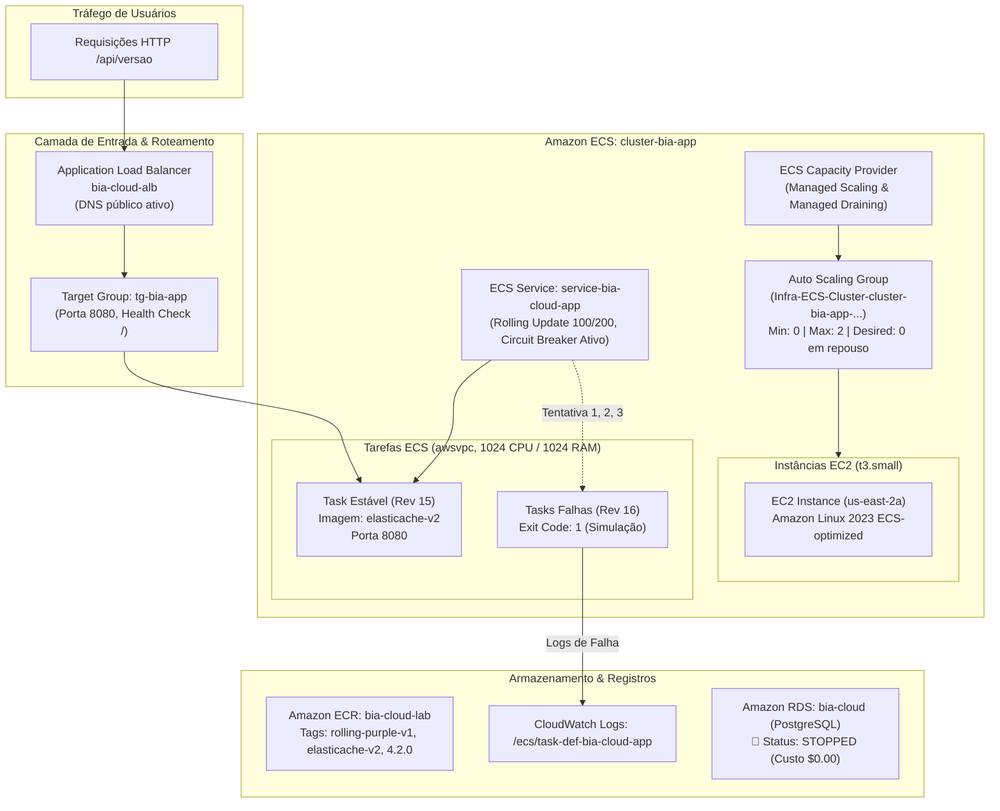

# Documento de Transição Técnica (HANDOFF) — Desafio 02

> **Projeto:** BIA Cloud Lab — D2NS / Formação AWS<br>
> **Trilha:** `04-deploy-strategies`<br>
> **Desafio Ativo:** `02-deploy-rollback-circuit-breaker`<br>
> **Data de Atualização / Fechamento:** 22/11/2026 ~01:45:00 UTC<br>
> **Conta AWS:** `123456789012` (Sanitizada para documentação pública)<br>
> **Região Operacional:** `us-east-2` (Ohio)<br>
> **Identidade IAM:** `arn:aws:iam::123456789012:user/AGY-AWS-LAB`<br>
> **Perfil AWS CLI:** `agy-aws-lab`<br>
> **Status de Autenticação:** Credenciais temporárias efêmeras STS via `aws login` com MFA<br>
> **Estado Final dos Recursos AWS:** 🛑 **Repouso Total Confirmado (0 instâncias EC2 ativas, 0 tasks, RDS stopped, ASG 0/0/0, Custo Computação $0/h)**<br>

---

## 🎯 1. Objetivo Original do Desafio 02

O Desafio 02 visa demonstrar, planejar, homologar e documentar com rigor de Engenharia de Confiabilidade (SRE) as estratégias de resiliência e auto-recuperação de serviços no Amazon ECS sob infraestrutura EC2:

1. **Modo 2 (Nativo ECS Circuit Breaker):** Configuração autônoma `deploymentCircuitBreaker: { enable: true, rollback: true }`. Homologação de injeção de falha deliberada (`task-def-fail`), monitoramento contínuo da disponibilidade no ALB (Zero Downtime), captura das falhas consecutivas de tasks pelo plano de controle do ECS e auto-reversão transparente para a versão estável anterior sem intervenção humana.
2. **Modo 1 (Operacional / Rollback via Script):** Automação de rollback controlado baseado em tags imutáveis ou histórico do Amazon ECR (`scripts/rollback.sh`), servindo como salvaguarda contra bugs lógicos de negócio onde a aplicação não crasha, mas o serviço é degradado.
3. **Automação Completa de Release (Pipeline de Deploy):** Construção e validação de script orquestrador (`deploy-pipeline.sh`) cobrindo o fluxo Git Commit SHA $\to$ Docker Build $\to$ ECR Push $\to$ ECS Task Definition $\to$ Update Service $\to$ Real-Time Rollout Monitoring $\to$ ALB Smoke Test $\to$ Automatic Rollback.

---

## 🏗️ 2. Arquitetura AWS e Topologia Utilizada



### Principais Constatações de Arquitetura:
- **Independência do Banco RDS:** A aplicação Express inicializa sem dependência síncrona com PostgreSQL. As rotas `/` (React SPA) e `/api/versao` (retorno estático `Bia 4.2.0`) não utilizam banco. O RDS permaneceu no estado `stopped` durante todo o teste, economizando custos.
- **Dimensionamento EC2:** Cada instância `t3.small` oferece 1913 MB de RAM livre. Como cada task da BIA consome 1024 MB de RAM e o deploy é configurado com `maximumPercent = 200` (exigindo 2 tasks simultâneas), são necessárias 2 instâncias no ASG durante a janela de transição para evitar filas de provisionamento (`RESOURCE:MEMORY`).
- **ECS Managed Scaling:** O Capacity Provider gerencia automaticamente a capacidade, escalando para 1 ou 0 instâncias via lifecycle hook de draining quando tarefas são encerradas.

---

## 🔬 3. Resumo Executivo das Fases Executadas

### Fase 0: Auditoria Prévia, Inventário e IAM
- Inventário técnico de toda a stack gerado em [AWS-INVENTORY.md](AWS-INVENTORY.md).
- Relatório de acessos e permissões mínimas documentado em [IAM-ACCESS-REPORT.md](IAM-ACCESS-REPORT.md).
- Reconciliação do comportamento do Express e confirmação de independência do banco PostgreSQL.
- Verificação da política temporária `AGY-BIA-Desafio2-ASG-Scale` anexada pelo usuário.

### Fase 1: Ativação de Capacidade e Subida da Baseline Saudável
- ASG elevado de 0 para 1 instância `t3.small` (`i-082efe6b1acd844a1`).
- Serviço `service-bia-cloud-app` configurado para `desiredCount = 1`, `minimumHealthyPercent = 100`, `maximumPercent = 200` e `deploymentCircuitBreaker = { enable: true, rollback: true }`.
- Target Group `tg-bia-app` atingiu status `healthy` no alvo `172.31.11.83:8080`.
- Endpoint `/api/versao` validado com HTTP 200 retornando `Bia 4.2.0`.

### Fase 2: Homologação Empírica do Circuit Breaker & Auto-Rollback (100% Comprovado)
- **Escalonamento Preventivo:** ASG elevado para 2 instâncias (`i-0c1271a67f553628a` provisionada na AZ us-east-2b) para comportar a segunda task.
- **Injeção de Falha:** Registrada a Task Definition `task-def-bia-cloud-app:16` derivada da revisão 15, com comando forçando código de saída 1 no contêiner:
  `command: ["sh", "-c", "echo '[SIMULACAO] Falha critica de inicializacao provocada para teste de Circuit Breaker' && exit 1"]`
- **Deploy Defeituoso:** Atualizado o serviço para a revisão 16 gerando o deployment `ecs-svc/3923766393478644619`.
- **Limiar do Circuit Breaker Atingido:** Para `desiredCount = 1`, o threshold é $\min(200, \max(3, \lceil 1 \times 0.5 \rceil)) = 3$ tasks consecutivas:
  - Task 1 (`9ac0b5fa...`): `EssentialContainerExited`, ExitCode `1`.
  - Task 2 (`c8c31a46...`): `EssentialContainerExited`, ExitCode `1`.
  - Task 3 (`d742a328...`): `EssentialContainerExited`, ExitCode `1`.
  - Task 4 (`cd89cf98...`): Abortada e cancelada pelo agendador do ECS (`ServiceSchedulerInitiated`).
- **Disparo do Rollback Nativo pelo ECS Control Plane:**
  - Evento: `deployment failed: tasks failed to start`.
  - Evento: `rolling back to deployment ecs-svc/5533401166745071967`.
  - Evento: `stopped 1 pending tasks`.
  - Evento: `(deployment ecs-svc/5533401166745071967) deployment completed`.
  - Evento: `has reached a steady state`.
  - A revisão 16 foi marcada como `rolloutState: FAILED` e expurgada. A revisão 15 foi restaurada com sucesso como `PRIMARY` (`COMPLETED`).
- **Comprovação de Zero Downtime (Telemetria HTTP ALB):**
  - Monitor contínuo em background sondando a cada 2 segundos durante mais de 11 minutos.
  - **298 requisições consecutivas com 100% HTTP 200 OK** (0 erros 5XX, 0 timeouts, latência média 0.27s).
- **Evidências Coletadas:** Logs gravados no CloudWatch Group `/ecs/task-def-bia-cloud-app` comprovando a mensagem de simulação capturada.

### Fase 3: Automação Completa de Deploy (Implementação Local da CLI Modular)
- Construção da CLI unificada [`deploy-ecs.sh`](../../scripts/deploy-ecs.sh) e do orquestrador de compatibilidade [`deploy-pipeline.sh`](../../scripts/deploy-pipeline.sh).
- Atualização e parametrização do endpoint no [`check-availability.sh`](../../scripts/check-availability.sh).
- Validação sintática com `bash -n`, testes defensivos de argumentos e execução completa de simulação via `--dry-run`.

---

## 📁 4. Relação de Arquivos Criados e Modificados

| Arquivo | Localização | Finalidade |
|---|---|---|
| [`deploy-ecs.sh`](../../scripts/deploy-ecs.sh) | `scripts/` | **Novo:** CLI modular unificada com deploy (build+push), rollback direto e listagem real no ECS. |
| [`deploy-pipeline.sh`](../../scripts/deploy-pipeline.sh) | `scripts/` | **Novo:** Wrapper de retrocompatibilidade para pipeline de release contínuo no ECS. |
| [`check-availability.sh`](../../scripts/check-availability.sh) | `scripts/` | **Modificado:** Monitor HTTP contínuo de latência e disponibilidade com suporte a -E. |
| [`scripts/README.md`](../../scripts/README.md) | `scripts/` | **Modificado:** Documentação completa da suite de scripts, flags, arquitetura e exemplos. |
| [`EXECUTION-LOG.md`](EXECUTION-LOG.md) | `docs/` | **Modificado:** Registro detalhado com cronologia de comandos, evidências empíricas da Fase 2 e Fase 3. |
| [`AWS-INVENTORY.md`](AWS-INVENTORY.md) | `docs/` | **Modificado:** Inventário completo atualizado com a topologia do laboratório. |
| [`IAM-ACCESS-REPORT.md`](IAM-ACCESS-REPORT.md) | `docs/` | **Criado:** Relatório de governança e menor privilégio IAM para o perfil `AGY-AWS-LAB`. |
| [`HANDOFF.md`](HANDOFF.md) | `docs/` | **Novo (este documento):** Consolidação técnica para retomada posterior. |

---

## 🛑 5. Estado Final Real dos Recursos na AWS (Repouso Total Confirmado)

Auditoria realizada via AWS CLI às 23:51:00 UTC após o encerramento autorizado:

| Recurso AWS | Identificador | Estado Final Auditado | Custo Estimado |
|---|---|:---:|:---:|
| **ECS Service** | `service-bia-cloud-app` | `desiredCount = 0`, `runningCount = 0`, `pendingCount = 0` | $0.00 |
| **ECS Tasks** | Cluster `cluster-bia-app` | **0 tarefas RUNNING**, **0 tarefas PENDING** (`[]`) | $0.00 |
| **ECS Container Instances** | Cluster `cluster-bia-app` | **0 instâncias ativas**, **0 instâncias draining** (`[]`) | $0.00 |
| **Outros Serviços ECS** | `alb`, `ru`, `bluegreen` | Todos com `desiredCount = 0`, `runningCount = 0` | $0.00 |
| **Auto Scaling Group** | `Infra-ECS-Cluster-cluster-bia-app-...` | `DesiredCapacity = 0`, `Instances = []` (vazio) | $0.00 |
| **Instâncias EC2** | `i-082efe6b1acd844a1`, `i-0c1271a67f553628a` | **`terminated`** (desligadas e destruídas pelo ASG) | $0.00 |
| **Application Load Balancer** | `bia-cloud-alb` | Ativo, porém Target Group `tg-bia-app` com **0 alvos (`[]`)** | Custo fixo residual |
| **Amazon RDS** | `bia-cloud` (PostgreSQL) | **`stopped`** (permaneceu desligado durante todo o teste) | $0.00 |
| **Amazon ECR** | `bia-cloud-lab` | Imagens preservadas (`elasticache-v2`, `rolling-purple-v1`, `4.2.0`) | < $0.01 |
| **Task Definitions** | `task-def-bia-cloud-app` | Revisões 15 (estável) e 16 (teste falha) preservadas | $0.00 |

> [!IMPORTANT]
> O ambiente computacional (EC2, Tasks, Banco de Dados) encontra-se em **desligamento total** ($0.00/h de capacidade de computação).

---

## 🔑 6. Permissões IAM Temporárias Utilizadas e Diagnóstico

### Políticas Ativas Utilizadas na Sessão:
1. `AGY-BIA-Desafio2-Deploy-Operacional`: Ações `ecs:UpdateService`, `ecs:RegisterTaskDefinition`, `iam:PassRole` (para `ecsTaskExecutionRole`).
2. `AGY-BIA-Desafio2-ASG-Scale`: Ação `autoscaling:SetDesiredCapacity` e ações de leitura do ASG, instâncias ECS e Launch Template.

### Diagnóstico de Permissão ECR para Build & Push:
Durante a auditoria da Fase 3, testamos o comando de login do ECR:
```bash
aws ecr get-login-password --profile agy-aws-lab --region us-east-2
```
Retornou: `AccessDeniedException: User AGY-AWS-LAB is not authorized to perform: ecr:GetAuthorizationToken on resource: *`.

### Política Proposta para Habilitar o Push no ECR (Pendente para a Próxima Sessão):
Caso deseje homologar o pipeline completo compilando e enviando uma nova imagem Docker para o ECR, o administrador da conta deve anexar a seguinte política temporária ao usuário `AGY-AWS-LAB`:

```json
{
  "Version": "2012-10-17",
  "Statement": [
    {
      "Sid": "ECRAuthToken",
      "Effect": "Allow",
      "Action": [
        "ecr:GetAuthorizationToken"
      ],
      "Resource": "*"
    },
    {
      "Sid": "ECRPushBiaRepo",
      "Effect": "Allow",
      "Action": [
        "ecr:BatchCheckLayerAvailability",
        "ecr:GetDownloadUrlForLayer",
        "ecr:BatchGetImage",
        "ecr:InitiateLayerUpload",
        "ecr:UploadLayerPart",
        "ecr:CompleteLayerUpload",
        "ecr:PutImage"
      ],
      "Resource": "arn:aws:ecr:us-east-2:123456789012:repository/bia-cloud-lab"
    }
  ]
}
```

---

## 🛑 7. Auditoria do Estado de Repouso (Sessão 22/11/2026)

Em 22/11/2026, o ambiente foi auditado e colocado em estado de repouso controlado para contenção de custos:

### 7.1. Inventário Consolidado de Recursos
| Recurso | Identificador / Nome | Estado em Repouso | Configuração de Origem (Baseline) |
|---|---|:---:|---|
| **ECS Cluster** | `cluster-bia-app` | `0 running / 0 pending` | 1 tarefa ativa |
| **ECS Service Principal** | `service-bia-cloud-app` | `desiredCount = 0` | `task-def-bia-cloud-app:15` com `desiredCount = 1` |
| **ECS Services Secundários** | `service-bia-cloud-alb`<br/>`service-bia-cloud-ru`<br/>`service-bia-cloud-bluegreen` | `desiredCount = 0` | Todos em `desiredCount = 0` |
| **Auto Scaling Group** | `Infra-ECS-Cluster-cluster-bia-app-0495f372-ECSAutoScalingGroup-5MzfS0ZZ7Q8j` | **`Min: 0 \| Max: 0 \| Desired: 0`** | `Min: 2 \| Max: 2 \| Desired: 2` |
| **EC2 Cluster Workers** | `i-01911923450827f5f`<br/>`i-0e3c93ac3e1fea4cd` | `terminated` / `shutting-down` | 2 instâncias `t3.small` ativas no ASG |
| **EC2 de Desenvolvimento** | `i-0776928a1b2220f48` (`bia-cloud-dev`) | `stopped` | Instância `t3.micro` parada |
| **RDS PostgreSQL** | `bia-cloud` | **`stopped`** | `db.t3.micro`, Single-AZ, 20 GB gp2/gp3 |
| **Application Load Balancer** | `bia-cloud-alb` | `active` | Inalterado (preserva DNS e regras) |
| **Target Groups (4)** | `tg-bia-app`, `tg-bia-app-ru`, `tg-bia-bg-blue`, `tg-bia-bg-green` | `0 targets` (vazios) | Inalterados |
| **ElastiCache Redis/Valkey** | *Nenhum recurso provisionado* | Inexistente (`[]`) | $0.00 |

### 7.2. Estimativa de Custos Residuais
- **Computação EC2, ECS e RDS:** **$0.00 / hora** (computação 100% zerada).
- **Application Load Balancer (Base):** ~$0.0225/hora (~$0.54/dia ou ~$16.20/mês).
- **Endereços IPv4 Públicos do ALB:** ~$0.010/hora (~$0.24/dia ou ~$7.20/mês para 2 AZs).
- **Armazenamento RDS (20 GB gp2/gp3):** ~$2.30/mês (~$0.076/dia).
- **Volume EBS da EC2 Dev (~30 GB gp3):** ~$2.40/mês (~$0.080/dia).
- **Custo Residual Total Estimado:** **~$0.70 a $0.85 USD / dia** (~$21 a $25 USD / mês).
- **Economia Conquistada:** Redução de mais de **80%** dos custos diários da conta.

> [!CAUTION]
> **Aviso Crítico de Auto-Restart do Amazon RDS (Regra de 7 Dias):**<br>
> De acordo com as políticas do plano de controle da AWS, instâncias de banco de dados no estado `stopped` são **automaticamente reiniciadas após 7 dias consecutivos** para aplicação de manutenções e patches mandatórios. Se o laboratório não for retomado antes desse prazo, o operador deve verificar o console ou executar novamente `aws rds stop-db-instance --db-instance-identifier bia-cloud` para evitar cobranças de computação indesejadas.

---

## 🚀 8. Roteiro Operacional para Retomada do Laboratório

Ao retomar as atividades da trilha:

### Passo 1: Validar Sessão e Identidade AWS
```bash
aws sts get-caller-identity --profile agy-aws-lab --region us-east-2
```
*Se a sessão tiver expirado, execute `aws login --profile agy-aws-lab` com autenticação MFA.*

### Passo 2: Iniciar o Banco de Dados Amazon RDS
```bash
aws rds start-db-instance \
  --db-instance-identifier bia-cloud \
  --profile agy-aws-lab \
  --region us-east-2
```
*Aguarde ~3 a 5 minutos até que o status mude de `starting` para `available`.*

### Passo 3: Restaurar a Capacidade do Auto Scaling Group (ASG)
> [!IMPORTANT]
> Como o `MaxSize` foi ajustado para `0` no Console AWS, é mandatório atualizar `max-size`, `min-size` e `desired-capacity` para `2`:

```bash
aws autoscaling update-auto-scaling-group \
  --auto-scaling-group-name Infra-ECS-Cluster-cluster-bia-app-0495f372-ECSAutoScalingGroup-5MzfS0ZZ7Q8j \
  --min-size 2 \
  --max-size 2 \
  --desired-capacity 2 \
  --profile agy-aws-lab \
  --region us-east-2
```
*(Ou realize o ajuste correspondente diretamente no Console AWS em EC2 -> Auto Scaling Groups).*

Aguarde ~3 minutos até que as 2 instâncias EC2 fiquem `InService` e registradas no ECS:
```bash
aws ecs describe-clusters \
  --clusters cluster-bia-app \
  --profile agy-aws-lab \
  --region us-east-2 \
  --query "clusters[0].registeredContainerInstancesCount"
```

### Passo 4: Reativar o Serviço ECS Baseline (Revisão 15)
Restaure o serviço para a baseline homologada de partida com `desiredCount = 1`:
```bash
aws ecs update-service \
  --cluster cluster-bia-app \
  --service service-bia-cloud-app \
  --desired-count 1 \
  --profile agy-aws-lab \
  --region us-east-2

aws ecs wait services-stable \
  --cluster cluster-bia-app \
  --services service-bia-cloud-app \
  --profile agy-aws-lab \
  --region us-east-2
```

### Passo 5: Validar a Saúde da Aplicação
Execute o Smoke Test no endpoint do ALB ou no domínio personalizado:
```bash
# Validação da versão
curl -i http://<ALB_DNS>/api/versao

# Validação da conexão com o banco RDS
curl -i http://<ALB_DNS>/api/tarefas
```
*Ambos devem retornar `HTTP 200 OK`.*

---

## 🔒 9. Salvaguardas e Regras de Segurança Permanentes

- **Perfil e Região:** Obrigatoriamente `--profile agy-aws-lab --region us-east-2` em todas as chamadas CLI.
- **Isolamento Estrito:** Proibido utilizar os perfis `default`, `formacaoaws`, `bedrock-lab` ou `n8n-lab`.
- **Governança Git:** Nenhum `git commit` ou `git push` executado. Os arquivos permanecem salvos localmente na árvore de trabalho.
- **Credenciais:** Nenhuma chave fixa (`AKIA...`), segredo ou senha foi gerada ou exposta.
- **Human-in-the-Loop:** Qualquer mutação em nova sessão exigirá nova autorização prévia e explícita do operador.
