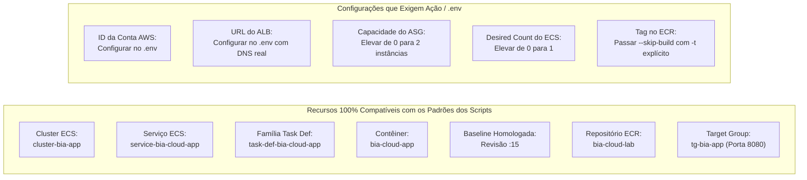
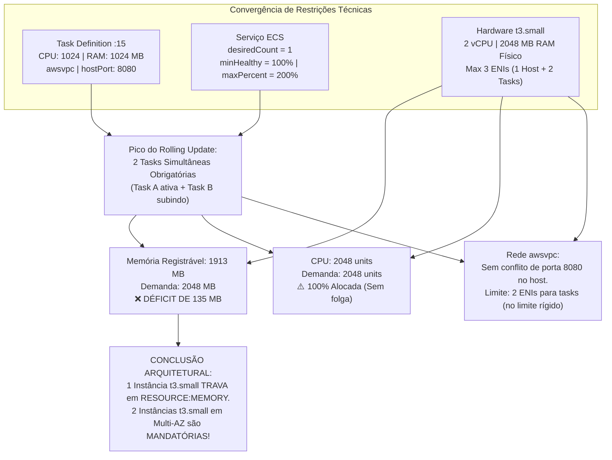

# Checklist e Guia de Configuração Pré-Deploy na AWS Real
## Trilha 04: Estratégias de Deploy & Resiliência — Desafio 02 (ECS Circuit Breaker & Rollback)

> **Projeto:** BIA Cloud Lab — D2NS / Formação AWS<br>
> **Trilha:** `DESAFIOS/04-deploy-strategies`<br>
> **Desafio:** `02-deploy-rollback-circuit-breaker`<br>
> **Documento:** `PRE-DEPLOY-CHECKLIST.md`<br>
> **Finalidade:** Mapear rigorosamente todas as configurações, variáveis, dependências de infraestrutura e passos operacionais necessários para religar o ambiente e executar com sucesso o deploy real na AWS.<br>
> **Modo de Operação:** 🛡️ Auditoria Read-Only (Nenhuma mutação ou religamento de recursos foi executado nesta etapa).<br>

---

## 📋 1. Checklist de Configurações Obrigatórias Pré-Deploy

Antes de executar qualquer comando de deploy ou rollback real, você precisará cumprir este checklist de verificação rápida:

- [ ] **1. Sessão AWS CLI Ativa:** Sessão temporária STS válida obtida via `aws login --profile agy-aws-lab` com desafio MFA concluído.
- [ ] **2. Arquivo `.env` Criado:** Arquivo `DESAFIOS/04-deploy-strategies/.env` criado a partir do `.env.example` no mesmo diretório.
- [ ] **3. Conta AWS Configurada:** `AWS_ACCOUNT_ID` e `AUTHORIZED_ACCOUNT` configuradas no `.env` com os 12 dígitos da sua conta autorizada.
- [ ] **4. Endpoint Real do ALB Mapeado:** `ENV_APP_ALB_URL` configurada no `.env` apontando para o DNS público do seu Application Load Balancer (`http://<ALB_DNS>/api/versao`).
- [ ] **5. Capacidade de Computação Ativada no ASG:** Auto Scaling Group elevado de `DesiredCapacity = 0` para exatamente `2` instâncias `t3.small` (`min=2, max=2, desired=2`) para acomodar a conjunção de memória física utilizável, limites de ENI e o pico de 200% do Rolling Update.
- [ ] **6. Instâncias Registradas no ECS:** Pelo menos 2 container instances registradas no cluster `cluster-bia-app` com status `ACTIVE` e distribuídas entre as AZs `us-east-2a` e `us-east-2b`.
- [ ] **7. Baseline Estável Ativa:** Serviço `service-bia-cloud-app` restaurado para `desiredCount = 1` com a Task Definition `:15` antes de testar nova versão.
- [ ] **8. Definição do Escopo de Teste (Infraestrutura vs Funcional Completo):**
  - **Teste de Disponibilidade e Resiliência da Infraestrutura ($0/h):** Manter o RDS `stopped`. Valida o ciclo ECS, ALB e Circuit Breaker via `/api/versao` (stateless).
  - **Homologação Funcional Completa:** Ligar previamente a instância RDS `bia-cloud` caso deseje validar persistência em banco via `/api/tarefas`.
- [ ] **9. Estratégia de Build e Imagem ECR Definida:**
  - **Deploy Rápido com Imagem Existente:** Utilizar a combinação obrigatória `--skip-build -t <TAG>` (ex: `-t elasticache-v2` ou `-t rolling-purple-v1`).
  - **Deploy Completo com Novo Artefato:** Docker Daemon local ativo e política temporária de push ECR anexada.

---

## 📊 2. Tabela de Configuração e Variáveis

Abaixo está o mapeamento exato de todas as variáveis consumidas pelos scripts ([`common.sh`](file:///home/danilo/formacaoaws/bia-cloud-lab/DESAFIOS/04-deploy-strategies/scripts/common.sh), [`deploy.conf`](file:///home/danilo/formacaoaws/bia-cloud-lab/DESAFIOS/04-deploy-strategies/scripts/deploy.conf), [`deploy.sh`](file:///home/danilo/formacaoaws/bia-cloud-lab/DESAFIOS/04-deploy-strategies/scripts/deploy.sh), [`rollback.sh`](file:///home/danilo/formacaoaws/bia-cloud-lab/DESAFIOS/04-deploy-strategies/scripts/rollback.sh), [`list-versions.sh`](file:///home/danilo/formacaoaws/bia-cloud-lab/DESAFIOS/04-deploy-strategies/scripts/list-versions.sh) e [`check-availability.sh`](file:///home/danilo/formacaoaws/bia-cloud-lab/DESAFIOS/04-deploy-strategies/scripts/check-availability.sh)):

| Nome da Variável | Arquivo de Origem / Uso | Valor Padrão no Código | Valor a Configurar no `.env` | Obrigatoriedade | Como Descobrir / Validar na AWS CLI | Consequência se Incorreta ou Ausente |
|---|---|---|---|:---:|---|---|
| **`AUTHORIZED_ACCOUNT`** / **`AWS_ACCOUNT_ID`** | `common.sh`, `deploy.sh`, `rollback.sh` | *Nenhum (Vazio por segurança)* | ID de 12 dígitos da sua conta AWS | 🔴 **OBRIGATÓRIA para Live Mode** | `aws sts get-caller-identity --profile agy-aws-lab --query Account --output text` | Bloqueio imediato (*fail-fast*) com `exit 1`: `CONFIGURAÇÃO DE SEGURANÇA MANDATÓRIA: Nenhuma conta autorizada foi definida`. |
| **`AWS_PROFILE`** / `DEFAULT_PROFILE` | `common.sh`, `deploy.conf` | `agy-aws-lab` | `agy-aws-lab` (ou o nome do seu perfil) | 🟡 Opcional (Mantém default se omitida) | `aws configure list-profiles` | `FALHA DE AUTENTICAÇÃO`: erro ao invocar chamadas AWS caso o perfil não exista no `~/.aws/config`. |
| **`AWS_REGION`** / `DEFAULT_REGION` | `common.sh`, `deploy.conf` | `us-east-2` | `us-east-2` (Ohio) | 🟡 Opcional (Mantém default se omitida) | `aws configure get region --profile agy-aws-lab` | Erro `ResourceNotFoundException`: os recursos (Cluster, ASG, ALB) não serão encontrados na região errada. |
| **`ENV_APP_ALB_URL`** / `ALB_URL` | `deploy.conf`, `common.sh`, `deploy.sh`, `rollback.sh` | `http://localhost:8080/api/versao` | `http://<ALB_DNS>/api/versao` | 🔴 **OBRIGATÓRIA para Live Mode** | `aws elbv2 describe-load-balancers --profile agy-aws-lab --region us-east-2 --names bia-cloud-alb --query "LoadBalancers[0].DNSName" --output text` | O Smoke Test HTTP pós-deploy tentará bater em `localhost`, falhará 5 vezes e acionará o **auto-rollback de emergência com código 3**, desfazendo seu deploy! |
| **`DEFAULT_ENV`** | `deploy.conf`, `common.sh` | `app` | `app` | 🟢 Padrão Seguro | Já configurado para o ambiente principal do lab. | Se alterado indevidamente para `alb` ou `didatico`, apontará para outro serviço ECS. |
| **`ENV_APP_CLUSTER`** | `deploy.conf`, `common.sh` | `cluster-bia-app` | `cluster-bia-app` | 🟢 Padrão Seguro | `aws ecs list-clusters --profile agy-aws-lab --region us-east-2` | Erro `ClusterNotFoundException`. |
| **`ENV_APP_SERVICE`** | `deploy.conf`, `common.sh` | `service-bia-cloud-app` | `service-bia-cloud-app` | 🟢 Padrão Seguro | `aws ecs list-services --cluster cluster-bia-app --profile agy-aws-lab --region us-east-2` | Erro `ServiceNotFoundException`. |
| **`ENV_APP_TASK_FAMILY`** | `deploy.conf`, `common.sh` | `task-def-bia-cloud-app` | `task-def-bia-cloud-app` | 🟢 Padrão Seguro | `aws ecs list-task-definition-families --profile agy-aws-lab --region us-east-2` | Bloqueio por `FAMÍLIA INCOMPATÍVEL` (`exit 1`). |
| **`ENV_APP_CONTAINER_NAME`**| `deploy.conf`, `common.sh` | `bia-cloud-app` | `bia-cloud-app` | 🟢 Padrão Seguro | Inspecionado no bloco `containerDefinitions[0].name`. | Bloqueio por `CONTÊINER NÃO ENCONTRADO` (`exit 1`). |
| **`ENV_APP_HOMOLOGATED_BASELINE`** | `deploy.conf`, `common.sh` | `15` | `15` | 🟢 Padrão Seguro | Revisão estável comprovada no Desafio 02. | Se apontar para a revisão `16`, haverá **bloqueio rígido de segurança** contra contaminação por poison pill. |
| **`DEFAULT_ECR_REPO`** | `deploy.conf`, `common.sh` | `bia-cloud-lab` | `bia-cloud-lab` | 🟢 Padrão Seguro | `aws ecr describe-repositories --profile agy-aws-lab --region us-east-2` | `RepositoryNotFoundException` caso seja alterado. |
| **`DEFAULT_TIMEOUT`** | `deploy.conf`, `common.sh` | `600` (10 minutos) | `600` | 🟢 Padrão Seguro | Tempo máximo de espera para convergência de tarefas. | Se reduzido em demasia (ex: < 120s), pode dar timeout prematuro enquanto as tasks EC2 sobem. |

---

## 🏗️ 3. Validação de Compatibilidade com o Ambiente Existente

Auditoria técnica dos recursos existentes na conta do laboratório (região `us-east-2`):



### 3.1. Recursos Já Corretos (Não precisam de alteração):
1. **Cluster ECS (`cluster-bia-app`):** Ativo e pronto para receber tarefas.
2. **Serviço Principal (`service-bia-cloud-app`):** Configurado com `launchType = EC2`, `networkMode = awsvpc`, Target Group `tg-bia-app` vinculado, `deploymentCircuitBreaker = { enable: true, rollback: true }` e `minimumHealthyPercent = 100`, `maximumPercent = 200`.
3. **Task Definition Base (`task-def-bia-cloud-app:15`):** Revisão estável intacta na AWS com a imagem `elasticache-v2` na porta 8080.
4. **Target Group (`tg-bia-app`):** Ativo na porta 8080 HTTP, aguardando alvos.
5. **Application Load Balancer (`bia-cloud-alb`):** Ativo com DNS público e regras de encaminhamento configuradas.
6. **Repositório ECR (`bia-cloud-lab`):** Preserva imagens estáveis (`elasticache-v2`, `rolling-purple-v1`, `4.2.0`).

---

### 3.2. Análise Arquitetural Multidimensional: Por que 2 instâncias `t3.small` são estritamente necessárias?

A recomendação de **2 instâncias `t3.small`** no Auto Scaling Group não se baseia em uma estimativa empírica isolada, mas na convergência de **seis dimensões arquiteturais mandatárias**:



| Dimensão Técnica | Especificação no Ambiente | Impacto no Rolling Update (`desiredCount=1`, `min=100%`, `max=200%`) | Comportamento com 1 Instância `t3.small` | Comportamento com 2 Instâncias `t3.small` |
|---|---|---|---|---|
| **1. Dinâmica do Rolling Update** | `minHealthy = 100%`<br/>`maxPercent = 200%` | Durante o deployment, o ECS sobe a nova tarefa (Task B) **antes** de encerrar a tarefa antiga (Task A). No pico da transição, coexistem **exatamente 2 tarefas ativas**. | O cluster precisa comportar simultaneamente 2 tarefas completas. | Cada instância hospeda 1 tarefa confortavelmente durante a transição. |
| **2. Memória RAM (Restrição Rígida)** | Task: `1024 MB`<br/>Host: `2048 MB` total físico | O SO Amazon Linux 2023, o ECS Container Agent e o containerd consomem ~135 MB a 170 MB de RAM. A memória registrável pelo ECS Agent (`registeredMemory`) em uma `t3.small` é de **1913 MB**.<br/>Demanda de 2 tasks: $2 \times 1024\text{ MB} = \mathbf{2048\text{ MB}}$. | ❌ **BLOQUEIO IMEDIATO:** $2048\text{ MB} > 1913\text{ MB}$. A segunda tarefa é rejeitada pelo ECS Scheduler com o evento `RESOURCE:MEMORY`. O deploy trava até estourar o timeout ou Circuit Breaker. | ✅ **TOTALMENTE SAUDÁVEL:** Cada instância aloca 1024 MB de seus 1913 MB disponíveis (~53% de ocupação por nó). |
| **3. CPU (vCPU)** | Task: `1024 units` (1 vCPU)<br/>Host: 2 vCPUs (`2048 units`) | Duas tasks simultâneas demandam $2 \times 1024 = 2048\text{ units}$. | ⚠️ A CPU ficaria com 100% de alocação estrita, sem folga para processos do host e telemetria do ECS Agent. | ✅ Cada instância opera com 50% de CPU alocada (1024/2048 units). |
| **4. Port Mappings & Network Mode** | `networkMode: awsvpc`<br/>`containerPort: 8080`<br/>`hostPort: 8080` | Como a Task Definition utiliza `awsvpc`, cada tarefa recebe uma Elastic Network Interface (ENI) dedicada com seu próprio endereço IP privado na VPC. A porta 8080 é vinculada ao IP da Task ENI, e **não** à interface primária do host. | Diferente do modo `bridge`, no modo `awsvpc` **não há conflito de porta 8080** no nível de host. O bloqueio não é de porta, mas de memória. | Sem conflito de portas e tráfego isolado por ENI em cada instância. |
| **5. Cota de ENIs da AWS (Hardware EC2)** | `t3.small`: Limite de **3 ENIs** por hardware | A interface primária `eth0` é reservada para o próprio host EC2. Restam **no máximo 2 ENIs adicionais** para tarefas ECS (`3 - 1 = 2`). | Teoricamente caberiam 2 ENIs de tarefas, mas a restrição de memória física impede o agendamento antes que a ENI seja anexada. | Cada instância utiliza apenas 2 ENIs (1 do host + 1 da tarefa ativa), operando com folga de interfaces. |
| **6. Zonas de Disponibilidade (Multi-AZ)** | Subnets em `us-east-2a` e `us-east-2b` | O ASG distribui as 2 instâncias balanceadamente entre as duas AZs da VPC padrão. | Sem tolerância a falhas zonais. | Alta disponibilidade real: a nova versão sobe na AZ oposta e o ALB redireciona o tráfego suavemente. |

> [!IMPORTANT]
> **Conclusão:** Configurar o ASG com `Min=2, Max=2, Desired=2` é um **requisito arquitetural indispensável**. Com apenas 1 instância, qualquer deploy em live mode com `maximumPercent = 200` falhará por falta de memória livre no nó (`RESOURCE:MEMORY`).

---

### 3.3. Modos de Teste Operacional: Disponibilidade de Infraestrutura vs Homologação Funcional Completa

É fundamental diferenciar o escopo e o custo de cada modo de teste na AWS:

#### Modo 1: Teste de Disponibilidade e Resiliência da Infraestrutura (RDS Parado — Standby / $0/h de Banco)
* **Objetivo:** Validar a mecânica de implantação contínua no ECS, registro de novas revisões de Task Definition, ciclo de vida de contêineres, attach de Task ENIs, estabilização no Target Group (`tg-bia-app`), drenagem de conexões (30s) e auto-recuperação do ECS Deployment Circuit Breaker.
* **Comportamento da Aplicação:** Conforme auditado no código Express da BIA (`server.js`, `config/express.js`, `api/controllers/versao.js`), o servidor HTTP sobe de forma assíncrona sem bloqueio síncrono ao PostgreSQL. Os endpoints `/` (frontend SPA React em memória) e `/api/versao` (versão estática em memória) respondem com **`HTTP 200 OK`**.
* **Limitação Técnica Explícita:** **Este teste NÃO valida operações com banco de dados.** Qualquer requisição enviada para rotas que exigem persistência (como `GET /api/tarefas` ou `POST /api/tarefas`) falhará com erro 500 (falha de conexão com PostgreSQL). Trata-se de um teste focado em infraestrutura, resiliência de tráfego e esteira de deploy.
* **Custo:** $0/h de banco relacional.

#### Modo 2: Homologação Funcional Completa (RDS Ativo — Operação End-to-End)
* **Objetivo:** Validar o ciclo completo da aplicação, incluindo operações transacionais de leitura e escrita no PostgreSQL (`bia-cloud`), persistência de tarefas e integridade relacional.
* **Pré-requisito Mandatório:** Ligar previamente a instância de banco com o comando:
  ```bash
  aws rds start-db-instance --db-instance-identifier bia-cloud --profile agy-aws-lab --region us-east-2
  ```
  *(Aguardar ~5 minutos até que o status mude de `starting` para `available` antes de executar o deploy).*
* **Custo:** Incide o valor horário da instância `db.t3.micro` (~$0.017/h) mais armazenamento e I/O enquanto o banco permanecer ligado.
* **Encerramento:** Ao concluir a homologação, deve-se parar o banco via `aws rds stop-db-instance --db-instance-identifier bia-cloud` para evitar custos ociosos.

---

### 3.4. Governança de Imagens ECR e Semântica Exata de `--skip-build` e `-t`

#### A. A imagem `elasticache-v2` existe no ECR? É apropriada para o teste?
* **Existência Comprovada:** O repositório `bia-cloud-lab` contém a imagem com a tag `elasticache-v2` (`sha256:65cecfbdb09835fc5c7206a9cb850044579f74b4cb38335366f02922479b63e2`), enviada em 03/11/2026.
* **Apropriação Técnica:**
  - A imagem `elasticache-v2` é a imagem **exata** que compõe a baseline operacional homologada (`task-def-bia-cloud-app:15`).
  - Utilizá-la no deploy via `--skip-build -t elasticache-v2` é seguro e ideal para testar a criação de uma nova revisão de Task Def (ex: `:17`), a substituição saudável de tarefas no cluster e o comportamento dos scripts sem necessidade de compilar imagem local.
  - **Atenção à percepção visual:** Como a baseline :15 já está executando essa imagem, o deploy de `elasticache-v2` não alterará visualmente o frontend ou a string `/api/versao` (`Bia 4.2.0`).
  - **Alternativa para mudança visível:** Se você desejar validar uma transição visual evidente entre versões sem compilar Docker localmente, pode utilizar a tag existente **`rolling-purple-v1`** (frontend roxo do Desafio 01):
    ```bash
    ./scripts/deploy-ecs.sh deploy --skip-build -t rolling-purple-v1
    ```

#### B. Semântica Exata das Flags no [`deploy.sh`](file:///home/danilo/formacaoaws/bia-cloud-lab/DESAFIOS/04-deploy-strategies/scripts/deploy.sh):
1. **Flag `--skip-build`:**
   - Inibe a execução das etapas locais de `docker build` e `docker push`.
   - Em live mode (`DRY_RUN=false`), executa `aws ecr describe-images --repository-name bia-cloud-lab --image-ids imageTag=<TAG>` para verificar se a imagem já existe no repositório remoto antes de registrar qualquer Task Definition. Se a tag não existir, o script aborta com erro imediatamente (*fail-fast*).
2. **Flag `-t <TAG>` (ou `--tag`):**
   - Especifica explicitamente a tag da imagem a ser referenciada no manifesto da nova Task Definition.
   - **Se `-t` for omitido:** O script tenta resolver a tag automaticamente a partir do Git short hash do HEAD (`GIT_SHORT_HASH`).
3. **Comportamento Combinado Mandatório:**
   - Se você passar apenas `--skip-build` **sem `-t`**, o script tentará buscar no ECR uma imagem com a tag do commit atual do Git. Se esse commit específico não tiver sido previamente compilado e enviado ao ECR, o comando falhará com:<br>
     `[ERROR] A imagem '...:a1b2c3d' não foi encontrada no ECR. Execute sem '--skip-build' para construir e publicar a imagem.`
   - Portanto, para reutilizar imagens pré-existentes no ECR, **é obrigatório informar ambas as flags**:<br>
     `./scripts/deploy-ecs.sh deploy --skip-build -t <TAG_EXISTENTE>`

---

## 📁 4. Arquivo `.env` para Uso Local

### 4.1. Carregamento Automático e Independência do Diretório de Execução

O carregamento das configurações foi desenhado com base no módulo central [`scripts/common.sh`](file:///home/danilo/formacaoaws/bia-cloud-lab/DESAFIOS/04-deploy-strategies/scripts/common.sh#L11-L25):

```bash
COMMON_SCRIPT_DIR="$(cd "$(dirname "${BASH_SOURCE[0]}")" && pwd)"
CONFIG_FILE="$COMMON_SCRIPT_DIR/deploy.conf"

if [[ -f "$COMMON_SCRIPT_DIR/../.env" ]]; then
  set -a
  source "$COMMON_SCRIPT_DIR/../.env"
  set +a
elif [[ -f "$COMMON_SCRIPT_DIR/.env" ]]; then
  set -a
  source "$COMMON_SCRIPT_DIR/.env"
  set +a
fi
```

> [!TIP]
> **Portabilidade Total Comprovada:**<br>
> Como `COMMON_SCRIPT_DIR` utiliza `BASH_SOURCE[0]`, o caminho é resolvido fisicamente para a pasta canônica dos scripts, independentemente do seu diretório atual no terminal (`$PWD`).<br>
> Isso significa que o arquivo `.env` localizado em `DESAFIOS/04-deploy-strategies/.env` será **carregado perfeitamente**, mesmo se você executar os comandos a partir de:
> - `DESAFIOS/04-deploy-strategies/` $\to$ `./scripts/deploy-ecs.sh ...`
> - `DESAFIOS/04-deploy-strategies/scripts/` $\to$ `./deploy-ecs.sh ...`
> - Raiz do repositório `/home/danilo/formacaoaws/bia-cloud-lab/` $\to$ `./DESAFIOS/04-deploy-strategies/scripts/deploy-ecs.sh ...`
> - Diretório `/tmp` ou `/home/danilo` invocando o caminho absoluto $\to$ `/home/.../deploy-ecs.sh ...`
>
> Você **não precisa** executar `export` manualmente nem rodar comandos prévios no terminal. Além disso, o arquivo `.env` é protegido contra commits pelo [.gitignore](file:///home/danilo/formacaoaws/bia-cloud-lab/DESAFIOS/04-deploy-strategies/.gitignore).

### 4.2. Exemplo Completo de `.env` para Criar no seu Ambiente

Crie o arquivo `DESAFIOS/04-deploy-strategies/.env` com o seguinte conteúdo:

```bash
# ==============================================================================
# .env — Configuração Operacional do BIA Cloud Lab (Desafio 02)
# ==============================================================================

# 1. Identidade e Conta AWS Autorizada (Preencher com os 12 dígitos da sua conta)
AWS_ACCOUNT_ID="123456789012"
AUTHORIZED_ACCOUNT="123456789012"

# 2. Perfil AWS CLI e Região
AWS_PROFILE="agy-aws-lab"
AWS_REGION="us-east-2"

# 3. Endpoint Real do Application Load Balancer para o Smoke Test HTTP
# (Substitua se o DNS do seu ALB tiver mudado; porta 8080 é roteada via Listener 80)
ENV_APP_ALB_URL="http://seu-alb-dns.us-east-2.elb.amazonaws.com/api/versao"

# 4. Parâmetros do Ambiente Principal (Valores padrão já alinhados com o laboratório)
DEFAULT_ENV="app"
DEFAULT_ECR_REPO="bia-cloud-lab"
DEFAULT_TIMEOUT="600"
ENV_APP_CLUSTER="cluster-bia-app"
ENV_APP_SERVICE="service-bia-cloud-app"
ENV_APP_TASK_FAMILY="task-def-bia-cloud-app"
ENV_APP_CONTAINER_NAME="bia-cloud-app"
ENV_APP_HOMOLOGATED_BASELINE="15"
```

---

## ⚡ 5. Roteiro de Comandos de Validação e Execução

Execute rigorosamente nesta ordem sequencial:

### Passo 1: Verificar a Identidade AWS Ativa (AuthN)
```bash
aws sts get-caller-identity --profile agy-aws-lab --region us-east-2
```
*Saída esperada: Retornar o ARN `arn:aws:iam::<SUA_CONTA>:user/AGY-AWS-LAB` e `Account` correspondente.*

### Passo 2: Validar a Leitura do Arquivo `.env` pelos Scripts (A partir de qualquer diretório)
```bash
./scripts/deploy-ecs.sh list --dry-run
```
*Saída esperada: Exibir a tabela de revisões sem acusar "CONFIGURAÇÃO DE SEGURANÇA AUSENTE".*

### Passo 3: Inspecionar o Status da Infraestrutura (Repouso Atual)
```bash
# A. Verificar se as instâncias EC2 do cluster estão em 0
aws ecs describe-clusters \
  --clusters cluster-bia-app \
  --profile agy-aws-lab \
  --region us-east-2 \
  --query "clusters[0].[registeredContainerInstancesCount,runningTasksCount]"

# B. Confirmar o DNS público do ALB
aws elbv2 describe-load-balancers \
  --names bia-cloud-alb \
  --profile agy-aws-lab \
  --region us-east-2 \
  --query "LoadBalancers[0].DNSName" \
  --output text
```

### Passo 4: Reativar a Capacidade Computacional Necessária
> [!WARNING]
> Este passo realiza mutação na AWS e gera custos computacionais (~$0.04/h para as 2 instâncias EC2 durante o teste). Execute somente quando for iniciar a validação na nuvem.

```bash
# 1. Elevar o Auto Scaling Group para exatamente 2 instâncias t3.small
aws autoscaling update-auto-scaling-group \
  --auto-scaling-group-name Infra-ECS-Cluster-cluster-bia-app-0495f372-ECSAutoScalingGroup-5MzfS0ZZ7Q8j \
  --min-size 2 \
  --max-size 2 \
  --desired-capacity 2 \
  --profile agy-aws-lab \
  --region us-east-2

# 2. Aguardar ~2 minutos até que 2 container instances se registrem no ECS:
# (Verifique com: aws ecs describe-clusters --clusters cluster-bia-app --profile agy-aws-lab --region us-east-2 --query "clusters[0].registeredContainerInstancesCount")

# 3. Ativar o serviço com 1 réplica baseline (Revisão 15 estável)
aws ecs update-service \
  --cluster cluster-bia-app \
  --service service-bia-cloud-app \
  --task-definition task-def-bia-cloud-app:15 \
  --desired-count 1 \
  --profile agy-aws-lab \
  --region us-east-2

# 4. Aguardar o serviço estabilizar e a task ficar saudável
aws ecs wait services-stable \
  --cluster cluster-bia-app \
  --services service-bia-cloud-app \
  --profile agy-aws-lab \
  --region us-east-2
```

### Passo 5: Validar a Baseline Saudável via HTTP
```bash
curl -i http://<ALB_DNS>/api/versao
```
*Saída esperada:* `HTTP/1.1 200 OK` com o corpo `Bia 4.2.0`.

### Passo 6: Executar a Simulação Prévia (Dry-Run Obrigatório)
```bash
# Validar todo o fluxo do deploy sem mutações na nuvem:
./scripts/deploy-ecs.sh deploy --dry-run
```
*Saída esperada:* `[SUCCESS] [DRY-RUN] Simulação completa de Deploy concluída com sucesso!`.

### Passo 7: Executar o Deploy Real (Somente com Autorização Explícita)
Escolha a abordagem desejada:

* **Opção 1: Deploy Rápido com Baseline Existente (`elasticache-v2`):**
  *(Testa o pipeline ECS sem compilação Docker; mantém a versão 4.2.0)*
  ```bash
  ./scripts/deploy-ecs.sh deploy --skip-build -t elasticache-v2
  ```

* **Opção 2: Deploy com Alternância Visual (`rolling-purple-v1`):**
  *(Testa o pipeline ECS e a alternância real de contêiner entre versões homologadas)*
  ```bash
  ./scripts/deploy-ecs.sh deploy --skip-build -t rolling-purple-v1
  ```

* **Opção 3: Deploy Completo com Docker Build & Push no ECR:**
  *(Requer Docker local ativo e política temporária de push anexada ao usuário `AGY-AWS-LAB`)*
  ```bash
  ./scripts/deploy-ecs.sh deploy
  ```

* **Opção 4: Rollback Controlado de Emergência para a Revisão 15:**
  ```bash
  ./scripts/deploy-ecs.sh rollback -r 15
  ```

---

## 🛑 6. Troubleshooting e Possíveis Erros

| Erro Observado | Causa Raiz | Procedimento Imediato de Resolução |
|---|---|---|
| `CONFIGURAÇÃO DE SEGURANÇA MANDATÓRIA` (`exit 1`) | Variáveis `AWS_ACCOUNT_ID` ou `AUTHORIZED_ACCOUNT` não configuradas. | Crie o arquivo `DESAFIOS/04-deploy-strategies/.env` com sua conta de 12 dígitos. |
| `FALHA DE AUTENTICAÇÃO: Não foi possível obter caller identity` | Sessão temporária STS expirou. | Execute `aws login --profile agy-aws-lab` com desafio MFA no navegador. |
| `BLOQUEIO DE SEGURANÇA: A revisão :16 é a Task Definition contaminada` | Operador tentou usar a `:16` como base de deploy ou alvo de rollback. | A revisão 16 contém falha proposital (`exit 1`). Utilize sempre a revisão `:15` homologada informando `-r 15` ou `--base-revision 15`. |
| `BUILD CONTEXT SUJO: Arquivos da aplicação foram modificados` | O Git detectou arquivos de código modificados fora do commit. | Faça commit das alterações ou execute com `--allow-dirty` caso a alteração seja deliberada para teste. |
| `RESOURCE:MEMORY` nas tarefas ECS / Deploy travado | Instância EC2 única sem memória registrável livre para a 2ª task (déficit de 135 MB na `t3.small` para `maximumPercent = 200`). | Eleve o ASG para exatamente 2 instâncias `t3.small` via `aws autoscaling update-auto-scaling-group --min-size 2 --max-size 2 --desired-capacity 2`. |
| `A imagem '...:tag' não foi encontrada no ECR` | O operador utilizou `--skip-build` sem a flag `-t`, fazendo o script buscar o commit SHA atual. | Forneça explicitamente a tag existente no ECR: `--skip-build -t elasticache-v2` ou `--skip-build -t rolling-purple-v1`. |
| Smoke Test reprovado com falhas consecutivas (`exit 3`) | Endpoint `ENV_APP_ALB_URL` inacessível ou Target Group não saudável. | Verifique se a URL do ALB no `.env` está com o DNS correto e confirme a saúde no Target Group com `aws elbv2 describe-target-health --target-group-arn ...`. |
| `SequelizeConnectionRefusedError` ou erro 500 em `/api/tarefas` | Tentativa de acessar rota de persistência com o RDS no estado `stopped`. | O teste padrão de infraestrutura opera intencionalmente com o RDS parado ($0/h). Caso queira validar a persistência em banco, inicie o RDS previamente via `aws rds start-db-instance --db-instance-identifier bia-cloud`. |
| `AccessDeniedException: ... ecr:GetAuthorizationToken` | Usuário `AGY-AWS-LAB` não possui permissão temporária de login no registry privado. | Para deploys com build/push, solicite o anexo temporário da política ECR ao administrador da conta, ou utilize a flag `--skip-build -t <TAG>` para reaproveitar tags existentes. |
| Rollout travado com `desiredCount = 0` | O serviço foi acionado com capacidade zero. | Ajuste `--desired-count 1` no `aws ecs update-service`. Os scripts bloqueiam deploys com `desiredCount = 0` para evitar falsos positivos de homologação. |

---

## 🔒 7. Encerramento e Retorno ao Repouso Pós-Teste

Após concluir o experimento de deploy e validação, execute o procedimento de desligamento para retornar o laboratório ao repouso total ($0/h):

```bash
# 1. Reduzir tarefas do ECS para zero
aws ecs update-service \
  --cluster cluster-bia-app \
  --service service-bia-cloud-app \
  --desired-count 0 \
  --profile agy-aws-lab \
  --region us-east-2

# 2. Desligar instâncias EC2 reduzindo o ASG para zero
aws autoscaling update-auto-scaling-group \
  --auto-scaling-group-name Infra-ECS-Cluster-cluster-bia-app-0495f372-ECSAutoScalingGroup-5MzfS0ZZ7Q8j \
  --min-size 0 \
  --max-size 0 \
  --desired-capacity 0 \
  --profile agy-aws-lab \
  --region us-east-2

# 3. Caso o RDS tenha sido iniciado para homologação funcional, desligá-lo:
# aws rds stop-db-instance \
#   --db-instance-identifier bia-cloud \
#   --profile agy-aws-lab \
#   --region us-east-2
```
