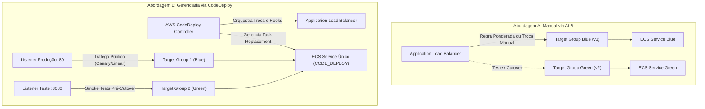

# Desafio 03 — Estratégia de Deploy Blue/Green no ECS

> **Projeto:** BIA Cloud Lab — D2NS<br>
> **Trilha:** Estratégias de Deploy & Resiliência<br>
> **Referência educacional:** Formação AWS — Henrylle Maia<br>
> **Implementação e adaptações:** Danilo Lima — D2NS<br>
> **Status:** 🟡 Documentado & Modelado (Validação via CodeDeploy Planejada na Plataforma)<br>
> **Adaptações D2NS:** Modelagem arquitetural independente para Blue/Green Manual via ALB (Target Groups ponderados) e Blue/Green Gerenciado via AWS CodeDeploy com AppSpec oficial e análise de capacidade de cluster.

---

## 🎯 Objetivo Arquitetural

Implementar e documentar a estratégia de **Blue/Green Deployment** para a aplicação BIA no Amazon ECS, isolando completamente o ambiente de produção atual (**Blue**) do ambiente da nova versão (**Green**). Esse padrão elimina o risco de indisponibilidade durante atualizações de esquema ou grandes mudanças arquiteturais, viabilizando homologação prévia em ambiente idêntico ao de produção e permitindo comutação de tráfego (*cutover*) e reversão (*rollback*) de forma atômica ou gradual.

---

## 📊 Matriz de Maturidade e Evidências

Para manter absoluta conformidade técnica e transparência, o nível de maturidade dos componentes desta estratégia está classificado em quatro dimensões:

| Dimensão | Situação | Detalhamento |
|---|:---:|---|
| **Funcionalidade em Templates** | ✅ Implementada | Modelagem arquitetural completa com templates sanitizados e validados para duas abordagens independentes: **Abordagem A (Manual via ALB)** e **Abordagem B (Gerenciada via AWS CodeDeploy)**. |
| **Execução Histórica** | ✅ Documentada | A prática de alternância entre Target Groups Blue e Green foi vivenciada e executada manualmente via Console AWS durante os laboratórios guiados da Formação AWS. |
| **Testes Comprovados** | 🟡 Parcial | Validação do conceito de múltiplos Target Groups associados a regras de listener no Application Load Balancer. |
| **Validações Pendentes** | ⚪ Planejada | **Automação via CodeDeploy e Tráfego Canário:** A orquestração automatizada com `AWS CodeDeploy`, `appspec.yaml`, hooks de teste e rollback automático baseado em CloudWatch Alarms **não** foi executada no ambiente original do BIA Cloud Lab (ambiente desprovisionado). Constitui arquitetura recomendada e modelada para futura implementação. |

---

## 🏗️ Comparativo entre as Abordagens



---

## 🅰️ Abordagem A — Blue/Green Manual via Application Load Balancer (ALB)

Nesta abordagem, o controle do ciclo de vida e do roteamento é gerenciado manualmente ou via scripts pelo operador, utilizando recursos nativos do Application Load Balancer.

### 1. Componentes da Infraestrutura
- **Dois Target Groups:**
  - `tg-bia-blue`: Conectado às tarefas da versão em produção (v1).
  - `tg-bia-green`: Conectado às tarefas da nova versão em homologação (v2).
- **Dois Serviços ECS Independentes:**
  - `service-bia-blue`: Mantém as tarefas da versão atual.
  - `service-bia-green`: Provisionado especificamente para a nova versão.
- **Listeners do ALB:**
  - Listener principal (porta 80/443) roteando para o Target Group ativo.
  - Listener secundário de validação (ex: porta 8080 ou regra baseada em path/header) roteando exclusivamente para o Target Group Green.

### 2. Fluxo Operacional de Validação e Cutover
1. **Provisionamento do Green:** O serviço `service-bia-green` é criado apontando para a nova Task Definition e registrado no `tg-bia-green`.
2. **Validação Prévia (Health Checks & Smoke Tests):**
   - As tarefas Green inicializam e atingem o estado `healthy` no ALB (`GET /api/versao`, rota real documentada da aplicação BIA; `/health` é mantido em discussões como exemplo arquitetural genérico).
   - A equipe técnica acessa a aplicação via porta de teste (8080) para validar banco de dados, renderização e rotas críticas antes que qualquer usuário real seja exposto.
3. **Alternância de Tráfego (Cutover):**
   - **Opção I (Imediata / All-at-Once):** A ação padrão do listener principal é editada de `tg-bia-blue` para `tg-bia-green`. O tráfego passa a ser encaminhado à nova versão.
   - **Opção II (Ponderada / Weighted):** Utiliza-se a configuração de pesos no listener (ex: 90% Blue / 10% Green), avaliando o comportamento sob carga real antes de mover para 50%/50% e finalmente 0%/100%.
4. **Descomissionamento Seguro:** Após período de observação (ex: 30 a 60 minutos), o `desiredCount` do `service-bia-blue` é reduzido a zero para economizar recursos.

### 3. Procedimento de Rollback
- Caso a nova versão apresente falha pós-cutover, o operador simplesmente altera o peso da regra do listener de volta para 100% no `tg-bia-blue`.
- **Tempo de Recuperação:** Dependente da propagação da chamada de API do ALB e do tempo de conclusão ou corte de conexões TCP ativas, sem garantia empírica pré-determinada, visto que testes formais de latência de chaveamento sob carga não foram executados neste laboratório.

### 4. Limitações e Riscos Operacionais
- **Intervenção Manual Obrigatória:** Sem automação, a troca e o monitoramento dependem de ação humana.
- **Custo de Esquecimento:** Risco de manter ambos os serviços ECS ativos indefinidamente após o deploy, duplicando despesas de computação.
- **Complexidade de Gestão:** Necessidade de manter dois serviços ECS distintos sincronizados quanto a variáveis de ambiente, IAM roles e tags.

---

## 🅱️ Abordagem B — Blue/Green Gerenciado via AWS CodeDeploy

Nesta abordagem recomendada para ambientes corporativos, o ciclo de vida da implantação é completamente orquestrado pelo AWS CodeDeploy integrado nativamente ao Amazon ECS.

### 1. Componentes da Infraestrutura
- **Serviço ECS Único:**
  - O serviço ECS é configurado com `deploymentController: { "type": "CODE_DEPLOY" }`. Não há necessidade de criar dois serviços ECS na AWS.
- **Application Load Balancer com Dois Listeners:**
  - **Production Listener (porta 80):** Atende o tráfego público de produção.
  - **Test Listener (porta 8080):** Direciona exclusivamente para a nova versão durante a fase de validação pré-cutover.
- **Par de Target Groups:**
  - O CodeDeploy alterna automaticamente os papéis de Target Group 1 e Target Group 2 a cada deployment.
- **Deployment Group do CodeDeploy:**
  - Configura os listeners, os target groups, a política de tráfego e o tempo de término das tarefas antigas.

### 2. Estratégias de Deslocamento de Tráfego (Traffic Shifting)

O CodeDeploy oferece três categorias de estratégias pré-configuradas:

| Estratégia | Descrição | Caso de Uso |
|---|---|---|
| `CodeDeployDefault.ECSAllAtOnce` | Transfere 100% do tráfego público para a nova versão assim que os testes forem aprovados. | Releases simples ou ambientes que exigem atualização imediata. |
| `CodeDeployDefault.ECSLinear10PercentEvery1Minute` | Transfere 10% de tráfego a cada minuto durante 10 minutos. | Avaliação gradual do comportamento da aplicação e consumo de banco de dados. |
| `CodeDeployDefault.ECSCanary10Percent5Minutes` | Direciona 10% do tráfego na primeira fatia, aguarda 5 minutos e, se estável, migra os 90% restantes. | Releases críticas com tempo de observação antes do cutover completo. |

### 3. O Arquivo AppSpec (`appspec.yaml`) e Ciclo de Vida com Hooks

O arquivo [appspec.example.yaml](templates/abordagem-b-codedeploy/appspec.example.yaml) define o manifesto da implantação no ECS:

```yaml
version: 0.0
Resources:
  - TargetService:
      Type: AWS::ECS::Service
      Properties:
        TaskDefinition: "arn:aws:ecs:us-east-1:123456789012:task-definition/task-def-bia:2"
        LoadBalancerInfo:
          ContainerName: "bia-cloud-app"
          ContainerPort: 8080
```

Durante o deployment, o CodeDeploy executa uma máquina de estados com hooks opcionais (funções AWS Lambda):
1. **`BeforeInstall`:** Validações prévias (ex: verificar conectividade com banco ou versão de migração).
2. **`AfterInstall`:** Tarefas Green provisionadas e registradas no Target Group de teste.
3. **`AfterAllowTestTraffic`:** Execução automatizada de testes de integração via Test Listener (porta 8080).
4. **`BeforeAllowTraffic`:** Ajustes finais de cache ou pré-aquecimento antes do tráfego público.
5. **`AfterAllowTraffic`:** Validação de métricas pós-cutover com tráfego real.

### 4. Rollback Automático e Monitoramento com CloudWatch
- **Gatilhos de Rollback:**
  - Falha no health check do Test Listener.
  - Falha em qualquer função Lambda associada aos lifecycle hooks.
  - Acionamento de alarmes do Amazon CloudWatch associados ao Deployment Group (ex: taxa de erro HTTP 5XX > 1% ou elevação de latência p95).
- **Ação Autônoma:** Ao detectar anomalia, o CodeDeploy reverte 100% do tráfego imediatamente para o Target Group Blue e cancela a subida do Green sem intervenção humana.
- **Término Programado:** Com `terminationWaitTimeInMinutes: 5`, o CodeDeploy mantém as tarefas Blue ativas por 5 minutos após o sucesso da release antes de finalizá-las (`TERMINATE`), garantindo janela de retorno rápido caso necessário.

---

## 💰 Análise de Custos e Capacidade da Infraestrutura

> [!WARNING]
> **Impacto de Duplicação Temporária de Tarefas (2x Capacity):**<br>
> Em qualquer estratégia Blue/Green, a versão Blue e a versão Green coexistem durante o período de homologação e drenagem. Isso exige o dobro da capacidade desejada de contêineres ($2 \times \text{desiredCount}$).

### 1. Comportamento no AWS Fargate
- A infraestrutura serverless provisiona as tarefas adicionais sob demanda.
- **Impacto Financeiro:** Paga-se proporcionalmente apenas pelos minutos ou horas em que as tarefas adicionais permanecerem ativas (geralmente poucos centavos por deploy).

### 2. Comportamento no ECS com Instâncias EC2
- O cluster deve possuir vCPU e memória **livres** para comportar todas as tarefas Blue e Green ao mesmo tempo.
- **Risco de Travamento:** Se o cluster for composto por instâncias fixas e dimensionadas à justa medida (ex: duas instâncias t3.medium já operando a 80% de memória), as novas tarefas Green não conseguirão ser alocadas pelo ECS e permanecerão travadas no status `PROVISIONING` por falta de capacidade no Capacity Provider.
- **Mitigação:** Configurar o Auto Scaling Group do cluster com Capacity Providers com `managedScaling: ENABLED` ou pré-aquecer instâncias adicionais antes de disparar o deploy Blue/Green.

---

## 📁 Templates Sanitizados Disponíveis

Os templates foram divididos em pastas exclusivas para não misturar as abordagens:

### Templates da Abordagem A (Manual via ALB)
- [`templates/abordagem-a-manual-alb/target-groups.example.json`](templates/abordagem-a-manual-alb/target-groups.example.json): Modelo declarativo de referência definindo ambos os Target Groups (`tg-bia-blue` e `tg-bia-green`) com health checks na rota real `/api/versao` (para criação via AWS CLI, cada Target Group é invocado separadamente com `aws elbv2 create-target-group`).
- [`templates/abordagem-a-manual-alb/listener-rule-weighted.example.json`](templates/abordagem-a-manual-alb/listener-rule-weighted.example.json): Configuração diretamente utilizável com `aws elbv2 modify-listener` para roteamento ponderado no listener do ALB (90% / 10%).
- [`templates/abordagem-a-manual-alb/ecs-service-blue.example.json`](templates/abordagem-a-manual-alb/ecs-service-blue.example.json): Definição de serviço ECS para a versão Blue, diretamente utilizável via `aws ecs create-service`.
- [`templates/abordagem-a-manual-alb/ecs-service-green.example.json`](templates/abordagem-a-manual-alb/ecs-service-green.example.json): Definição de serviço ECS para a versão Green, diretamente utilizável via `aws ecs create-service`.

### Templates da Abordagem B (Gerenciada via CodeDeploy)
- [`templates/abordagem-b-codedeploy/ecs-service-codedeploy.example.json`](templates/abordagem-b-codedeploy/ecs-service-codedeploy.example.json): Serviço ECS único configurado com `deploymentController: { type: "CODE_DEPLOY" }`, utilizável diretamente via `aws ecs create-service`.
- [`templates/abordagem-b-codedeploy/appspec.example.yaml`](templates/abordagem-b-codedeploy/appspec.example.yaml): Manifesto padronizado AppSpec para orquestração da release no ECS, contendo os 5 hooks de ciclo de vida oficiais suportados pelo CodeDeploy para ECS (executados via funções Lambda opcionais).
- [`templates/abordagem-b-codedeploy/codedeploy-deployment-group.example.json`](templates/abordagem-b-codedeploy/codedeploy-deployment-group.example.json): Configuração diretamente utilizável via `aws deploy create-deployment-group --cli-input-json`, definindo política linear, par de target groups, listeners de produção/teste e rollback atrelado a alarmes CloudWatch.

---

## 🔍 Limitações Conhecidas e Próximos Passos

1. **Implementação de Pipeline CI/CD:** A automação via AWS CodeDeploy constitui um modelo de referência pronto para ser acoplado a pipelines de entrega contínua (ex: GitHub Actions ou AWS CodePipeline).
2. **Evolução para Análise de Resiliência com IA:** No próximo estágio ([Desafio 04 — Blue/Green Deployment com IA](../04-blue-green-ai/README.md)), será explorado o uso de agentes Foundation Models (Amazon Bedrock) para validar logs e telemetria antes de autorizar o cutover de tráfego.
