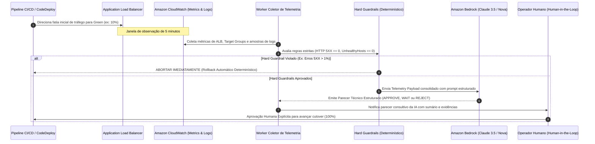

# Desafio 04 — Blue/Green Assistido por Inteligência Artificial (Arquitetura Proposta)

> **Projeto:** BIA Cloud Lab — D2NS 
> **Trilha:** Estratégias de Deploy & Resiliência 
> **Referência educacional:** Formação AWS — Henrylle Maia 
> **Implementação e adaptações:** Danilo Lima — D2NS 
> **Status:** ⚪ Arquitetura Proposta (Conceitual / Não Implementada nem Homologada na Nuvem) 
> **Adaptações D2NS:** Proposta de arquitetura de governança com Amazon Bedrock atuando como SRE Copilot em modo consultivo (read-only), com Human-in-the-Loop obrigatório e Hard Guardrails determinísticos.

---

## 🎯 Objetivo Arquitetural

Apresentar um modelo de governança avançado de entrega contínua onde agentes de Inteligência Artificial baseados em Foundation Models do **Amazon Bedrock** atuam como consultores analíticos de confiabilidade (SRE Copilot). O objetivo é correlacionar telemetria em tempo real (métricas de ALB, saúde de Target Groups e logs do Amazon CloudWatch) durante a fase de validação da versão Green, emitindo pareceres técnicos estruturados para recomendar o avanço (*cutover*), a espera ou o cancelamento imediato (*rollback*) do deployment.

---

## 📊 Matriz de Maturidade e Evidências

Em total conformidade com os princípios de governança deste repositório, este desafio classifica-se estritamente como **pesquisa e arquitetura conceitual proposta**:

| Dimensão | Situação | Detalhamento |
|---|:---:|---|
| **Funcionalidade em Código** | ⚪ Não Implementada | Nenhuma função Lambda, script ou pipeline operacional de IA foi comitado ou executado na AWS para este desafio. |
| **Execução Histórica** | ⚪ Inexistente | Nenhuma chamada de API ao Amazon Bedrock para avaliação de deploy foi realizada nos laboratórios originais. |
| **Testes Comprovados** | ⚪ Inexistente | Não há evidências empíricas de cutover acionado por IA ou testes de injeção de falhas sintéticas com agentes. |
| **Classificação Formal** | 📐 **Arquitetura Proposta** | Especificação técnica de desenho de solução, fluxos conceituais e templates de contrato de dados para implementação em fases futuras. |

---

## 🏛️ Desenho da Solução e Fluxo de Auditoria

---

## 🛡️ Diretrizes Inegociáveis de Segurança

### 1. Papel Estritamente Consultivo (Read-Only)
- **A IA NÃO altera recursos na AWS:** O modelo não possui permissões IAM de escrita (`ecs:UpdateService`, `elasticloadbalancing:ModifyListener`, etc.).
- **Modo Consultor (Advisory Only):** A IA atua exclusivamente como analista de dados, gerando recomendações para leitura humana.

### 2. Human-in-the-Loop Obrigatório
- Nenhuma alteração de tráfego, modificação de peso no ALB ou cancelamento definitivo ocorre sem confirmação formal do operador humano responsável pelo release.
- Toda recomendação do modelo é acompanhada de pontuação de confiança (`confidenceScore`) e rastreabilidade dos logs analisados.

### 3. Hard Guardrails (Critérios Determinísticos de Segurança)
- Modelos de linguagem generativos **não** devem ser o único filtro para decisões de infraestrutura crítica.
- **Camada Determinística em Código:**
  - Se a contagem de `HTTPCode_Target_5XX_Count > 0` ou `UnhealthyHostCount > 0`, o deployment é interrompido ou revertido automaticamente pelo pipeline ou CodeDeploy, **independentemente** de qualquer análise gerada pela IA.
  - A IA é reservada para análises qualitativas: interpretar mensagens de log não estruturadas, correlacionar alertas silenciosos (warnings) e avaliar dispersão estatística de latência (p95 vs p99).

---

## ⚠️ Riscos e Limitações Conhecidas

1. **Alucinação e Falsos Pareceres:**
   - Modelos de fundação podem interpretar logs normais como anomalias críticas ou ignorar erros silenciosos mal formatados.
   - Mitigação: Prompts estritos com temperatura baixa (`temperature: 0.1`) e schema de saída JSON rígido.
2. **Problema do Cold Start e Dados Insuficientes:**
   - Durante os primeiros minutos de um canary com 10% de tráfego, o volume de requisições na versão Green pode ser estatisticamente irrelevante para análises de latência (p99 instável).
   - O modelo deve ser instruído a retornar `status: "WAIT"` quando o volume amostral for inferior ao limiar mínimo confiável.
3. **Custo e Latência de Inferência:**
   - Invocações frequentes de LLMs de grande porte (como Claude 3.5 Sonnet) a cada ciclo de deploy aumentam o custo operacional e introduzem latência de 2 a 5 segundos por avaliação.
4. **Resiliência e Fallback:**
   - Caso a API do Amazon Bedrock sofra indisponibilidade, throttling ou timeout durante a janela de release, o pipeline deve obrigatoriamente degradar graciosamente para a validação puramente determinística baseada nos alarmes do CloudWatch.

---

## 📁 Templates Conceituais Disponíveis

Os seguintes arquivos exemplificam os contratos de dados e prompts modelados para este desafio:

| Arquivo | Descrição |
|---|---|
| [`templates/telemetry-payload.example.json`](templates/telemetry-payload.example.json) | Estrutura consolidada de métricas e amostras de logs enviada como contexto para o modelo. |
| [`templates/bedrock-prompt-template.example.json`](templates/bedrock-prompt-template.example.json) | Template de prompt para invocação do Bedrock, contendo persona SRE, schema de resposta e guardrails. |
| [`templates/ai-evaluation-output.example.json`](templates/ai-evaluation-output.example.json) | Exemplo de parecer técnico estruturado emitido pelo modelo, com nível de risco e recomendação fundamentada. |

---

## 🔍 Próximos Passos para Homologação Futura

1. Desenvolver função AWS Lambda consumindo a API `bedrock-runtime:Converse`.
2. Integrar a chamada de avaliação como hook `AfterAllowTestTraffic` em um pipeline CodeDeploy.
3. Executar testes controlados de estresse com injeção de erros propositais (ex: endpoint simulando HTTP 500) para validar se o modelo identifica a anomalia e emite `REJECT`.
