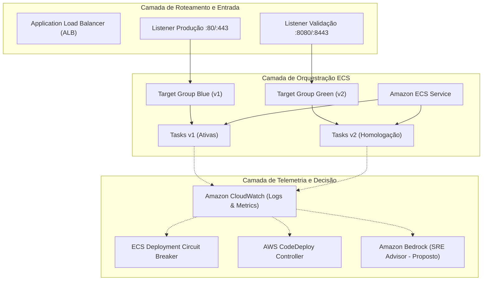

# Memorial Arquitetural — Estratégias de Deploy & Resiliência na AWS

> **Trilha:** Estratégias de Deploy & Resiliência<br>
> **Status:** Documento Consolidado de Referência Técnica<br>
> **Referência:** Formação AWS (Henrylle Maia) | Implementação BIA Cloud Lab (Danilo Lima)

---

## 🎯 1. Visão Geral e Propósito Arquitetural

Este memorial consolida as decisões de design, topologias e padrões de engenharia para o ciclo de vida de publicação e resiliência da aplicação BIA no Amazon ECS. O escopo abrange desde atualizações incrementais até alternâncias completas de ambiente e governança orientada por inteligência artificial.



---

## ⚖️ 2. Matriz Comparativa de Estratégias de Deploy

| Dimensão | Rolling Update (Desafio 01) | Rollback & Circuit Breaker (Desafio 02) | Blue/Green Manual (Desafio 03-A) | Blue/Green CodeDeploy (Desafio 03-B) | Blue/Green AI (Desafio 04 - Proposto) |
|---|---|---|---|---|---|
| **Mecanismo de Substituição** | Tarefa por tarefa dentro do mesmo serviço ECS. | Tarefa por tarefa com interrupção autônoma sob falhas. | Dois serviços ECS com chaveamento manual no ALB. | Serviço único com par de Target Groups gerenciado. | Par de Target Groups com análise semântica de telemetria. |
| **Gatilho de Rollback** | Manual via script (`deploy-ecs.sh rollback`). | Automático pelo ECS control plane ao atingir limiar de tarefas falhas. | Manual via alteração de pesos/listeners no ALB. | Automático via falha em testes ou alarmes CloudWatch. | Consultivo: parecer da IA + Hard Guardrails determinísticos. |
| **Tempo de Recuperação** | Minutos (tempo de registrar task-def anterior e aguardar drain). | Médio (após 3 falhas de container, reverte de forma autônoma). | Quase imediato na camada de rede (tempo de propagação da API ALB). | Rápido (comutação imediata de tráfego de volta ao Blue). | Consultivo (depende da confirmação do operador humano). |
| **Impacto na Capacidade** | $+100\%$ temporário (`maximumPercent: 200`). | $+100\%$ temporário (`maximumPercent: 200`). | $+100\%$ constante até desligar o serviço Blue. | $+100\%$ temporário durante o `terminationWaitTime`. | $+100\%$ temporário durante janela de auditoria da IA. |
| **Complexidade Operacional** | Baixa. | Baixa/Média. | Média (gestão de 2 serviços). | Alta (CodeDeploy + AppSpec + IAM). | Muito Alta (Pipelines + Bedrock + Guardrails). |
| **Status no Laboratório** | ✅ Implementado em código. | 🟢 Homologado na Nuvem (Fase 2) / Em Repouso. | 🟡 Vivenciado em treinamento guiado. | ⚪ Modelado em templates. | ⚪ Arquitetura proposta. |

---

## 🌐 3. Topologia de Rede e Integração com Application Load Balancer

1. **Target Group Stickiness:** Desabilitado por padrão (`targetGroupStickinessConfig.enabled: false`) para permitir alternância homogênea e distribuição justa entre targets.
2. **Deregistration Delay:** Parametrizado em **30 segundos** nos templates (reduzido em relação ao padrão de 300s da AWS) para equilibrar drenagem limpa de requisições em trânsito com agilidade no ciclo de publicação.
3. **Endpoint de Verificação de Saúde:** A aplicação BIA expõe a rota oficial `/api/versao` para validação de integridade e resposta `HTTP 200`. O caminho `/` atende a interface gráfica React SPA, e caminhos como `/health` são tratados como convenções arquiteturais genéricas.

---

## 🔐 4. Governança e Gestão de Segredos

- **Eliminação de Plaintext Passwords:** A Task Definition histórica continha credenciais em texto claro (`DB_PWD`). Os novos templates sanitizados adotam a injeção via **AWS Systems Manager Parameter Store**:
  ```json
  "secrets": [
    {
      "name": "DB_PWD",
      "valueFrom": "arn:aws:ssm:${AWS_REGION}:${AWS_ACCOUNT_ID}:parameter/bia/db_password"
    }
  ]
  ```
- **Princípio do Menor Privilégio:** A execução das tarefas ECS utiliza duas IAM Roles especializadas:
  - `ecsTaskExecutionRole`: Concedida ao agente ECS para pull de imagens no ECR, envio de logs ao CloudWatch e leitura de segredos no SSM.
  - `ecsTaskRole`: Concedida ao contêiner em runtime para acessar recursos AWS específicos da aplicação.

---

## 📈 5. Dimensionamento de Capacidade (Fargate vs EC2)

1. **AWS Fargate:**
   - Modelo elástico serverless.
   - Paga-se por vCPU/hora e GB/hora consumidos no período de pico do deploy ($2 \times \text{tarefas}$).
2. **Amazon ECS em EC2:**
   - A capacidade máxima do cluster é limitada pela vCPU e memória das instâncias EC2 ativas.
   - Em clusters com instâncias t3.medium de capacidade justa, a execução de Rolling Update com `maximumPercent: 200` ou Blue/Green falha se não houver reserva de recursos, travando o deployment no status `PROVISIONING`.
   - **Requisito Mandatório:** Habilitar ECS Capacity Providers com Auto Scaling gerenciado (`managedScaling: ENABLED`).
