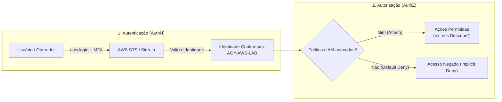
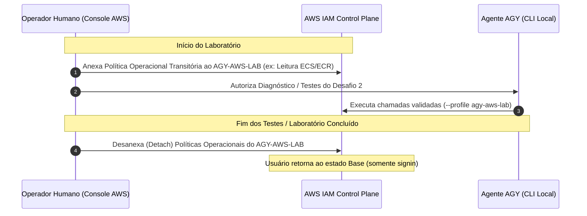

# Ciclo de Vida do Acesso IAM & Governança de Autenticação

> **Projeto:** BIA Cloud Lab — D2NS<br>
> **Trilha:** Estratégias de Deploy & Resiliência (Amazon ECS)<br>
> **Identidade Operacional:** `AGY-AWS-LAB`<br>
> **Conta AWS:** `${AWS_ACCOUNT_ID}` (Configurada via `.env`)<br>
> **Região Padrão:** `us-east-2` (Ohio)<br>
> **Perfil AWS CLI Local:** `agy-aws-lab`<br>
> **Status de Autenticação:** ✅ Autenticação Validada (Sessão Temporária Ativa)

---

## 🎯 1. Objetivo da Identidade Exclusiva `AGY-AWS-LAB`

A criação e utilização do usuário IAM dedicado **`AGY-AWS-LAB`** fundamenta-se nos princípios de **segregação de funções (Separation of Concerns)**, **menor privilégio (Least Privilege)** e **rastreabilidade estrita (Auditability)**:

- **Isolamento de Cargas e Laboratórios:** O agente automatizado AGY não deve operar sob identidades humanas nem compartilhar perfis de outros laboratórios (como `formacaoaws`, `bedrock-lab` ou `n8n-lab`).
- **Rastreabilidade no AWS CloudTrail:** Todas as chamadas de API disparadas durante os testes da trilha `04-deploy-strategies` ficam claramente vinculadas ao ARN `arn:aws:iam::<AWS_ACCOUNT_ID>:user/AGY-AWS-LAB`.
- **Prevenção de Efeitos Colaterais:** Garante que permissões concedidas para homologar estratégias de deploy no ECS (Rolling Update, Circuit Breaker, Blue/Green) não impactem recursos de outros projetos e que sua revogação seja pontual e imediata.

---

## ⚖️ 2. Diferença Crítica: Autenticação (AuthN) vs. Autorização (AuthZ)

É mandatório compreender a fronteira de segurança entre os dois conceitos:



1. **Autenticação (AuthN — "Quem é você?"):**
   - Confirmada com sucesso via `aws login --profile agy-aws-lab`.
   - O comando `aws sts get-caller-identity --profile agy-aws-lab` comprova que as credenciais pertencem ao usuário `AGY-AWS-LAB` na conta autorizada configurada.
   - **IMPORTANTE:** Estar autenticado **NÃO** significa ter autorização para interagir com ECS, ECR, CloudWatch ou qualquer outro recurso.

2. **Autorização (AuthZ — "O que você pode fazer?"):**
   - Determinada exclusivamente pelas políticas IAM (Identity-Based Policies) anexadas ao usuário ou grupo.
   - Por padrão, na AWS vigora o **Default Deny**: uma identidade recém-autenticada sem políticas operacionais anexadas não possui permissão para executar chamadas contra os serviços da nuvem.

---

## 🔐 3. Mecanismo de Autenticação via `aws login` com Credenciais Temporárias

O perfil `agy-aws-lab` utiliza o recurso de autenticação de desenvolvimento local do AWS CLI v2 (`aws login`), eliminando a necessidade de credenciais estáticas de longa duração.

### 3.1. Permissão IAM Necessária para o Login
Para permitir que o usuário IAM realize a autenticação via navegador/CLI, é mandatória a seguinte declaração IAM atrelada ao usuário:

```json
{
  "Version": "2012-10-17",
  "Statement": [
    {
      "Sid": "AllowLocalDevelopmentSignIn",
      "Effect": "Allow",
      "Action": "signin:SignInLocalDevelopmentAccess",
      "Resource": "*"
    }
  ]
}
```

### 3.2. Fluxo com MFA e Credenciais Temporárias
1. O operador executa `aws login --profile agy-aws-lab`.
2. O navegador abre a sessão de autenticação segura da AWS solicitando credenciais e o **token do dispositivo MFA**.
3. Após aprovação, a AWS emite um conjunto de **credenciais efêmeras** (`AccessKeyId`, `SecretAccessKey` e `SessionToken`).
4. Essas credenciais temporárias são cacheadas localmente de forma segura em `~/.aws/cli/cache/` ou `~/.aws/sso/cache/`.
5. **Proibição Estrita:** **Não foram criadas e é expressamente proibido criar Access Keys permanentes** (`AKIA...`) para este perfil.

> [!IMPORTANT]
> **Validade e Expiração da Sessão:**<br>
> A validade das credenciais temporárias emitidas via `aws login` **não deve ser presumida como fixa (ex.: 12 horas)**. A duração efetiva depende das configurações de sessão, políticas de controle de serviço (SCPs), limites do provedor de identidade e parâmetros locais. Quando a sessão expira, novas chamadas retornam `ExpiredToken` e exigem reautenticação.

---

## 🔄 4. Procedimento de Reautenticação e Validação Local

Quando a sessão temporária expirar ou no início de cada jornada de laboratório, siga o fluxo abaixo:

### Passo 1: Executar o Login Interativo
```bash
aws login --profile agy-aws-lab
```
*(Concluir o desafio MFA no navegador ou dispositivo configurado)*.

### Passo 2: Validar a Identidade Conectada
```bash
aws sts get-caller-identity --profile agy-aws-lab
```
**Saída Esperada Mandatória:**
```json
{
    "UserId": "AIDA...",
    "Account": "123456789012",
    "Arn": "arn:aws:iam::123456789012:user/AGY-AWS-LAB"
}
```

### Passo 3: Validar a Região Operacional Padrão
```bash
aws configure get region --profile agy-aws-lab
```
**Saída Esperada:** `us-east-2`

> [!CAUTION]
> Se o ARN retornado por `sts get-caller-identity` for diferente do usuário esperado ou a conta for divergente da autorizada configurada, interrompa a execução imediatamente. Não utilize outros perfis como fallback.

---

## 🛡️ 5. Proteção de Credenciais, MFA e Arquivos Locais

1. **Tokens e Cache:** Nunca inspecione, exiba ou comite o conteúdo de arquivos em `~/.aws/cli/cache/` ou `~/.aws/sso/cache/`.
2. **Arquivos `.env` e Manifestos:** Nunca armazene variáveis sensíveis como `AWS_SECRET_ACCESS_KEY` ou `AWS_SESSION_TOKEN` em arquivos locais do repositório ou logs de tarefas.
3. **MFA Obrigatório:** O MFA atua como barreira física; mesmo que credenciais locais de sessão sejam interceptadas, novas sessões não podem ser geradas sem o token dinâmico.

---

## 📋 6. Concessão Just-in-Time e Revogação de Permissões Operacionais

A gestão de privilégios para a trilha `04-deploy-strategies` adota o modelo **Just-in-Time (JIT)**:



### 6.1. Expirar Sessão $\neq$ Revogar Permissões IAM
Um dos erros conceituais mais comuns em governança de nuvem é confundir o término da sessão com a remoção de acessos:
- **Expirar a Sessão:** Apenas invalida o token local no seu terminal. No dia seguinte, ao executar `aws login`, o usuário recuperará todas as permissões que ainda estiverem atreladas a ele no IAM.
- **Revogar Permissões (Desanexar Política):** Remove o direito de acesso no control plane da AWS. Mesmo com uma sessão ativa e token válido, qualquer chamada subsequente será bloqueada imediatamente com erro `AccessDenied`.

---

## 🛑 7. Procedimento Formal de Encerramento do Laboratório

Ao concluir uma sessão de testes ou finalizar um desafio da trilha:

1. **Remover Permissões de Escrita/Deploy:** Desanexar quaisquer políticas transitórias que permitam `UpdateService`, `RegisterTaskDefinition` ou mutações em recursos.
2. **Remover Permissões de Leitura:** Desanexar as políticas de diagnóstico (`Describe*`, `Get*`, `List*`).
3. **Estado de Repouso Seguro:** O usuário `AGY-AWS-LAB` deve permanecer vinculado **exclusivamente** à permissão de autenticação (`signin:SignInLocalDevelopmentAccess`), sem permissões ativas em nenhum serviço AWS.
4. **Limpeza de Recursos Transitórios:** Garantir que tarefas ou serviços de teste criados no cluster ECS tenham sido terminados para evitar custos ociosos na sua conta AWS.
