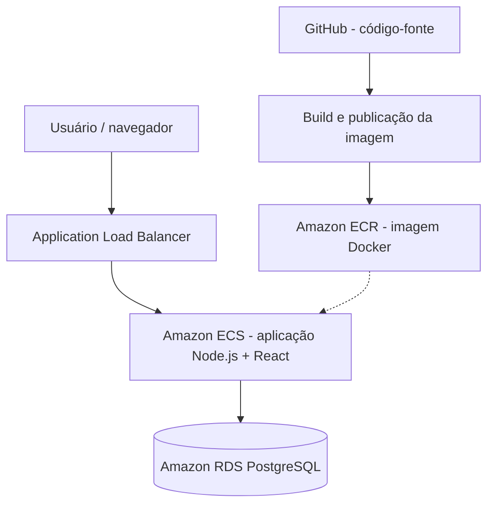

<div align="center">

# ☁️ BIA Cloud Lab AWS

### Aplicação full-stack | AWS Cloud | Docker | DevOps | Agentes de IA

Laboratório prático de desenvolvimento, containerização e implantação de aplicações na AWS, baseado no projeto **BIA da Formação AWS**, com personalizações e experimentos de arquitetura, segurança, automação e operação em nuvem.


[Visão geral](#-visão-geral) · [Arquitetura](#-arquitetura) · [Execução local](#-execução-local) · [AWS](#-infraestrutura-aws) · [Agentes](#-agentes-de-ia) · [Créditos](#-créditos)

</div>

---

## 🎯 Visão geral

O **BIA Cloud Lab AWS** é um laboratório de aprendizado aplicado, construído a partir do projeto BIA da **Formação AWS**, para praticar o ciclo de vida de uma aplicação web: desenvolvimento, testes, empacotamento em contêiner, publicação de imagens e implantação na AWS.

O objetivo é exercitar decisões técnicas que aparecem em ambientes corporativos: conectividade entre serviços, configuração segura, observabilidade, automação de entregas e controle de custos.

### Escopo do laboratório

| Área | Tecnologias e práticas |
| --- | --- |
| Frontend | React, Vite e componentes de interface |
| Backend | Node.js, Express e API REST |
| Dados | PostgreSQL e Sequelize |
| Contêineres | Docker e Docker Compose |
| AWS | Amazon ECR, Amazon ECS com EC2, Application Load Balancer e Amazon RDS |
| Automação | Scripts Shell, AWS CLI e workflow de testes com GitHub Actions |
| Agentes de IA | Agentes PO, Dev, DevOps e QA organizados em `.kiro/` |

> **Nota de escopo:** o repositório contém código e configurações do laboratório. A existência de scripts ou arquivos de configuração não significa, por si só, que todos os serviços e pipelines estejam implantados ou ativos. O status de cada etapa deve ser documentado conforme a validação prática.

## 🧩 Personalizações e aprendizados

Este repositório representa uma evolução prática do material de estudo, incluindo:

- Personalização da interface React e componentes de visualização de versão e ambiente.
- Ajustes no build da aplicação com **Node.js 22**, React e Vite em imagem Docker.
- Preparação da aplicação para acessar a API pela **mesma origem** em que o frontend é servido, facilitando a publicação atrás de um ALB.
- Configuração local com Docker Compose e credenciais fornecidas por variáveis de ambiente, sem versionar o arquivo `.env`.
- Estruturação de agentes especializados para organização de tarefas, desenvolvimento, DevOps e testes.
- Preparação de imagem para publicação no **Amazon ECR** e estudos de implantação no **Amazon ECS**.

Essas atividades são parte de um laboratório em evolução, com foco em aprendizado e documentação reproduzível.

## 🏗️ Arquitetura

### Visão conceitual do ambiente AWS



O diagrama representa o **desenho-alvo do laboratório**, não uma comprovação de que todos os componentes estejam ativos neste momento.

### Componentes

- **React + Vite:** interface web, compilada durante o build da imagem.
- **Node.js + Express:** backend e disponibilização dos arquivos estáticos.
- **PostgreSQL:** persistência de dados da aplicação.
- **Amazon ECR:** armazenamento privado das imagens Docker.
- **Amazon ECS (EC2):** execução dos contêineres na AWS.
- **Application Load Balancer:** entrada HTTP e distribuição do tráfego.
- **Amazon RDS:** banco de dados gerenciado.

Consulte também o [diagrama de arquitetura existente](docs/architecture/aws-ecs-diagram.html).

## 🗂️ Estrutura do repositório

```text
bia-cloud-lab/
├── .github/workflows/       # Automação de testes
├── .kiro/
│   ├── agents/              # Agentes PO, Dev, DevOps e QA
│   ├── docs/                # Documentação de workflows
│   ├── rules/               # Regras do projeto
│   └── tasks/               # Histórico e gestão de tarefas
├── api/                     # Controllers, models e routes
├── client/                  # Aplicação React + Vite
├── config/                  # Configuração do backend
├── database/                # Migrações
├── docs/                    # Documentação e arquitetura
├── scripts/                 # Scripts de apoio ao laboratório
├── tests/                   # Testes automatizados
├── Dockerfile               # Build da imagem da aplicação
├── compose.yml              # Ambiente local em contêineres
├── buildspec.yml            # Configuração de build AWS
└── server.js                # Inicialização da aplicação
```

## 💻 Execução local

### Pré-requisitos

- Git
- Docker Engine e Docker Compose
- Acesso ao código-fonte deste repositório

### 1. Clonar

```bash
git clone https://github.com/drlima85/bia-cloud-lab.git
cd bia-cloud-lab
```

### 2. Configurar as variáveis de ambiente

O arquivo `compose.yml` utiliza a variável `DB_PASSWORD`. Crie um arquivo `.env` **local**, na raiz do projeto:

```dotenv
DB_PASSWORD=defina-uma-senha-forte-aqui
```

> O arquivo `.env` está no `.gitignore` e **não deve ser enviado ao GitHub**. Não use senhas reais de ambientes corporativos neste laboratório.

### 3. Construir e iniciar os contêineres

```bash
docker compose up -d --build
```

Para acompanhar a inicialização:

```bash
docker compose ps
docker compose logs -f
```

**Portas e acesso:** consulte o mapeamento atual em `compose.yml`. No ambiente de laboratório personalizado, a aplicação foi utilizada na porta **3002**; confirme o mapeamento antes de acessar `http://localhost:3002`.

### 4. Encerrar sem apagar os dados

```bash
docker compose down
```

**Atenção:** não utilize `docker compose down -v` se quiser preservar os dados persistidos nos volumes.

## ☁️ Infraestrutura AWS

O laboratório contempla estudos e configurações para:

1. **Amazon ECR:** criação de repositório privado, autenticação do Docker e versionamento de imagens.
2. **Amazon ECS com EC2:** definição de tarefas, serviços e execução da aplicação em contêineres.
3. **Application Load Balancer:** roteamento de requisições para a aplicação.
4. **Amazon RDS PostgreSQL:** persistência dos dados e conectividade com a aplicação.
5. **IAM, redes e Security Groups:** controle de permissões e acesso entre componentes.

### Publicação da imagem no ECR

O processo de build e publicação é realizado separadamente da publicação do código no GitHub. A imagem Docker do laboratório foi preparada com a tag `4.0.0`; a publicação no ECR e a implantação no ECS devem ser confirmadas antes de marcar a entrega como concluída.

### Boas práticas de segurança

- Não versionar `.env`, chaves privadas ou arquivos locais de credenciais.
- Preferir identidades e permissões mínimas necessárias para automações.
- Evitar imprimir senhas ou segredos nos logs.
- Restringir o acesso ao banco de dados e validar regras de rede.
- Revisar custos e desligar recursos de laboratório quando não estiverem em uso.

## 🤖 Agentes de IA

A pasta `.kiro/` organiza o trabalho de agentes especializados:

| Agente | Responsabilidade principal |
| --- | --- |
| **PO** | Especificação, priorização e acompanhamento de tarefas |
| **Dev** | Desenvolvimento e manutenção da aplicação |
| **DevOps** | Contêineres, infraestrutura, automação e deploy |
| **QA** | Planejamento e execução de testes |

O projeto também contém documentação de **Git worktrees**, branches de feature e fluxo de tarefas. Veja [workflow de worktrees](.kiro/docs/worktree-workflow.md) e [regras de infraestrutura](.kiro/rules/infraestrutura.md).

## 🧪 Testes e API

Os testes unitários estão organizados em `tests/unit/`, e há um workflow de GitHub Actions em `.github/workflows/testes-pr.yml`.

Para verificar os comandos de teste disponíveis:

```bash
npm run
```

### Endpoints documentados

| Método | Rota | Finalidade |
| --- | --- | --- |
| GET | `/api/ping` | Verificação de disponibilidade |
| GET | `/api/versao` | Informações da versão |
| GET | `/api/tarefas` | Listar tarefas |
| GET | `/api/tarefas/:id` | Consultar tarefa |
| POST | `/api/tarefas` | Criar tarefa |
| PUT | `/api/tarefas/:id` | Atualizar tarefa |
| DELETE | `/api/tarefas/:id` | Remover tarefa |

> As rotas acima seguem a documentação do projeto. Consulte `api/routes/` para confirmar o contrato e o comportamento de cada endpoint.

## 📸 Evidências do laboratório

Esta seção será atualizada com evidências verificáveis, como:

- Capturas da interface personalizada.
- Diagrama final da arquitetura AWS.
- Build da imagem Docker e publicação no ECR.
- Execução do serviço ECS e validação do acesso pelo ALB.
- Resultados dos testes automatizados.

## 🗺️ Próximas etapas

- [x] Personalizar a aplicação e preparar o Dockerfile.
- [x] Organizar o código-fonte em repositório Git.
- [x] Preparar a configuração do Amazon ECR.
- [ ] Confirmar a publicação da imagem no ECR.
- [ ] Validar a aplicação no ECS por meio do ALB.
- [ ] Adicionar evidências e capturas de tela.
- [ ] Revisar e documentar o pipeline de entrega de ponta a ponta.

## 📚 Créditos

Este laboratório é **baseado no projeto BIA**, utilizado na **Formação AWS**, de Henrylle Maia.

- **Projeto original:** [henrylle/bia](https://github.com/henrylle/bia)
- **Adaptações e laboratório pessoal:** [drlima85/bia-cloud-lab](https://github.com/drlima85/bia-cloud-lab)

O repositório tem finalidade educacional e de portfólio. Os créditos ao material de origem são preservados; eventuais condições de licenciamento do projeto original devem ser verificadas antes de redistribuição ou reutilização fora desse contexto.

---

<div align="center">

**BIA Cloud Lab AWS** · Aprendizado prático em Cloud, DevOps e automação

</div>
