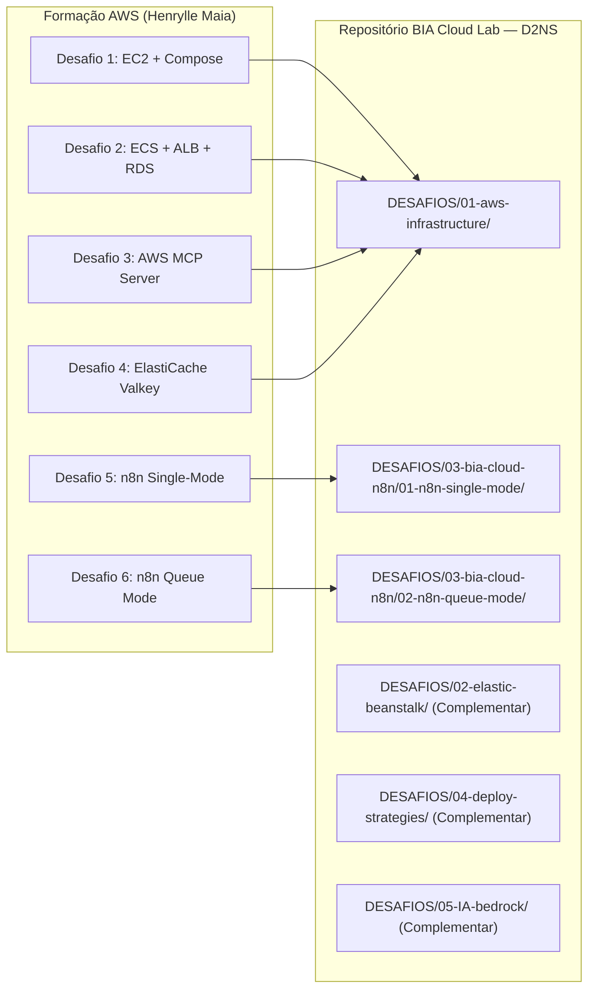
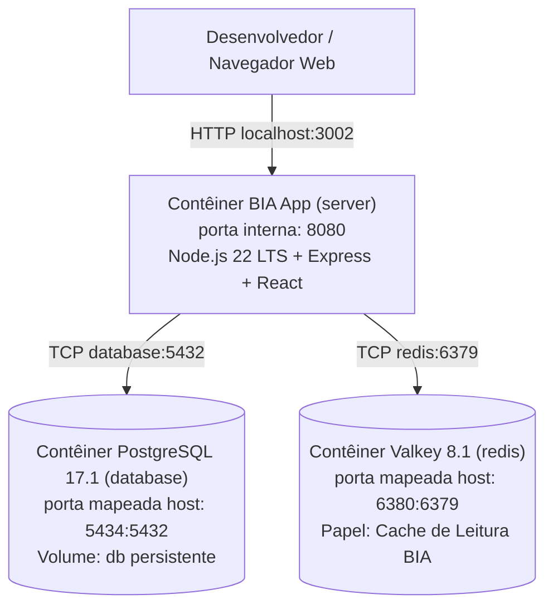
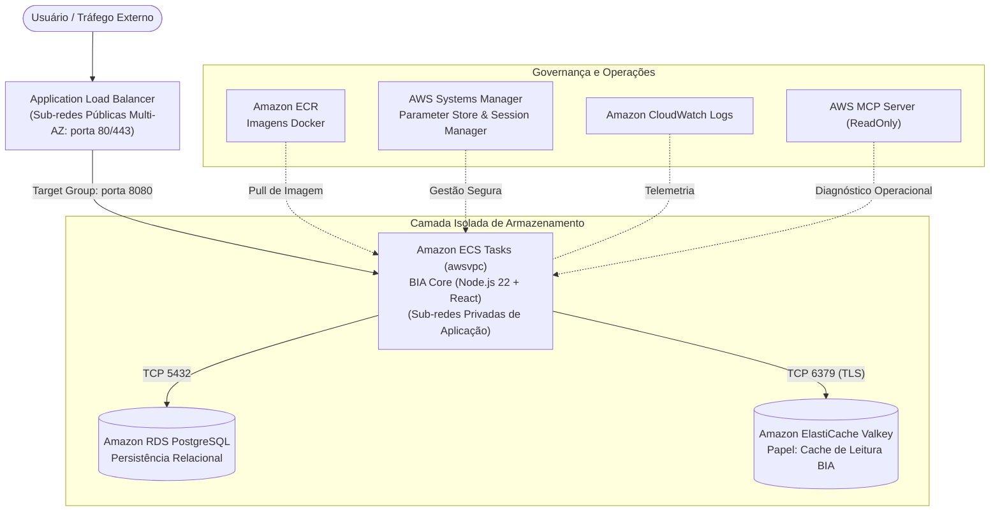
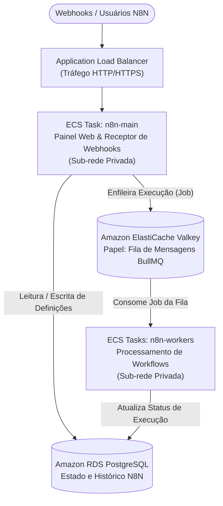
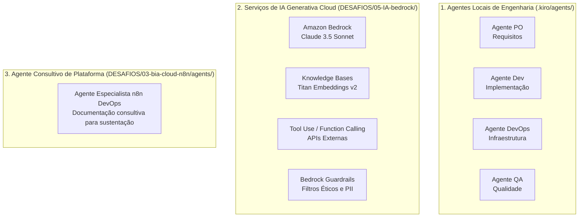

<div align="center">

# ☁️ BIA Cloud Lab — D2NS

### Engenharia em Nuvem AWS | Contêineres ECS | Automação n8n | IA Generativa

Laboratório prático de arquitetura, containerização, automação e implantação de aplicações na nuvem AWS, baseado no projeto **BIA da Formação AWS** (Henrylle Maia), com personalizações, novos componentes e trilhas avançadas desenvolvidas no ambiente **D2NS** por Danilo Lima.


[Visão geral](#-visão-geral) · [Trilhas técnicas](#-trilhas-técnicas-e-desafios) · [Arquiteturas](#-arquiteturas-por-contexto) · [Matriz técnica](#-matriz-de-implementação-testes-e-evidências) · [Execução local](#-execução-local) · [Segurança & IAM](#-segurança-iam-e-governança) · [Camadas de IA](#-camadas-de-inteligência-artificial) · [Créditos e atribuição](#-créditos-e-atribuição) · [Fale comigo](#-fale-comigo)

</div>

---

## 🎯 Visão geral

O **BIA Cloud Lab — D2NS** é um repositório técnico de engenharia de software e computação em nuvem estruturado para consolidar práticas corporativas de arquitetura, conteinerização, automação de processos, estratégias de deploy e inteligência artificial generativa na Amazon Web Services (AWS).

O projeto adota como código-base e base didática o projeto **BIA** (Business Intelligence Application), concebido pelo instrutor **Henrylle Maia** na **Formação AWS**, expandindo-o em uma estrutura monorepo com cinco trilhas complementares de aprendizado prático e documentação técnica reproduzível.

### Objetivos do laboratório

- Exercitar o ciclo completo de entrega de software: desenvolvimento, build, empacotamento Docker e publicação de imagens no **Amazon ECR**.
- Provisionar ambientes na AWS sob topologia de rede controlada (VPC, sub-redes públicas e privadas, Security Groups com regras restritivas).
- Implementar orquestração de contêineres com **Amazon ECS** (EC2 e Fargate) atrás de **Application Load Balancer (ALB)**.
- Integrar camada de persistência com **Amazon RDS PostgreSQL** e camadas em memória com **Amazon ElastiCache Valkey**.
- Explorar arquiteturas orientadas a eventos e automação distribuída com **n8n** (Single-Mode e Queue Mode com BullMQ).
- Avaliar estratégias de resiliência e entrega contínua (Rolling Updates com dimensionamento matemático, rollback e Circuit Breaker).
- Integrar serviços de IA Generativa de ponta com **Amazon Bedrock**, Claude 3.5 Sonnet, RAG e Guardrails éticos.
- Aplicar governança de acessos baseada no princípio do menor privilégio (**IAM**) e administração segura via **AWS Systems Manager (SSM)**, eliminando a exposição de portas SSH na Internet.

---

## 🧭 Trilhas Técnicas e Desafios

O laboratório é estruturado no diretório [`DESAFIOS/`](DESAFIOS/), dividindo-se entre os desafios centrais da Formação AWS e trilhas complementares de engenharia:

### Correspondência entre Desafios da Formação AWS e o Repositório



### Índice Navegável das Trilhas

| Trilha no Repositório | Escopo & Desafios Abrangidos | Tecnologias Principais | Estado de Conclusão |
| :--- | :--- | :--- | :---: |
| [**01-aws-infrastructure**](DESAFIOS/01-aws-infrastructure/README.md) | **Desafios Originais 1 a 4**<br>• Desafio 1: EC2, User Data, Compose v2 e SSM<br>• Desafio 2: ECS EC2, ALB, RDS PostgreSQL e ECR<br>• Desafio 3: Observabilidade com AWS MCP Server<br>• Desafio 4: ElastiCache Valkey (cache de leitura) e SSM | ECS, EC2, ALB, RDS PostgreSQL, ElastiCache Valkey, AWS MCP, SSM, CloudWatch | ✅ Concluído |
| [**02-elastic-beanstalk**](DESAFIOS/02-elastic-beanstalk/README.md) | **Laboratório Complementar: PaaS AWS**<br>• Empacotamento Docker Compose para Beanstalk<br>• Scripts defensivos de build e release ZIP<br>• Publicação e ciclo de vida via EB CLI | Elastic Beanstalk (Docker), ECR, RDS, ALB, EB CLI, Bash parametrizado | ✅ Concluído |
| [**03-bia-cloud-n8n**](DESAFIOS/03-bia-cloud-n8n/README.md) | **Desafios Originais 5 e 6 + MCP & Agentes**<br>• Desafio 5: n8n Single-Mode com auto-recovery (`01/`)<br>• Desafio 6: n8n Queue Mode com Valkey BullMQ (`02/`)<br>• Ferramenta complementar AWS MCP (`mcp/`)<br>• Agente consultivo DevOps (`agents/n8n/`) | ECS (Fargate/EC2), n8n, ElastiCache Valkey (Fila BullMQ), RDS, 9 IAM Policies | ✅ Concluído |
| [**04-deploy-strategies**](DESAFIOS/04-deploy-strategies/README.md) | **Laboratório Complementar: Resiliência & Deploy**<br>• Rolling Update com controle de capacidade (`minimumHealthyPercent` / `maximumPercent`)<br>• Rollback manual e ECS Deployment Circuit Breaker<br>• Modelagem Blue/Green (ALB / CodeDeploy)<br>• Proposta de governança assistida por IA (Bedrock) | Amazon ECS, ALB, CodeDeploy, Deployment Circuit Breaker, Scripts Shell | 🟡 Concluído / Documentado |
| [**05-IA-bedrock**](DESAFIOS/05-IA-bedrock/README.md) | **Laboratório Complementar: IA Generativa na AWS**<br>• Invocação interativa CLI/SDK com streaming<br>• Tool Use / Function Calling para sistemas externos<br>• RAG com Knowledge Bases & Titan Embeddings v2<br>• Moderação de conteúdo com Bedrock Guardrails | Amazon Bedrock, Claude 3.5 Sonnet, Titan Embeddings v2, Knowledge Bases, Guardrails | ✅ Concluído |

---

## 🏗️ Arquiteturas por Contexto

Para garantir rigor técnico e evitar confusões entre as finalidades dos componentes, as arquiteturas do repositório são apresentadas separadamente por contexto de execução.

### Contexto 1: Ambiente Local de Desenvolvimento (Docker Compose)

No ambiente local, a aplicação BIA opera via `compose.yml` em uma rede interna isolada do Docker, com mapeamentos de portas dedicados no host para evitar conflitos com serviços nativos da máquina do desenvolvedor:



> **Configuração real comprovada ([compose.yml](compose.yml)):** Host `3002` ➔ Contêiner `8080` | Host `5434` ➔ PostgreSQL `5432` | Host `6380` ➔ Valkey `6379`. Credenciais injetadas exclusivamente via variáveis de ambiente (`DB_PASSWORD`).

---

### Contexto 2: Arquitetura AWS Cloud — Aplicação BIA (Trilhas 01 e 04)

Na nuvem, a aplicação BIA opera dentro de uma VPC com separação entre camadas de tráfego, computação e dados.

> [!NOTE]
> **Variação Regional e Topologias de Laboratório:**
> - **Laboratórios Históricos de EC2 e Docker Compose:** Provisionados em `us-east-1` (Norte da Virgínia) em topologia deliberada de zona única (`us-east-1a`), voltada à contenção de custos e testes iniciais de User Data e SSM.
> - **Laboratórios Avançados de ECS, ALB, RDS e Observabilidade:** Operados predominantemente em `us-east-2` (Ohio), com o Application Load Balancer distribuído em sub-redes de múltiplas zonas (ex.: `us-east-2a` e `us-east-2b`) e orquestração de tarefas ECS com diagnósticos via AWS MCP Server.
> - **Laboratórios de IA Generativa (Bedrock):** Executados em `us-east-1` para acesso integral ao portfólio de modelos fundacionais (Anthropic Claude 3.5 Sonnet) e Guardrails éticos.
> - **Esclarecimento sobre Resiliência e Zonas:** O orquestrador do **Amazon ECS Service Scheduler** atua para manter o número desejado de tarefas (*desired count*) e substituir contêineres que venham a falhar, sem constituir garantia de recuperação em qualquer cenário (como restrições de capacidade ou indisponibilidade do host). Da mesma forma, a alocação de sub-redes em múltiplas zonas exigida pelo ALB **não deve ser confundida com Alta Disponibilidade (Multi-AZ) tolerante a desastres de zona**, que exige redundância computacional ativa simultânea e estratégias dedicadas de resiliência e failover de dados entre zonas.



---

### Contexto 3: Arquitetura AWS Cloud — Plataforma N8N (Trilha 03)

O laboratório do N8N na AWS evoluiu da topologia monólita (Single-Mode) para uma arquitetura distribuída desacoplada (**Queue Mode**).

> [!IMPORTANT]
> **Diferenciação Crítica do ElastiCache Valkey:** Nesta arquitetura, o Valkey **não atua como cache da aplicação BIA**. Ele atua como **broker de mensagens / fila assíncrona BullMQ**, armazenando os jobs de automação disparados pelos webhooks até que um contêiner worker os processe.



---

## 📊 Matriz de Implementação, Testes e Evidências

Para assegurar rigor técnico como portfólio profissional, o status de cada componente é classificado de acordo com o grau de validação factual:

| Componente / Funcionalidade | Trilha / Localização | Classificação Factual | Detalhes e Evidências Técnicas |
| :--- | :--- | :---: | :--- |
| **Containerização BIA (Node 22 / React)** | Raiz / `Dockerfile` / `compose.yml` | **Implementado e Validado** | Docker Compose local operando com portas mapeadas `3002:8080`, `5434:5432` e `6380:6379`. |
| **Testes Unitários Automatizados** | `tests/unit/` | **Implementado e Validado** | Suite Jest executável via `npm test` validando modelos e rotas. |
| **Infraestrutura ECS EC2 + RDS + ALB** | `DESAFIOS/01-aws-infrastructure/` | **Implementado e Validado** | Provisionamento com separação de sub-redes (ALB multi-zone e tasks ECS em `us-east-2` / `us-east-1`), SSM Session Manager e Target Groups funcionais. |
| **Cache de Leitura ElastiCache Valkey** | `DESAFIOS/01-aws-infrastructure/04-*/` | **Implementado e Validado** | Integração via `ioredis` com TLS habilitado e persistência no RDS. |
| **Scripts Utilitários com Idempotência** | `scripts/` | **Implementado e Validado** | Scripts de inicialização e `lancar_ec2_zona_a.sh` com validação defensiva pré-lançamento para evitar instâncias duplicadas. |
| **Validação Visual de Rolling Update** | `client/src/` | **Validação Planejada** | Alteração de cor do botão de tarefas implementada no código (`AddTask.jsx` e `index.css`) como marcador visual; a validação empírica de alternância visual em ambiente de nuvem permanece como teste planejado. |
| **Retenção de Fila BullMQ no N8N** | `DESAFIOS/03-bia-cloud-n8n/02-*/` | **Testado com Evidências** | Teste empírico de resiliência: workers pausados, jobs acumulados no Valkey e processados após restabelecimento (evidência de 10/11/2026). |
| **Inferência e Moderação Bedrock** | `DESAFIOS/05-IA-bedrock/` | **Testado com Evidências** | Chamadas via SDK/CLI com Claude 3.5 Sonnet em `us-east-1`, streaming e moderação comprovada via Guardrails éticos. |
| **Deploy PaaS Elastic Beanstalk** | `DESAFIOS/02-elastic-beanstalk/` | **Documentado e Modelado** | Manifestos Docker Compose, geração de pacotes ZIP e scripts de validação defensiva consolidados. |
| **Controle de Capacidade (Rolling Update)** | `DESAFIOS/04-deploy-strategies/01-*/` | **Documentado e Modelado** | Modelagem de parâmetros por cenário: sobre-alocação temporária (`min: 100%`, `max: 200%`) com nós extras; reciclagem monotarefa (`min: 0%`, `max: 100%`) no n8n Single-Mode. |
| **Políticas IAM de Menor Privilégio** | `DESAFIOS/03-bia-cloud-n8n/iam/` | **Documentado e Modelado** | 9 políticas IAM dedicadas cobrindo execution roles, instance profiles e acesso restrito ao Valkey. |
| **Rollback e Circuit Breaker ECS** | `DESAFIOS/04-deploy-strategies/` | **Documentado e Modelado** | Lógica de reversão manual no script de deploy e templates de configuração do ECS Deployment Circuit Breaker com reversão autônoma. |
| **Modelagem Blue/Green (ALB / CodeDeploy)** | `DESAFIOS/04-deploy-strategies/03-*/` | **Documentado e Modelado** | Topologia conceitual e templates documentados para transição de tráfego entre Target Groups. |
| **Multi-AZ com Disaster Recovery** | Arquitetura Cloud Global | **Proposto para Evolução** | Evolução das topologias de laboratório (Single-AZ ou balanceamento de tarefas com auto-recovery) para arquitetura corporativa Multi-AZ com instâncias redundantes e failover automático de banco. |
| **Zero Downtime Estatístico sob Carga** | `DESAFIOS/04-deploy-strategies/` | **Proposto para Evolução** | Comprovação estatística formal via testes contínuos de benchmark (k6, Artillery) sob alta concorrência; o laboratório validou a alternância funcional/visual das tarefas. |
| **Orquestração Blue/Green via Bedrock** | `DESAFIOS/04-deploy-strategies/04-*/` | **Proposto para Evolução** | Arquitetura conceitual de governança com Foundation Models analisando métricas de ALB para acionamento de rollback. |

---

## 💻 Execução Local

### Pré-requisitos

- Git instalado.
- Docker Engine e Docker Compose v2 (`docker compose version`).
- Node.js 22 LTS e npm (caso deseje executar os testes unitários fora do contêiner).

### Passo a passo para inicialização

1. **Clonar o repositório:**
   ```bash
   git clone https://github.com/drlima85/bia-cloud-lab.git
   cd bia-cloud-lab
   ```

2. **Configurar as variáveis de ambiente:**
   Crie o arquivo `.env` na raiz do projeto (este arquivo é ignorado pelo Git):
   ```dotenv
   DB_PASSWORD=sua-senha-segura-aqui
   ```

3. **Construir e iniciar a pilha de contêineres:**
   ```bash
   docker compose up -d --build
   ```

4. **Verificar os serviços e logs:**
   ```bash
   docker compose ps
   docker compose logs -f server
   ```

5. **Acesso aos serviços locais:**
   - **Interface e API da BIA:** [`http://localhost:3002`](http://localhost:3002) (mapeada para a porta interna `8080`).
   - **PostgreSQL:** `localhost:5434` (mapeada para a porta interna `5432`).
   - **Valkey (Cache):** `localhost:6380` (mapeada para a porta interna `6379`).

6. **Parar os contêineres preservando dados:**
   ```bash
   docker compose down
   ```
   > Utilize `docker compose down -v` apenas se desejar apagar os dados persistidos no volume PostgreSQL.

---

## 🔒 Segurança, IAM e Governança

- **Eliminação de Exposição SSH:** Acesso administrativo a instâncias EC2 e contêineres ECS é realizado via **AWS Systems Manager (SSM Session Manager)**, sem abertura de porta 22 em Security Groups nem necessidade de chaves `.pem` compartilhadas.
- **Isolamento de Credenciais:** Nenhuma credencial ou segredo em texto claro é versionado. O arquivo [.gitignore](.gitignore) protege estritamente variáveis `.env`, chaves privadas, certificados, estados locais de Terraform e arquivos de definição de tasks operacionais com dados de conta (`/task-def-bia-cloud-alb-v2.json`).
- **Princípio do Menor Privilégio no IAM:** Políticas granulares mapeadas para funções específicas (Execution Role com acesso restrito a ECR/CloudWatch; Task Role para acesso aos recursos da aplicação; perfis de instância dedicados).
- **Diagnóstico com Menor Privilégio via AWS MCP Server:** Acesso aos metadados do ECS e CloudWatch via Model Context Protocol opera estritamente sob permissões ReadOnly, garantindo observabilidade sem risco de mutação acidental.

---

## 🤖 Camadas de Inteligência Artificial

O projeto adota a inteligência artificial sob três perspectivas arquiteturais claramente diferenciadas:



1. **Agentes Locais de Engenharia de Software ([`.kiro/agents/`](.kiro/agents/)):**
   - Agentes locais utilizados no ambiente de desenvolvimento para suporte operacional: Product Owner (PO), Desenvolvedor (Dev), DevOps e Quality Assurance (QA).
2. **Serviços de IA Generativa em Nuvem ([`DESAFIOS/05-IA-bedrock/`](DESAFIOS/05-IA-bedrock/README.md)):**
   - Aplicações de inteligência artificial generativa em nuvem utilizando **Amazon Bedrock**, modelo **Anthropic Claude 3.5 Sonnet**, recuperação vetorial com **Amazon Bedrock Knowledge Bases** e filtros éticos corporativos com **Amazon Bedrock Guardrails**.
3. **Agente Consultivo de Plataforma ([`DESAFIOS/03-bia-cloud-n8n/agents/`](DESAFIOS/03-bia-cloud-n8n/agents/n8n/README.md)):**
   - Especificação consultiva de persona DevOps voltada a apoiar o operador humano na sustentação do ecossistema n8n na AWS (não é carregado automaticamente pelo assistente local).

---

## 🗂️ Estrutura do Repositório

```text
bia-cloud-lab/
├── .github/workflows/          # Pipelines de validação contínua (GitHub Actions)
├── .kiro/                      # Agentes locais de desenvolvimento, regras e tasks
├── DESAFIOS/                   # Trilhas do laboratório de computação em nuvem
│   ├── 01-aws-infrastructure/  # Desafios Originais 1 a 4: EC2, ECS, MCP e Valkey Cache
│   ├── 02-elastic-beanstalk/   # Laboratório PaaS: Docker, EB CLI e scripts defensivos
│   ├── 03-bia-cloud-n8n/       # Desafios Originais 5 e 6: n8n Single/Queue, BullMQ e IAM
│   ├── 04-deploy-strategies/   # Laboratório Resiliência: Rolling Update, Rollback e Circuit Breaker
│   └── 05-IA-bedrock/          # Laboratório IA Generativa: Amazon Bedrock, RAG e Guardrails
├── api/                        # Backend Node.js, rotas e controladores REST
├── client/                     # Frontend React + Vite com interface personalizada
├── config/                     # Configurações do Sequelize e conexões com PostgreSQL
├── database/                   # Migrações e estrutura do banco de dados
├── docs/                       # Documentação arquitetural complementar
├── n8n-lab/                    # Memorial e laboratório histórico de execução do n8n
├── scripts/                    # Scripts utilitários de infraestrutura e automação EC2/SSM
├── tests/                      # Testes automatizados (Jest)
├── Dockerfile                  # Build multi-stage da aplicação BIA
├── compose.yml                 # Definição do ambiente multi-contêiner local
└── server.js                   # Inicialização da aplicação web
```

---

## 📚 Créditos e atribuição

- **Projeto:** BIA Cloud Lab — Ambiente D2NS
- **Implementações e adaptações:** Danilo Lima
- **Referência educacional:** Formação AWS — Henrylle Maia
- **Finalidade:** Laboratório de estudos e portfólio técnico.

Este laboratório utiliza como código-base e referência educacional os materiais desenvolvidos por Henrylle Maia na Formação AWS:
- **Projeto original (código-base):** [henrylle/bia](https://github.com/henrylle/bia)
- **Referência de IA (Bedrock):** [henrylle/colorado](https://github.com/henrylle/colorado)
- **Repositório D2NS (este laboratório):** [drlima85/bia-cloud-lab](https://github.com/drlima85/bia-cloud-lab)

> **Observação sobre licenciamento e redistribuição:** O código-base original e os materiais de terceiros permanecem sujeitos às respectivas condições de licenciamento e redistribuição. A aplicação base BIA declara licença ISC em seu manifesto original. A criação e publicação de um arquivo `LICENSE` formal no repositório será decidida separadamente, após confirmação dos avisos e permissões aplicáveis.

---

## 🤝 Fale comigo

- **GitHub:** [https://github.com/drlima85](https://github.com/drlima85)
- **LinkedIn:** [https://www.linkedin.com/in/danilo-lima-9ba0375a/](https://www.linkedin.com/in/danilo-lima-9ba0375a/)

---

<div align="center">

**BIA Cloud Lab — D2NS** · Portfólio de Engenharia de Software, Cloud e Inteligência Artificial

</div>
