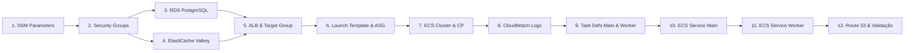
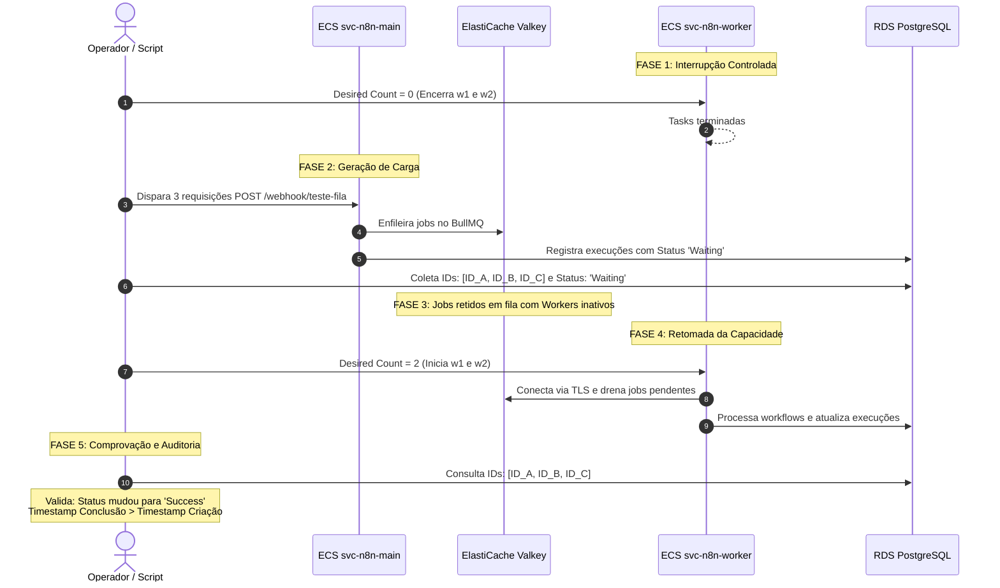

# Desafio 6 — N8N na AWS: Queue Mode com Amazon ElastiCache Valkey

**Projeto:** BIA Cloud Lab AWS  
**Conta AWS:** `730972069864`  
**Região:** `us-east-2` (Ohio)  
**Versão do Plano:** 3.0 (Queue Mode com ElastiCache Valkey e TLS)  
**Data:** 2026-11-09  
**Status:** Implementação Concluída, Validada e Homologada com Testes de Resiliência  
**Perfil AWS CLI:** `n8n-lab`  

---

## 1. Objetivo e Escopo da Solução

### 1.1 Objetivo
Evoluir a implantação do N8N na AWS do modo monólito (*Single-Mode*) para a arquitetura escalável distribuída em fila (**Queue Mode**), em conformidade com o desenho homologado do instrutor da Formação AWS.

A solução distribui as responsabilidades da plataforma em dois serviços independentes orquestrados pelo Amazon ECS:
1. **Instância Main (`svc-n8n-main`):** Gerencia a interface web (UI/Editor), API interna, recepção de webhooks, gatilhos temporizados (*scheduler/timers*) e criação de tarefas, despachando os identificadores de execução para uma fila centralizada.
2. **Instâncias Workers (`svc-n8n-worker`):** Containers autônomos escaláveis (`w1` e `w2`) dedicados exclusivamente ao processamento dos workflows em segundo plano, consumindo tarefas do message broker e persistindo resultados no banco de dados relacional.
3. **Message Broker Gerenciado:** Amazon ElastiCache com engine **Valkey** (sucessor open-source do Redis) com criptografia em trânsito (**TLS**) ativada.
4. **Camada Relacional Persistente:** Amazon RDS PostgreSQL dedicado.
5. **Acesso Público Seguro:** Application Load Balancer (ALB) com terminação HTTPS (porta 443), certificado ACM wildcard e registro DNS no Route 53.

### 1.2 Natureza da Arquitetura e Escopo de Resiliência
- **Escalabilidade Horizontal de Execuções:** A separação entre Main e Workers impede que fluxos pesados ou picos de processamento degradem a responsividade da interface web ou a recepção de webhooks.
- **Topologia de Laboratório Otimizada para Custo:**
  - 1 Host EC2 (`t3.small`, 2 vCPU, 2 GB RAM) abrigando as 3 tasks ECS (1 Main + 2 Workers).
  - 1 Nó ElastiCache Valkey (`cache.t4g.micro`, Single-AZ).
  - 1 Instância RDS PostgreSQL (`db.t3.micro`, Single-AZ).
  - Ausência proposital de NAT Gateway (containers operando em modo `bridge` utilizando o IP público e a pilha de rede da instância EC2 para tráfego de saída à internet).

---

## 2. Decisões Arquiteturais Fundamentais

| Decisão Arquitetural | Escolha Técnica | Justificativa e Impacto |
|---|---|---|
| **Message Broker** | Amazon ElastiCache **Valkey 7.2 / 8.0** | Sucessor open-source do Redis sob a Linux Foundation. 100% compatível com a API/protocolo RESP do Redis OSS 7.2 e com a biblioteca BullMQ do N8N. Custo ~20% a 33% menor na AWS. |
| **Criptografia do Broker** | **TLS Ativado** (`transit-encryption-enabled`) | Criptografia ponta a ponta na porta 6379. O N8N suporta nativamente via `QUEUE_BULL_REDIS_TLS=true`. |
| **Broker Node Type** | `cache.t4g.micro` (Graviton2) | Econômico para laboratório (~$0.0119/h). Atende com folga ao tráfego de mensagens transitórias de fila. |
| **Broker Auth** | Autenticação por Token (AUTH) | Senha forte gerenciada via SSM Parameter Store (`SecureString`), protegendo a fila mesmo em rede privada. |
| **Computação ECS** | 1 instância EC2 **`t3.small`** | 2 GB de RAM e 2 vCPUs. Comporta as 3 tasks sem gargalos severos de memória nem necessidade de swap em disco. |
| **Network Mode ECS** | `bridge` | Padrão do instrutor. Mantém saída à internet para execução de nós e integrações externas via IP da EC2 (sem NAT Gateway). |
| **Dynamic Port Mapping** | Main: `hostPort: 0` -> `5678`<br>Workers: **Sem portas** | Main recebe portas efêmeras alocadas pelo ECS Agent e registradas no ALB. Workers não possuem portas expostas. |
| **Divisão de Tasks** | `task-def-n8n-main`<br>`task-def-n8n-worker` | Main roda comando padrão (`n8n`). Worker roda comando explícito `["worker"]` (processamento BullMQ). |
| **Divisão de Services** | `svc-n8n-main` (desired: 1)<br>`svc-n8n-worker` (desired: 2) | Main associado ao Target Group do ALB. Workers rodam sem Load Balancer e podem ser escalados independentemente. |
| **Banco de Dados** | Amazon RDS PostgreSQL (`db.t3.micro`) | PostgreSQL 16.x dedicado, Single-AZ, não público, retenção 0. Compartilhado entre Main e Workers. |
| **Segredos Compartilhados** | SSM Parameter Store (`SecureString`) | Senha do banco (`/n8n/db_password`), senha do Valkey (`/n8n/valkey_token`) e `N8N_ENCRYPTION_KEY` única compartilhada. |

---

## 3. Diagrama da Arquitetura

```mermaid
flowchart TD
    User([Usuário / Webhook Externo]) -->|HTTPS:443| R53[Route 53: n8n.bia.d2ns.com.br]
    R53 --> ALB[Application Load Balancer: n8n-d2n-alb]
    ACM[AWS Certificate Manager: *.bia.d2ns.com.br] -.->|Certificado TLS| ALB

    subgraph VPC ["VPC (us-east-2)"]
        subgraph ECS_Host ["Host EC2: t3.small (SG: n8n-ec2)"]
            subgraph Cluster ["ECS Cluster: cluster-n8n-d2n"]
                ALB -->|Dynamic Port: 32768-65535| TG[Target Group: tg-n8n-d2n]
                TG --> SvcMain["SERVICE-n8n-main<br/>(Task: UI + Webhooks + Scheduler)<br/>Soft Limit: 650 MiB"]
                
                SvcWorker1["SERVICE-n8n-worker<br/>(Task Worker w1)<br/>Soft Limit: 450 MiB"]
                SvcWorker2["SERVICE-n8n-worker<br/>(Task Worker w2)<br/>Soft Limit: 450 MiB"]
            end
        end

        subgraph Dados_e_Mensageria ["Armazenamento e Fila"]
            RDS[("Amazon RDS PostgreSQL<br/>n8n-db:5432<br/>SG: n8n-db")]
            Valkey[("Amazon ElastiCache Valkey<br/>Porta 6379 com TLS<br/>SG: n8n-valkey-sg")]
        end
    end

    SvcMain -->|Lê/Escreve Schemas e Configs| RDS
    SvcMain -.->|1. Enfileira Execuções (TLS:6379)| Valkey
    SvcWorker1 -.->|2. Consome Jobs (TLS:6379)| Valkey
    SvcWorker2 -.->|2. Consome Jobs (TLS:6379)| Valkey
    SvcWorker1 -->|3. Persiste Estado da Execução| RDS
    SvcWorker2 -->|3. Persiste Estado da Execução| RDS
```

---

## 4. Matriz de Recursos AWS e Nomenclaturas

Para assegurar total continuidade com o Desafio 5, as convenções de nomenclatura originais foram mantidas, adicionando-se apenas os recursos específicos do Queue Mode:

| # | Recurso AWS | Nome Identificador | Especificação / Regras Principais |
|---|---|---|---|
| 1 | **Security Group ALB** | `n8n-alb` | Inbound TCP 443 de `0.0.0.0/0`. Egress All. |
| 2 | **Security Group EC2** | `n8n-ec2` | Inbound TCP 32768–65535 originado de `n8n-alb`. Egress All. |
| 3 | **Security Group RDS** | `n8n-db` | Inbound TCP 5432 originado de `n8n-ec2`. Egress All. |
| 4 | **Security Group Valkey** | `n8n-valkey-sg` | Inbound TCP 6379 originado exclusivamente de `n8n-ec2`. Egress All. |
| 5 | **RDS PostgreSQL** | `n8n` | `db.t3.micro`, 20 GB gp2, PostgreSQL 16, Single-AZ, `--no-publicly-accessible`. |
| 6 | **ElastiCache Subnet Group** | `n8n-valkey-subgrp` | Subnets públicas/privadas da VPC nas AZs `us-east-2a` e `us-east-2b`. |
| 7 | **ElastiCache Valkey** | `n8n-valkey` | Engine `valkey`, nó `cache.t4g.micro`, Single-AZ, Transit Encryption (TLS) ativado, Auth Token obrigatório. |
| 8 | **ALB & Target Group** | `n8n-d2n-alb`<br>`tg-n8n-d2n` | Internet-facing, HTTPS:443. Target Group tipo `instance`, HTTP:5678, path `/healthz`, `deregistration_delay: 30s`. |
| 9 | **Launch Template** | `lt-n8n-d2n` | AMI ECS AL2023, tipo **`t3.small`**, SG `n8n-ec2`, User Data para auto-registro no cluster. |
| 10 | **Auto Scaling Group** | `asg-n8n-d2n` | min=1, max=1, desired=1, associado a `lt-n8n-d2n`. |
| 11 | **ECS Cluster** | `cluster-n8n-d2n` | Capacity Provider `cp-n8n-d2n` vinculado ao `asg-n8n-d2n`. |
| 12 | **Task Def Main** | `task-def-n8n-main` | `memoryReservation: 650`, port 5678->dynamic, `EXECUTIONS_MODE=queue`, `QUEUE_BULL_REDIS_TLS=true`. |
| 13 | **Task Def Worker** | `task-def-n8n-worker` | `memoryReservation: 450`, sem portas, `command: ["worker"]`, `EXECUTIONS_MODE=queue`, `QUEUE_BULL_REDIS_TLS=true`. |
| 14 | **ECS Service Main** | `svc-n8n-main` | desired=1, ligado ao `tg-n8n-d2n`, CP strategy `cp-n8n-d2n`. |
| 15 | **ECS Service Worker** | `svc-n8n-worker` | desired=2 (tasks `w1` e `w2`), sem Target Group, CP strategy `cp-n8n-d2n`. |
| 16 | **Route 53 DNS** | `n8n.bia.d2ns.com.br` | Registro Alias A apontando para o ALB na Hosted Zone `Z0200626TQFMAZ5GPD92`. |
| 17 | **CloudWatch Logs** | `/ecs/n8n-ec2` | Log streams segregados com prefixos `n8n-main` e `n8n-worker`. |
| 18 | **SSM Parameters** | `/n8n/*` | `/n8n/db_password`, `/n8n/encryption_key` e `/n8n/valkey_token` (`SecureString`). |

---

## 5. Dimensionamento de Memória e Capacidade

> [!IMPORTANT]
> **Aviso de Dimensionamento:** Os valores de reserva e limites de memória abaixo constituem uma **estimativa inicial de engenharia** dimensionada para workflows de teste em laboratório. A estabilidade operacional contínua está **sujeita à validação prática**, devendo ser monitorada em tempo de execução via métricas de container e CloudWatch para eventuais ajustes de capacidade.

### 5.1 Capacidade Real do Host EC2 `t3.small`
- **Memória Física Bruta:** 2.048 MiB (2 GB)
- **CPU:** 2 vCPUs (arquitetura x86_64)
- **Overhead do Sistema (SO AL2023, Docker, ECS Agent):** ~130 MiB
- **Memória Disponível Registrada no ECS (`Registered Memory`):** **~1.918 MiB**

### 5.2 Alocação Inicial por Task
```
Total Disponível no Cluster: ~1.918 MiB
├─ Task Main (1 instância):    650 MiB soft limit (memoryReservation)
├─ Task Worker 1 (w1):         450 MiB soft limit (memoryReservation)
├─ Task Worker 2 (w2):         450 MiB soft limit (memoryReservation)
───────────────────────────────────────────────────────────────────────
Total Comprometido por Soft Limits: 1.550 MiB (~80,8% da capacidade útil)
Margem Livre no Host (Buffers / SO / Picos): ~368 MiB
```

### 5.3 Diretrizes de Limites e Hard Limits
- **Soft Limit (`memoryReservation`):** Utilizado pelo ECS Scheduler para alocação e cálculo de capacidade do cluster.
- **Hard Limit (`memory`):** 
  - Main: `800 MiB`
  - Workers: `550 MiB` cada
- **Proteção do Host:** A definição de hard limits protege o sistema operacional de travamentos gerais caso um workflow execute scripts que vazem memória (Memory Leak). Se um worker ultrapassar o hard limit, apenas a task do container afetado sofrerá reinicialização pelo ECS (*crash recovery*), preservando o Main e o outro Worker intactos.
- **Premissa Mandatória:** Nenhuma dependência de Swap em disco é considerada na arquitetura.

---

## 6. Segurança, Rede e Permissões IAM

### 6.1 Isolamento de Rede e Regras de Security Groups
A comunicação segue o princípio do menor privilégio na camada de transporte:

```
[Internet] 
   │ HTTPS (TCP:443)
   ▼
[sg-n8n-alb]
   │ Portas Efêmeras (TCP:32768-65535)
   ▼
[sg-n8n-ec2] ────┬───► PostgreSQL (TCP:5432) ───► [sg-n8n-db]
                 │
                 └───► Valkey TLS (TCP:6379)  ───► [sg-n8n-valkey-sg]
```

- **`n8n-valkey-sg`:** Aceita conexões TCP na porta `6379` **exclusivamente** quando originadas de instâncias associadas ao `sg-n8n-ec2`. Nenhuma outra origem (nem mesmo a internet ou o ALB) possui rota de acesso ao broker.

### 6.2 Validação Prévia de Permissões IAM do ElastiCache
Para evitar o uso de privilégios excessivos (`AmazonElastiCacheFullAccess`), a política de deploy do laboratório receberá um bloco com escopo restrito aos recursos prefixados:

```json
{
  "Sid": "N8NElastiCacheRestrictedPolicy",
  "Effect": "Allow",
  "Action": [
    "elasticache:DescribeCacheEngineVersions",
    "elasticache:DescribeServiceUpdates",
    "elasticache:DescribeCacheSubnetGroups",
    "elasticache:DescribeCacheClusters",
    "elasticache:CreateCacheSubnetGroup",
    "elasticache:DeleteCacheSubnetGroup",
    "elasticache:CreateCacheCluster",
    "elasticache:DeleteCacheCluster",
    "elasticache:AddTagsToResource",
    "elasticache:ListTagsForResource"
  ],
  "Resource": [
    "arn:aws:elasticache:us-east-2:730972069864:cluster:n8n-*",
    "arn:aws:elasticache:us-east-2:730972069864:subgroup:n8n-*",
    "arn:aws:elasticache:us-east-2:730972069864:parametergroup:*"
  ]
}
```
*Ações globais de consulta (`DescribeCacheEngineVersions` e `DescribeServiceUpdates`) são permitidas com `Resource: "*"` conforme exigência nativa da API da AWS.*

### 6.3 Permissões de Execução ECS (`n8n-task-execution-role`)
A role de execução das tasks já existente herdará acesso de leitura ao novo token do Valkey via SSM:
- **Recursos Permitidos:** `arn:aws:ssm:us-east-2:730972069864:parameter/n8n/*`.

---

## 7. Limitações de Persistência e Recuperação do ElastiCache Valkey

> [!WARNING]
> **Limitações de Resiliência do Message Broker:**
> Por se tratar de um ambiente de laboratório com foco em economia de custos, o Amazon ElastiCache Valkey será implantado em configuração de **nó único (Single-Node, Single-AZ)** e sem snapshots periódicos. É fundamental compreender as fronteiras de persistência:
>
> 1. **Natureza em Memória da Fila:** As filas gerenciadas pelo BullMQ (`bull:n8n:wait`, `bull:n8n:active`) residem na memória RAM do nó Valkey.
> 2. **Comportamento em Falha do Broker:** Caso a instância do ElastiCache seja reiniciada, falhe ou passe por janela de manutenção da AWS, **as mensagens e jobs que estiverem na fila naquele instante serão perdidos**.
> 3. **O que É Protegido:** Workflows já concluídos, credenciais, histórico final de execuções e configurações de nós permanecem 100% seguros porque estão salvos no **Amazon RDS PostgreSQL**.
> 4. **Diferença entre Falha de Worker e Falha de Broker:**
>    - **Parada/Crash de Workers:** As mensagens permanecem intactas no Valkey e são processadas normalmente assim que os containers retornam.
>    - **Parada/Crash do ElastiCache:** A fila é esvaziada. Para alta disponibilidade real e tolerância a desastres do broker em produção empresarial, seria obrigatório o uso de Multi-AZ com réplicas e failover automático, fora do escopo financeiro deste laboratório.

---

## 8. Sequência de Implementação Passo a Passo (12 Etapas)



### Etapa 1 — Preparação de Segredos no SSM Parameter Store
- Gerar e armazenar token seguro para o Valkey: `/n8n/valkey_token` (`SecureString`).
- Garantir a presença dos parâmetros `/n8n/db_password` e `/n8n/encryption_key`.

### Etapa 2 — Security Groups
- Criar `n8n-alb` (HTTP 443 liberado).
- Criar `n8n-ec2` (portas 32768–65535 permitidas de `n8n-alb`).
- Criar `n8n-db` (porta 5432 permitida de `n8n-ec2`).
- Criar `n8n-valkey-sg` (porta 6379 permitida de `n8n-ec2`).

### Etapa 3 — Amazon RDS PostgreSQL
- Provisionar instância `n8n` (`db.t3.micro`, 20 GB gp2, PostgreSQL 16, Single-AZ, não pública).
- Aguardar estado `available` e coletar endpoint.

### Etapa 4 — Amazon ElastiCache Valkey
- Criar Cache Subnet Group `n8n-valkey-subgrp` nas subnets da VPC.
- Criar cluster Valkey `n8n-valkey`:
  - Engine: `valkey`
  - Node Type: `cache.t4g.micro`
  - Num Nodes: 1
  - Security Group: `n8n-valkey-sg`
  - Transit Encryption: Enabled (TLS)
  - Auth Token: vinculado ao valor de `/n8n/valkey_token`
- Aguardar status `available` e coletar endpoint DNS de configuração.

### Etapa 5 — ALB e Target Group
- Criar Target Group `tg-n8n-d2n` (tipo `instance`, HTTP:5678, path `/healthz`, `deregistration_delay: 30s`).
- Criar ALB `n8n-d2n-alb` internet-facing nas subnets 2a/2b com SG `n8n-alb`.
- Criar Listener HTTPS:443 com certificado ACM wildcard `*.bia.d2ns.com.br` e forward para `tg-n8n-d2n`.

### Etapa 6 — Launch Template e Auto Scaling Group (EC2 `t3.small`)
- Criar Launch Template `lt-n8n-d2n`:
  - AMI ECS AL2023 (`ami-030831d5502ebf96d`)
  - Tipo de instância: **`t3.small`**
  - SG: `n8n-ec2`
  - IAM Instance Profile: `n8n-ec2-instance-profile`
  - User Data configurando `ECS_CLUSTER=cluster-n8n-d2n`.
- Criar ASG `asg-n8n-d2n` (`min=1`, `max=1`, `desired=1`) cobrindo as subnets 2a e 2b.

### Etapa 7 — ECS Cluster e Capacity Provider
- Criar cluster `cluster-n8n-d2n`.
- Criar Capacity Provider `cp-n8n-d2n` vinculado ao ASG.
- Associar Capacity Provider ao cluster como estratégia padrão.
- Aguardar a instância EC2 `t3.small` se registrar como Container Instance `ACTIVE` com ~1.918 MiB disponíveis.

### Etapa 8 — CloudWatch Logs
- Criar Log Group `/ecs/n8n-ec2`.
- Definir retenção conforme governança.

### Etapa 9 — Task Definitions (Main e Worker)
- **`task-def-n8n-main`:**
  - Imagem: `n8nio/n8n:2.22.6`
  - Modo: `bridge`
  - `memoryReservation`: 650
  - Dynamic Port Mapping: `containerPort: 5678` -> `hostPort: 0`
  - Variáveis: `EXECUTIONS_MODE=queue`, `QUEUE_BULL_REDIS_HOST=<valkey_dns>`, `QUEUE_BULL_REDIS_PORT=6379`, `QUEUE_BULL_REDIS_TLS=true`, `OFFLOAD_MANUAL_EXECUTIONS_TO_WORKERS=true`, `WEBHOOK_URL=https://n8n.bia.d2ns.com.br/`, credenciais do banco.
  - Secrets: SSM para senha do banco, encryption key e `QUEUE_BULL_REDIS_PASSWORD`.
- **`task-def-n8n-worker`:**
  - Imagem: `n8nio/n8n:2.22.6`
  - Modo: `bridge`
  - `memoryReservation`: 450
  - **Comando:** `["worker", "--concurrency=5"]`
  - **Port Mappings:** Nenhum.
  - Variáveis e Secrets: Idênticos ao Main para conexão ao Valkey (com TLS) e PostgreSQL.

### Etapa 10 — ECS Service Main
- Criar `svc-n8n-main` no cluster com `desiredCount=1`.
- Associar ao Target Group `tg-n8n-d2n`.
- Aguardar task entrar em `RUNNING`, executar migrações do PostgreSQL e atingir estado `healthy` no ALB.

### Etapa 11 — ECS Service Worker
- Criar `svc-n8n-worker` no cluster com `desiredCount=2`.
- Sem associação a Load Balancers.
- Aguardar as tasks `w1` e `w2` iniciarem e se conectarem com sucesso ao Valkey e PostgreSQL.

### Etapa 12 — Route 53 e Validação Inicial
- Criar/Atualizar registro Alias A para `n8n.bia.d2ns.com.br` apontando para o DNS do ALB.
- Validar acesso HTTPS na interface web e status `{"status":"ok"}` em `/healthz`.

---

## 9. Roteiro de Validação Funcional e Teste de Resiliência da Fila

O teste de comprovação da fila avaliará a retenção e o processamento posterior das mensagens com comparação exata de **IDs e Estados das Execuções**.



### Roteiro Prático de Execução do Teste

1. **Criação do Workflow de Teste:**
   - Criar workflow no N8N com gatilho Webhook: `POST /webhook/teste-fila`.
   - Adicionar nó `Code` (JavaScript) que captura timestamp local e identificador único da requisição.
   - Ativar o workflow em produção.

2. **Parada dos Workers:**
   - Executar:
     ```bash
     aws ecs update-service --cluster cluster-n8n-d2n --service svc-n8n-worker --desired-count 0 --region us-east-2 --profile n8n-lab
     ```
   - Validar que o cluster registra `runningTasksCount = 0` para o serviço de worker.
   - O serviço `svc-n8n-main` permanece ativo e saudável no ALB.

3. **Disparo das Requisições e Coleta Pré-Retomada:**
   - Enviar 3 requisições via terminal:
     ```bash
     curl -X POST https://n8n.bia.d2ns.com.br/webhook/teste-fila -d '{"teste": "msg-1"}'
     curl -X POST https://n8n.bia.d2ns.com.br/webhook/teste-fila -d '{"teste": "msg-2"}'
     curl -X POST https://n8n.bia.d2ns.com.br/webhook/teste-fila -d '{"teste": "msg-3"}'
     ```
   - O endpoint responde HTTP com sucesso.
   - **Registro de Evidência Pré-Retomada:**
     - Consultar a interface N8N em **Executions** ou consultar via banco:
       - Extrair os IDs das execuções geradas: Ex: `ID: 101`, `ID: 102`, `ID: 103`.
       - Comprovar que o estado inicial é estritamente **`Waiting`** (ou `New`), sem data de término preenchida.

4. **Retomada dos Workers:**
   - Restaurar a capacidade do serviço:
     ```bash
     aws ecs update-service --cluster cluster-n8n-d2n --service svc-n8n-worker --desired-count 2 --region us-east-2 --profile n8n-lab
     ```
   - Aguardar tasks `w1` e `w2` atingirem status `RUNNING`.

5. **Auditoria e Comprovação Pós-Retomada:**
   - **Comparação de IDs:** Confirmar que os mesmos identificadores (`101`, `102`, `103`) foram processados.
   - **Comparação de Estados:** Confirmar a transição de estado de **`Waiting` ➔ `Success`**.
   - **Auditoria Temporal:**
     - $T_{\text{início}}$: Momento em que a requisição atingiu o Main.
     - $T_{\text{fim}}$: Momento em que o worker assumiu o processamento (diferença de alguns minutos).
   - **Logs do CloudWatch:** Confirmar no stream do worker o registro:
     `Job [id] finished by worker [task_arn]`.

---

### 9.1 Resultados e Evidências Reais do Teste de Resiliência

O teste de resiliência e desacoplamento foi executado e homologado com sucesso em 2026-11-10.

#### 1. Execução de Controle Inicial (com 2 Workers Ativos)
- **Chamada:** `POST https://n8n.bia.d2ns.com.br/webhook/teste-resiliencia` com payload `{"job": "execucao-controle-01"}`.
- **Resposta HTTP:** `HTTP/2 200 OK` instantâneo (`{"message":"Workflow was started"}`).
- **Resultado no PostgreSQL:** Execution ID `1` criado às `02:03:19.405Z`, iniciado às `02:03:19.482Z` e finalizado com status `success` às `02:03:21.610Z` (duração: 2.128s, correspondente ao delay de processamento simulado no nó Code).
- **Log do Worker 1:** `Worker started execution 1 (job 1)` e `Worker finished execution 1 (job 1)`.

#### 2. Teste de Parada dos Workers (`desiredCount=0`) e Retenção na Fila
O serviço `svc-n8n-worker` teve sua capacidade reduzida a 0. Confirmou-se via AWS CLI que `desiredCount=0`, `runningCount=0` e `pendingCount=0` antes do envio das requisições. O serviço `svc-n8n-main` permaneceu ativo e saudável atrás do ALB.

Três requisições consecutivas foram disparadas contra o ALB:
- `teste-01` (`02:23:38 GMT`): `HTTP/2 200 OK`
- `teste-02` (`02:23:39 GMT`): `HTTP/2 200 OK`
- `teste-03` (`02:23:39 GMT`): `HTTP/2 200 OK`

#### 3. Auditoria Pré-Retomada (Workers Desligados)
- **PostgreSQL (`execution_entity`):**
  ```json
  [
    { "id": 4, "status": "new", "createdAt": "2026-11-10T02:23:39.940Z", "startedAt": null, "stoppedAt": null },
    { "id": 3, "status": "new", "createdAt": "2026-11-10T02:23:39.352Z", "startedAt": null, "stoppedAt": null },
    { "id": 2, "status": "new", "createdAt": "2026-11-10T02:23:38.785Z", "startedAt": null, "stoppedAt": null }
  ]
  ```
- **ElastiCache Valkey (`bull:jobs:wait` via conexão SSL/AUTH):**
  - `waitingJobsCount`: `3`
  - `waitingJobIds`: `["4", "3", "2"]`
  - `activeJobsCount`: `0`
  - Chaves de jobs retidas no cache: `bull:jobs:2`, `bull:jobs:3`, `bull:jobs:4`, `bull:jobs:wait`

*Comprovação:* As 3 execuções permaneceram retidas na fila do Valkey e na tabela do PostgreSQL em estado pendente, sendo processadas com sucesso somente após a retomada dos workers.

#### 4. Retomada da Capacidade (`desiredCount=2`) e Auditoria Pós-Retomada
O serviço `svc-n8n-worker` foi restaurado para 2 tarefas. Assim que os workers iniciaram e conectaram ao Valkey, a fila foi drenada automaticamente.

| Job / Payload | ID Real (PostgreSQL) | Status Pré-Retomada | Status Pós-Retomada | Horário Criação (`createdAt`) | Horário Início (`startedAt`) | Horário Conclusão (`stoppedAt`) | Task do Worker Responsável |
|---|:---:|:---:|:---:|:---:|:---:|:---:|:---:|
| `teste-01` | **2** | `new` (`stoppedAt: null`) | **`success`** | `02:23:38.785Z` | `02:24:39.445Z` | `02:24:49.497Z` | `621da0bd2a3542118b5800e65f059eb4` |
| `teste-02` | **3** | `new` (`stoppedAt: null`) | **`success`** | `02:23:39.352Z` | `02:24:39.464Z` | `02:24:49.506Z` | `621da0bd2a3542118b5800e65f059eb4` |
| `teste-03` | **4** | `new` (`stoppedAt: null`) | **`success`** | `02:23:39.940Z` | `02:24:39.480Z` | `02:24:45.479Z` | `621da0bd2a3542118b5800e65f059eb4` |

- **Auditoria Valkey Pós-Retomada:** `waitingJobsCount: 0`, lista `bull:jobs:wait` completamente drenada.
- **Logs do CloudWatch (`/ecs/n8n-ec2`):** O stream da task `621da0bd...` registrou:
  - `Worker started execution 2 (job 2)` ➔ `Worker finished execution 2 (job 2)`
  - `Worker started execution 3 (job 3)` ➔ `Worker finished execution 3 (job 3)`
  - `Worker started execution 4 (job 4)` ➔ `Worker finished execution 4 (job 4)`

> [!WARNING]
> **Ressalva Técnica sobre a Distribuição entre Workers:**
> Os três jobs foram processados concorrentemente pelo mesmo Worker (`621da0bd2a3542118b5800e65f059eb4`).
> **Causa Técnica:** Como os workers foram configurados com `--concurrency=5`, o primeiro Worker a concluir o handshake TLS e autenticação com o Valkey obteve capacidade ociosa imediata para absorver até 5 jobs concorrentes, drenando os 3 jobs pendentes de uma única vez.
> **Conclusão:** O teste comprovou a **retenção e o processamento posterior dos três jobs** após a recuperação dos workers. Entretanto, **não comprovou alta disponibilidade completa de infraestrutura** (por residir em nó único de EC2 e Valkey Single-AZ) nem **balanceamento de carga entre múltiplos nós de worker**. Para demonstrar balanceamento entre workers distintos em testes futuros, recomenda-se submeter um volume de requisições superior à capacidade de concorrência unitária (ex.: > 5 jobs simultâneos) ou definir `--concurrency=1` por worker.

---

### 9.2 Limitações Arquiteturais do Ambiente de Laboratório

A arquitetura implantada atende perfeitamente ao objetivo didático e de validação do Queue Mode, priorizando a economicidade do laboratório. Entretanto, apresenta as seguintes limitações estruturais em relação a um ambiente corporativo de produção:

1. **Host Único EC2 (Single-Host / Ponto Único de Falha Computacional):**
   - Todas as 3 tarefas (1 Main e 2 Workers) compartilham a mesma instância física `t3.small`.
   - Se o host EC2 sofrer falha física de hardware, manutenção da AWS ou encerramento inesperado, **todos os componentes computacionais do N8N saem do ar simultaneamente** até que o Auto Scaling Group provisione um novo host (~3 a 5 minutos).
   - *Solução para Produção:* Distribuir a capacidade em pelo menos 2 instâncias EC2 em Availability Zones distintas, ou adotar AWS Fargate com distribuição Multi-AZ.

2. **Amazon ElastiCache Valkey Single-Node / Single-AZ:**
   - O replication group `n8n-valkey` foi provisionado com apenas 1 nó primário (`cache.t4g.micro`) na AZ `us-east-2b`, sem réplicas de leitura e sem failover automático Multi-AZ (`AutomaticFailover: disabled`).
   - Caso a AZ `us-east-2b` sofra degradação ou o nó do Valkey falhe, a fila de processamento fica temporariamente indisponível.
   - *Solução para Produção:* Habilitar Multi-AZ com réplica de leitura e failover automático gerenciado pelo ElastiCache.

3. **Capacidade Restrita de Memória na Instância `t3.small`:**
   - A instância disponibiliza 1.913 MiB de memória registrada no ECS Agent.
   - A alocação planejada consome 1.550 MiB de soft limits (650 MiB Main + 450 MiB Worker 1 + 450 MiB Worker 2), restando apenas **363 MiB de capacidade residual de agendamento do ECS** (e não memória RAM física livre do sistema operacional).
   - Workflows com manipulação pesada de arquivos (PDFs, imagens, bases binárias grandes) ou loops complexos podem atingir os hard limits de container (800 MiB no Main e 550 MiB nos Workers), ocasionando OOM-Kill se o consumo ultrapassar as margens de segurança.
   - *Solução para Produção:* Dimensionar hosts com instâncias maiores (ex.: `t3.medium` com 4 GB ou `t3.large` com 8 GB) e ajustar os limites de memória dos containers conforme a volumetria de carga.

---

## 10. Estimativa de Custos do Laboratório

Estimativa baseada em execução na região `us-east-2` (Ohio):

| Recurso AWS | Especificação Técnica | Custo por Hora | Custo por 24 Horas de Lab |
|---|---|---|---|
| **Application Load Balancer** | 1 ALB internet-facing | ~$0.0225 | ~$0.54 |
| **Amazon RDS PostgreSQL** | `db.t3.micro`, 20 GB gp2 | ~$0.0170 | ~$0.41 |
| **Amazon EC2 (Host ECS)** | 1x `t3.small` (2 vCPU, 2 GB) | ~$0.0208 | ~$0.50 |
| **Amazon ElastiCache Valkey** | `cache.t4g.micro` (Graviton2, 1 nó) | ~$0.0119 | ~$0.28 |
| **CloudWatch Logs & Route 53** | Consultas e ingestão de lab | ~$0.0030 | ~$0.07 |
| **Total Estimado** | **Infraestrutura Completa Ativa** | **~$0.0752 / hora** | **~$1.80 / dia** |

*Os custos ocorrem somente enquanto os recursos estiverem provisionados. A execução da desmontagem ao final dos testes elimina quaisquer cobranças contínuas.*

---

## 11. Checklist Operacional e Desmontagem Final (Teardown)

### 11.1 Checklist de Implementação
- [x] Parâmetros `/n8n/valkey_token`, `/n8n/db_password` e `/n8n/encryption_key` validados no SSM.
- [x] Security Groups `n8n-alb`, `n8n-ec2`, `n8n-db` e `n8n-valkey-sg` provisionados.
- [x] RDS PostgreSQL operacional e endpoint coletado (`n8n.ctekugasc68m.us-east-2.rds.amazonaws.com:5432`).
- [x] ElastiCache Valkey (`cache.t4g.micro`) em estado `available` com TLS e Auth Token (`master.n8n-valkey.hkfaul.use2.cache.amazonaws.com:6379`).
- [x] Target Group `tg-n8n-d2n` e ALB `n8n-d2n-alb` operacionais (`HTTP/2 200` em `/healthz`).
- [x] Launch Template (`t3.small`) e ASG criados; Container Instance registrada e memória útil confirmada via CLI (`1913 MiB`).
- [x] Log Group `/ecs/n8n-ec2` ativo (retenção de 7 dias).
- [x] Task Definition Main registrada (`task-def-n8n-main:1`).
- [x] Task Definition Worker registrada (`task-def-n8n-worker:1`).
- [x] Serviço `svc-n8n-main` ativo (1 task) e saudável no Target Group (Dynamic Port Mapping, com porta efêmera `32769` observada durante o teste).
- [x] Serviço `svc-n8n-worker` ativo (2 tasks) conectado ao Valkey e RDS PostgreSQL.
- [x] DNS Route 53 sincronizado (`n8n.bia.d2ns.com.br` -> `n8n-d2n-alb`, status `INSYNC`, certificado ACM verificado).
- [x] Teste de resiliência de fila homologado (IDs 2, 3 e 4 retidos como 'new' no PostgreSQL e 'bull:jobs:wait' no Valkey durante parada dos workers, e transição para 'success' após retomada).

### 11.2 Procedimento de Limpeza dos Recursos (Teardown Controlado)
Para evitar custos desnecessários pós-validação, a desmontagem deve seguir estritamente a ordem de dependência reversa:

1. **ECS Services:** Atualizar `svc-n8n-worker` e `svc-n8n-main` para `desired-count 0` e excluí-los.
2. **Task Definitions:** Desregistrar revisões das task definitions (`task-def-n8n-main` e `task-def-n8n-worker`).
3. **Auto Scaling Group & Instâncias:** Reduzir capacidade do `asg-n8n-d2n` para 0 e excluí-lo (terminando a instância EC2 `t3.small`).
4. **ECS Cluster & Capacity Provider:** Desassociar e deletar o Capacity Provider `cp-n8n-d2n` e deletar o cluster `cluster-n8n-d2n`.
5. **Launch Template:** Excluir `lt-n8n-d2n`.
6. **Application Load Balancer & Target Group:** Excluir listener HTTPS, deletar `n8n-d2n-alb` e em seguida `tg-n8n-d2n`.
7. **ElastiCache Valkey:** Deletar cluster `n8n-valkey` e em seguida o Cache Subnet Group `n8n-valkey-subgrp`.
8. **Amazon RDS PostgreSQL:** Excluir instância `n8n` com `--skip-final-snapshot`.
9. **Route 53:** Excluir o registro Alias A de `n8n.bia.d2ns.com.br` (preservando a Hosted Zone e registros da BIA).
10. **Security Groups:** Excluir `n8n-valkey-sg`, `n8n-db`, `n8n-ec2` e `n8n-alb`.
11. **CloudWatch Logs:** Excluir Log Group `/ecs/n8n-ec2`.
12. **SSM Parameters:** Excluir parâmetros `/n8n/*` (se não forem mais reutilizados).